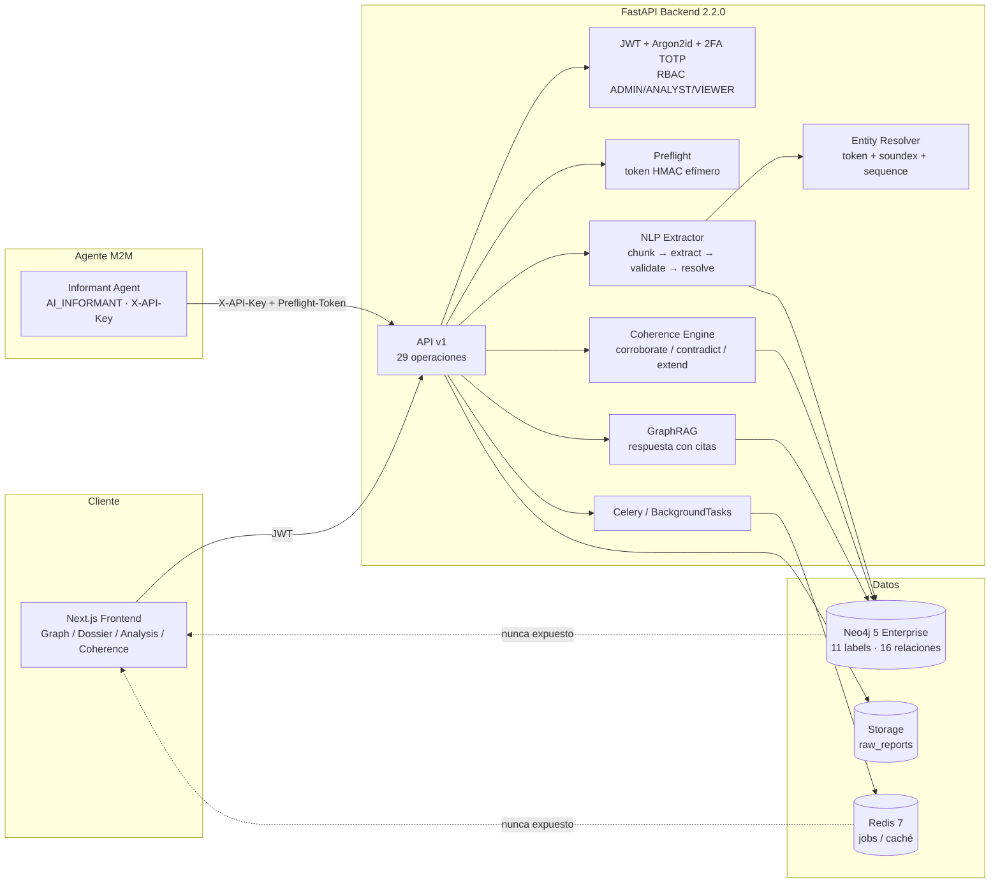

# AUDIT.md — Diagnóstico de Brechas y Reutilización

> **Fase 1 del pipeline SDD · Documento de auditoría, no autoriza cambios de código.**
> Proyecto: OSINT Nexus Platform · Repositorio: `murdok1982/DataBaseInt-Osint-socmint-Sigint`
> Baseline auditada: `main` @ `e90ac34` · Versión de aplicación: **2.2.0**
> Fecha de auditoría: **2026-10-23** · Auditor: Arquitecto SDD (Agente 0)
> Documentos hermanos: [`SPEC.md`](./SPEC.md) · [`PLAN.md`](./PLAN.md) · [`DB_CONTRACT.sql`](./DB_CONTRACT.sql) · [`DB_CONTRACT.json`](./DB_CONTRACT.json)

---

## 0. Veredicto ejecutivo

**La plataforma actual es un producto v2.2 sólido, seguro y bien especificado, pero NO es la célula multi-agente descrita en el objetivo.** Es un backend OSINT monológico (un único agente M2M genérico, `AI_INFORMANT`) sobre Neo4j, con ontología propia de 5 entidades y 16 relaciones, análisis humano-asistido y un motor de coherencia. No existe `HERMES`, ni `ARACNE`, ni `ARGOS`, ni `ATENEA`, ni `DIRECTOR_CELL`; no existe `raw_intel_ledger`; no existe STIX 2.1; no existe el código Almirantazgo `[A-F][1-6]` por aserción; no existe separación de permisos de base de datos por agente; y no existe la capa de custodia criptográfica.

| Dimensión | Estado actual | Objetivo | Brecha |
|---|---|---|---|
| Topología de agentes | 1 agente M2M (`AI_INFORMANT`) | 5 agentes + Dirección | **Crítica** |
| Cadena de custodia | `Report` + archivo + `source_report_id` | `raw_intel_ledger` append-only + SHA-256 | **Crítica** |
| Grafo validado | Neo4j, ontología propia | STIX 2.1 + JSONB + pgvector | **Crítica** |
| Evaluación Almirantazgo | `reliability_rating` A–F a nivel de informe | `[A-F][1-6]` por entidad/relación | **Alta** |
| Evidencia por aserción | 1 `source_report_id` por arista | `supporting_evidence_ids[]` con FK | **Crítica** |
| Permisos por agente | 1 API Key `AI_INFORMANT` | Roles DB + principals por agente | **Crítica** |
| PIR/EEI/Tasking | `Analysis` + `IntelRequirement` documental | Misión → PIR → EEI → Tarea | **Crítica** |
| OPSEC HUMINT | Inexistente | Políticas, rate-limit, aborto | **Crítica** |
| Búsqueda semántica | GraphRAG textual + full-text | Híbrida BM25 + pgvector (HNSW) | **Alta** |
| Madurez SDD | 7 specs, 3 contratos sellados, 12/12 | Extender a v3.0 | **Media** |

**Conclusión:** se puede **reutilizar ~55–65 %** del código (seguridad, RBAC, resolución de entidades, coherencia, pipeline de ingesta, frontend, despliegue, tooling SDD), pero la capa de datos y la topología de agentes requieren una **refactorización mayor con migración de datos**, no un parche. La recomendación es **aprobar una SPEC v3.0** y ejecutar los hitos de `PLAN.md`; **no** empezar por el código.

---

## 1. Método, alcance y evidencia

### 1.1 Qué se inspeccionó

| Área | Artefactos |
|---|---|
| Backend | `apps/backend/app/**` (API, core, db, services, schemas, workers), 1.833 líneas en `repository.py` |
| Contratos | `contracts/openapi.yaml` (773 líneas, 29 `operationId`), `contracts/graph-constraints.cypher` (177 líneas), `contracts/extraction-schema.json` (103 líneas), `contracts/SEAL.md` |
| Specs | `specs/00`–`06` (7 specs, incluida `06-operations-and-compliance`) |
| Agente | `apps/informant-agent/**` (11 módulos) |
| Frontend | `apps/frontend/src/components/**` (dossier, ingest, graph, search, analysis, coherence) |
| Despliegue | `deploy/docker-compose.prod.yml`, `deploy/README.md`, scripts |
| Tests | `apps/backend/tests/**` (26 archivos), `apps/informant-agent` |
| Gobernanza | `AGENTS.md`, `.antigravity/sdd-constitution.md`, `scripts/audit_sdd.py` |

### 1.2 Verificación ejecutada en esta auditoría

| Comando | Resultado |
|---|---|
| `python scripts/audit_sdd.py` | **12/12 checks OK** |
| `bash scripts/validate-contracts.sh` | **3/3 contratos válidos** (9 warnings de lint, no bloqueantes) |
| `cd apps/backend && python -m pytest -q` | **389 passed, 2 skipped** (86,94 s) |
| `cd apps/informant-agent && python -m pytest -q` | **36 passed** (0,16 s) |

> Limitación: no hay daemon Docker activo en este entorno, por lo que **no** se ejecutó un smoke test real contra Neo4j/Redis/Celery. La verificación es estática + suite de tests con dobles. El despliegue real sigue pendiente (ver `PLAN.md`, Hito 6).

### 1.3 Búsqueda de la arquitectura objetivo en el repositorio

Se ejecutó una búsqueda global de `HERMES|ARACNE|ARGOS|ATENEA|DIRECTOR_CELL|Admiralty|Almirantazgo|STIX|raw_intel_ledger|pgvector` sobre `.py, .md, .json, .yaml, .yml, .cypher, .sql` (excluyendo `node_modules`, `.git`, `__pycache__`). **Resultado: 0 coincidencias.** La arquitectura objetivo no está ni siquiera esbozada.

---

## 2. Arquitectura actual (as-is)

### 2.1 Vista de componentes



### 2.2 Flujo de ingesta actual

1. `POST /auth/login` → JWT (15 min) + refresh; ADMIN con 2FA TOTP.
2. `POST /context/preflight` → contexto de análisis activos, RFIs abiertas y diccionario canónico + `preflight_token` HMAC efímero.
3. `POST /ingest/informant` (M2M, `X-API-Key`) → exige `X-Preflight-Token`; sin él, **409**.
4. El pipeline `NLPExtractor` ejecuta `chunk → extract → validate → coherence → resolve → persist`.
5. `EntityResolver` decide `MERGE`, `NEW` o `REVIEW` según umbrales (0,70 / 0,88) y `locked_by_analyst`.
6. `GraphRepository` escribe nodos/aristas en Neo4j con Cypher parametrizado.
7. `CoherenceEngine` aplica `CORROBORATES`, `CONTRADICTS`, `EXTENDS`, `ANSWERS_REQUIREMENT`, `CITES_ANALYSIS`.
8. El frontend consume `/graph`, `/reports`, `/analyses`, `/coherence`, `/search/rag`.

### 2.3 Modelo de datos actual (Neo4j)

**11 labels** (`contracts/graph-constraints.cypher` líneas 16–35; `repository.py` líneas 40–50):

| Categoría | Labels |
|---|---|
| Entidades OSINT (5) | `Person`, `Organization`, `CyberAsset`, `Location`, `Event` |
| Documentales/analíticos (4) | `Report`, `Analysis`, `IntelRequirement`, `CoherenceAlert` |
| Plataforma (2) | `User`, `ApiKey` |

**16 relaciones** (`repository.py` líneas 62–88):

| Categoría | Relaciones |
|---|---|
| Red OSINT (7) | `CONTROLS`, `FINANCED`, `USES_ASSET`, `LOCATED_AT`, `ASSOCIATED_WITH`, `PARTICIPATED_IN`, `MENTIONED_IN` |
| Coherencia/análisis (9) | `INVESTIGATES`, `HAS_REQUIREMENT`, `CITES_ANALYSIS`, `CORROBORATES`, `CONTRADICTS`, `EXTENDS`, `ANSWERS_REQUIREMENT`, `RAISED_FOR`, `ABOUT` |

**Propiedades obligatorias de arista** (`repository.py` líneas 95–104): `confidence` (float 0–1), `source_report_id`, `exact_quote`, `text_evidence_span`, `page_number`, `first_seen`, `last_seen`, `locked_by_analyst`.

**Índices**: unicidad por `id`; índices de nombre/valor/fecha/estado; full-text `entity_names_ft`; vectoriales por label (`person_embedding_idx`, `organization_embedding_idx`, `cyberasset_embedding_idx`) porque Neo4j no admite vector multi-label (v2.1.0).

### 2.4 Roles y seguridad actuales

| Actor | Autenticación | Permisos |
|---|---|---|
| `ADMIN` | JWT + 2FA TOTP | Control total, incluido `deleteGraphNode` |
| `ANALYST` | JWT | Ingesta, análisis, coherencia, edición de grafo |
| `VIEWER` | JWT | Solo lectura |
| `AI_INFORMANT` | `X-API-Key` | Solo `/context/preflight` y `/ingest/informant` |

Controles existentes: Argon2id, JWT 15 min, refresh, bloqueo de login con `429` + `Retry-After`, auditoría JSON `osint.audit`, `X-Request-ID`, backups cifrados, rotación de logs, healthchecks, Redis/Neo4j sin puertos publicados.

### 2.5 Contratos sellados (v2.2.0)

| Contrato | Versión | Hash |
|---|---|---|
| `graph-constraints.cypher` | 2.1.0 | `43ecd30a0529fdfcdfc2bd37b2b378688e53cac51c549c74194a310b04b57363` |
| `extraction-schema.json` | 2.0.0 | `7f66c7d866b29bfdab2c762a09b2642f7055716a872c8717a8fc52203050e7f8` |
| `openapi.yaml` | 2.2.0 | `83a182d7d8250f5b6e984dc95d6c589bb90fe68fa39dcf1d15a1b7bb4f6446b2` |

El contrato de extracción v2 tiene raíz `{report_metadata, extracted_triplets[], analytical_context_links[]}`; los 5 labels extraíbles y 6 predicados están alineados con SPEC-01. `report_id` lo asigna el servidor. `LLM_PROVIDER=null` mantiene el sistema en modo retrieval-only sin API key.

---

## 3. Inventario verificable

### 3.1 Backend (módulos relevantes)

| Archivo | Rol actual | LOC aprox. | ¿Reutilizable? |
|---|---|---:|---|
| `app/db/repository.py` | Repositorio Cypher, nodos/aristas, coherencia, SNA | 1.833 | **Sí, como referencia/adaptador** |
| `app/db/driver.py` | Factoría Neo4j perezosa | 104 | Solo si se conserva Neo4j |
| `app/services/entity_resolver.py` | Resolución de entidades | 420 | **Sí, casi completo** |
| `app/services/coherence_engine.py` | Coherencia humano-IA | 241 | **Sí, extender** |
| `app/services/preflight.py` | Contexto + token efímero | 304 | **Sí, extender a misión/PIR** |
| `app/services/nlp_extractor.py` | Pipeline NLP | 618 | **Parcial** |
| `app/services/chunking.py` | Fragmentación con página/offset | — | **Sí** |
| `app/services/graphrag_engine.py` | GraphRAG con citas | — | **Sí** |
| `app/services/llm_client.py` | Cliente LLM | — | **Sí, multi-proveedor** |
| `app/core/rbac.py` | Matriz de 4 actores | 359 | **Sí, ampliar a 5 agentes** |
| `app/core/security.py` | JWT/Argon2id | — | **Sí** |
| `app/core/apikeys.py` | API Keys M2M | — | **Sí, ampliar** |
| `app/core/audit.py` | Log JSON | — | **Parcial, pasar a DB append-only** |
| `app/core/documents.py` | Almacenamiento de informes | — | **Parcial, añadir hash** |
| `app/api/v1/*.py` | 29 operaciones | — | **Sí, adaptar** |
| `app/workers/tasks.py` | Celery | 209 | **Sí** |
| `app/schemas/extraction.py` | Pydantic del contrato v2 | 457 | **Parcial, nuevo contrato v3** |

### 3.2 API actual (29 operaciones)

| Grupo | Operaciones |
|---|---|
| Auth (4) | `authLogin`, `authRefresh`, `authLogout`, `authMe` |
| Grafo (6) | `listGraphNodes`, `getGraphNode`, `updateGraphNode`, `deleteGraphNode`, `lockGraphNode`, `listGraphEdges`, `getGraphNeighborhood` |
| Contexto (1) | `postContextPreflight` |
| Ingesta (4) | `createIngestJob`, `createInformantIngestJob`, `getIngestJob`, `ingestProgressWs` |
| Informes (3) | `getReport`, `getReportFile`, `getReportChunks` |
| Análisis (6) | `listAnalyses`, `createAnalysis`, `getAnalysis`, `updateAnalysis`, `createIntelRequirement`, `listAnalysisRequirements` |
| Coherencia (2) | `listCoherenceAlerts`, `resolveCoherenceAlert` |
| Búsqueda (1) | `searchRag` |
| Sistema (1) | `getInfo` |

### 3.3 Tests (26 archivos backend)

| Suite | Cobertura |
|---|---|
| `test_entity_resolution.py` | Umbrales, merge, alias, locked |
| `test_repository_contract.py` | Contrato de repositorio, labels/rels |
| `test_deploy_contract.py` | Compose, healthchecks, puertos |
| `ingestion/test_extraction_schema.py` | JSON Schema v2 |
| `ingestion/test_chunking.py` | Página/offset |
| `ingestion/test_threshold.py` | 0,50 auto vs review |
| `ingestion/test_idempotency.py` | Reingesta |
| `ingestion/test_graphrag.py` | Citas y abstención |
| `ingestion/test_worker.py` | Celery/fallback |
| `ingestion/test_preflight.py` | Token y 409 |
| `ingestion/test_coherence_engine.py` | 4 vínculos |
| `security/test_rbac_matrix.py` | 23 operaciones × roles |
| `security/test_jwt.py`, `test_argon2.py`, `test_login_hardening.py` | Auth |
| `security/test_audit_log.py` | Auditoría |
| `security/test_report_file_access.py` | Fuga de archivos |
| `security/test_service_degradation.py` | 503 controlado |
| `security/test_trunk_routes.py` | Rutas troncales |
| `security/test_analysis_listing.py`, `test_analysis_requirements.py` | Análisis/RFI |
| `e2e/test_symbiotic_cycle.py` | Ciclo completo |

### 3.4 Frontend

| Componente | Función |
|---|---|
| `components/graph/GraphCanvas.tsx` | Visualización de grafo |
| `components/graph/GraphFilters.tsx` | Filtros |
| `components/graph/Timeline.tsx` | Cronología |
| `components/dossier/DossierPanel.tsx` | Dossier |
| `components/dossier/ReportViewer.tsx` | Visor de informe |
| `components/dossier/AnalysisCitationCard.tsx` | Citas |
| `components/analysis/AnalysisWorkspace.tsx` | Espacio de análisis + RFI |
| `components/coherence/CoherenceInbox.tsx` | Bandeja de alertas |
| `components/search/SearchConsole.tsx` | Búsqueda GraphRAG |
| `components/ingest/IngestDropzone.tsx` | Ingesta |

### 3.5 Agente actual (`apps/informant-agent`)

Módulos: `config.py`, `models.py`, `contract.py`, `coherence.py`, `extractor.py`, `pipeline.py`, `api_client.py`, `testing.py`, `cli.py`, `__main__.py`. Es un **cliente M2M genérico** que hace preflight, extrae tripletas, valida contra el contrato y envía el informe. **No** tiene identidad operativa, ni sockpuppets, ni conversación, ni OPSEC, ni evaluación de engaño.

### 3.6 Despliegue

`deploy/docker-compose.prod.yml`: frontend, backend, worker Celery, Redis 7, **Neo4j 5 Enterprise** (licencia + APOC), Caddy/ACME, volúmenes `neo4j_data`, `neo4j_backups`, `reports_data`. Sin puertos publicados para DB/Redis. Backups cifrados, rotación, healthchecks. **No hay PostgreSQL ni pgvector.**

---

## 4. Brechas respecto a la arquitectura objetivo

### 4.1 Tabla maestra de brechas

| ID | Requisito objetivo | Estado actual | Evidencia | Severidad |
|---|---|---|---|---|
| **G-01** | Célula de 5 agentes + Dirección | 1 agente genérico | `rbac.py`, `apps/informant-agent` | **Crítica** |
| **G-02** | `HERMES` HUMINT virtual/SOCMINT | No existe | búsqueda global 0 coincidencias | **Crítica** |
| **G-03** | `ARACNE` SNA/bots/astroturfing | No existe; solo `paths_of_influence` y `critical_brokers` | `repository.py` | **Crítica** |
| **G-04** | `ARGOS` OSINT técnico/documental | No existe; solo resolución genérica | `entity_resolver.py` | **Crítica** |
| **G-05** | `ATENEA` fusión y gatekeeper único | Parcial: `CoherenceEngine` + escritores | `coherence_engine.py`, `repository.py` | **Crítica** |
| **G-06** | `DIRECTOR_CELL`, PIR, EEI, tasking | Parcial: `Analysis` + `IntelRequirement` | `openapi.yaml`, `specs/01` | **Crítica** |
| **G-07** | `raw_intel_ledger` append-only + SHA-256 | No existe; `Report` + archivo | `documents.py`, `repository.py` | **Crítica** |
| **G-08** | STIX 2.1 (SDO/SRO) | Ontología propia Neo4j | `graph-constraints.cypher` | **Crítica** |
| **G-09** | PostgreSQL + JSONB + pgvector | Neo4j 5 Enterprise | `docker-compose.prod.yml` | **Crítica** |
| **G-10** | Almirantazgo `[A-F][1-6]` por aserción | `reliability_rating` A–F por informe | `extraction-schema.json` | **Alta** |
| **G-11** | `supporting_evidence_ids[]` con FK | 1 `source_report_id` por arista | `repository.py` L95–104 | **Crítica** |
| **G-12** | `valid_from` / `valid_until` | `first_seen` / `last_seen` | `repository.py` L95–104 | **Alta** |
| **G-13** | Permisos DB segregados por agente | 1 API Key `AI_INFORMANT` | `rbac.py` | **Crítica** |
| **G-14** | OPSEC HUMINT (avatares, rate-limit) | Inexistente | — | **Crítica** |
| **G-15** | Detección de engaño/alucinación | Solo `CONTRADICTS` | `coherence_engine.py` | **Alta** |
| **G-16** | Entity Resolution → `ALIAS_OF` STIX | Merge/alias propio, sin STIX | `entity_resolver.py` | **Media** |
| **G-17** | UI de misión/PIR/ledger/OPSEC | UI de grafo/dossier/análisis | `apps/frontend` | **Media** |
| **G-18** | TLP en dato y UI | No existe | — | **Alta** |
| **G-19** | Auditoría tamper-evident | Log JSON | `app/core/audit.py` | **Media** |
| **G-20** | CI de contratos + tests + auditoría | No hay CI | `.github/` ausente | **Media** |
| **G-21** | Licencia | Solo aviso legal en README | `README.md` | **Baja** |
| **G-22** | Búsqueda híbrida BM25 + vector | Full-text + vector por label | `graph-constraints.cypher` L67–82 | **Alta** |

### 4.2 Detalle de las brechas críticas

#### G-01/G-02 — No existe la célula, y Hermes no existe

El repositorio **no contiene** `HERMES`, `ARACNE`, `ARGOS`, `ATENEA` ni `DIRECTOR_CELL`. El agente actual (`apps/informant-agent`) es un pipeline de extracción de tripletas, no un operador HUMINT. No hay:

- gestión de identidades operativas (sockpuppets, leyendas, aislamiento de huella);
- elicitación conversacional ni análisis de lenguaje natural orientado a engaño;
- perfilado psicográfico/conductual;
- transcripciones, canales cerrados (Telegram/Discord/foros) ni metadatos de interacción;
- reglas de exposición, jitter, rate-limit por avatar ni aborto OPSEC;
- separación entre “reporte crudo” y “grafo validado” a nivel de identidad y permisos.

**Impacto:** el objetivo central del usuario (Hermes como especialista dentro de una célula) no está iniciado. Cualquier “Hermes” que se construya sobre el agente actual sería un renombrado, no una refactorización.

#### G-07 — No hay cadena de custodia

Hoy el informe se guarda como archivo (`/storage/raw_reports/{report_id}.pdf`) y se crea un nodo `Report`; las aristas llevan `source_report_id`, `page_number` y `exact_quote`. Eso da **trazabilidad documental**, pero no cadena de custodia:

- no se calcula SHA-256 en el instante de captura;
- no hay `raw_payload` íntegro en una tabla inmutable;
- no hay `tlp_classification`;
- no hay `captured_at_utc` separado de `ingested_at`;
- no hay `collector_agent` (solo `AI_INFORMANT`);
- no hay append-only: `deleteGraphNode` y `updateGraphNode` permiten alterar/borrar;
- no hay verificación de integridad posterior.

**Impacto:** una pieza de inteligencia no es defendible probatoriamente. El requisito EARS 1 no se cumple.

#### G-08/G-09 — Neo4j propio, no STIX 2.1 ni PostgreSQL/pgvector

La ontología es **custom** (`Person`, `Organization`, `CyberAsset`, `Location`, `Event`) y las relaciones son **custom** (`CONTROLS`, `FINANCED`, …). No hay:

- SDOs/SROs STIX 2.1 (`identity`, `user-account`, `threat-actor`, `infrastructure`, `location`, `report`, `relationship`);
- `spec_version`, `stix_id`, `object_marking_refs` (TLP), `external_references`, `revoked`;
- `JSONB` para propiedades extensibles;
- `pgvector` para embeddings híbridos;
- exportación STIX Bundle.

Neo4j 5 Enterprise es capaz, pero **no** ofrece la segregación de permisos por agente que exige EARS 2 a nivel de base de datos, y su licencia enterprise + APOC añade coste operacional. La decisión de motor se trata en `SPEC.md` §5 (ADR-001).

#### G-10/G-11/G-12 — Almirantazgo, evidencia y tiempo

- El contrato de extracción tiene `reliability_rating` A–F **a nivel de informe**, no `[A-F][1-6]` por entidad/relación.
- `confidence` es un float 0–1; el objetivo es entero 0–100, recalculado desde Almirantazgo + corroboración.
- Cada arista tiene **un** `source_report_id`; no un array de evidencias con FK.
- No hay `valid_from`/`valid_until`; solo `first_seen`/`last_seen`, que no permiten consultar “qué era cierto en una fecha”.

**Impacto:** no se puede cumplir EARS 2, 3 ni la inteligencia temporal. El grafo puede contener inteligencia huérfana.

#### G-13/G-14 — Un solo principal y cero OPSEC

`AI_INFORMANT` es un único principal M2M con una API Key. Todos los colectores comparten identidad, por lo que:

- no hay no-repudio por agente;
- no se puede limitar a Hermes a `raw_intel_ledger` y a Atenea a `validated_intel_graph`;
- no se puede auditar “quién escribió qué” a nivel de agente;
- no hay políticas OPSEC por avatar/misión.

**Impacto:** EARS 5 y la segregación de permisos son inimplementables con el diseño actual.

#### G-06 — “Dirección” no es una misión de inteligencia

`Analysis` + `IntelRequirement` son documentales: un análisis tiene tesis, estado y RFIs. No hay:

- `Mission` con `opsec_policy`, clasificación y estado;
- `PIR` (Priority Intelligence Requirement) con prioridad y due date;
- `EEI` (Essential Elements of Information) con indicadores;
- `TaskingOrder` con asignación a agente, restricciones y aceptación;
- cobertura PIR → EEI → tarea → evidencia → inteligencia validada;
- cierre de misión con métricas de cobertura.

**Impacto:** el `DIRECTOR_CELL` no puede dirigir la recolección ni evitar bucles/fuera de alcance.

### 4.3 Brechas secundarias

| ID | Brecha | Impacto |
|---|---|---|
| G-15 | No hay evaluación de decepción ni de alucinación; solo contradicción binaria | Atenea no puede priorizar engaño |
| G-16 | Resolución propia; no propone `ALIAS_OF` STIX ni fusiona identidades STIX | Duplicados semánticos |
| G-17 | UI sin misión/PIR/tasking/ledger/OPSEC | El analista no puede operar el ciclo completo |
| G-18 | Sin TLP por entidad/relación, sin control de difusión | Riesgo de diseminación indebida |
| G-19 | Auditoría en log JSON, no en tabla append-only con hash chain | No tamper-evident |
| G-20 | Sin CI; los tests se ejecutan manualmente | Deriva de contratos |
| G-21 | Sin `LICENSE` | Riesgo legal para uso/instalación |
| G-22 | Full-text + vector por label, no híbrido unificado | Recall limitado |

---

## 5. Qué se puede reutilizar (mapa de reutilización)

La refactorización **no parte de cero**. Estos activos se conservan, con adaptaciones:

| Activo actual | Archivo(s) | Reutilización en v3 | Esfuerzo | Riesgo |
|---|---|---|---|---|
| Resolución de entidades (token + Soundex + secuencia, umbrales 0,70/0,88) | `app/services/entity_resolver.py` | **Alta (85 %)**. Se conserva el algoritmo; se añade salida `ALIAS_OF` STIX y candidatos `entity_resolution_candidates`. | Bajo | Bajo |
| Motor de coherencia (CORROBORATES / CONTRADICTS / EXTENDS / ANSWERS_REQUIREMENT) | `app/services/coherence_engine.py` | **Alta (70 %)**. Se convierte en el núcleo de fusión de Atenea, ampliado con decepción/alucinación y Almirantazgo. | Medio | Medio |
| Preflight + token HMAC efímero | `app/services/preflight.py` | **Media (60 %)**. Se generaliza a “contexto de misión” (PIR/EEI, diccionario canónico, límites OPSEC). | Medio | Bajo |
| Pipeline NLP (chunk → extract → validate → resolve) | `app/services/nlp_extractor.py`, `chunking.py` | **Alta (75 %)**. Se conserva para Argos/Atenea; Hermes añade pipeline conversacional. | Medio | Medio |
| GraphRAG con citas y abstención | `app/services/graphrag_engine.py` | **Alta (80 %)**. Se adapta a Postgres híbrido; se conserva el contrato de citas. | Medio | Bajo |
| Repositorio Cypher parametrizado, validación de labels/rels, locks | `app/db/repository.py` | **Media (50 %)**. Patrones de parametrización, validación y bloqueo reutilizables; el motor cambia. | Alto | Alto |
| RBAC, JWT, Argon2id, 2FA TOTP, API Keys | `app/core/rbac.py`, `security.py`, `apikeys.py`, `login_guard.py` | **Alta (80 %)**. Se amplía a 5 agentes + `DIRECTOR_CELL` + roles DB. | Medio | Bajo |
| Auditoría, `X-Request-ID`, rate-limit de login | `app/core/audit.py`, `main.py` | **Media (60 %)**. Se migra a `audit.events` append-only con hash chain. | Medio | Bajo |
| Almacenamiento de informes y acceso protegido | `app/core/documents.py` | **Media (60 %)**. Se añade SHA-256 en captura y referencia al ledger. | Bajo | Bajo |
| Frontend (grafo, dossier, análisis, coherencia, búsqueda, ingesta) | `apps/frontend` | **Alta (65 %)**. Se añaden vistas de misión, PIR, ledger, revisión y OPSEC. | Medio | Medio |
| Despliegue (compose, healthchecks, backups, ACME, worker) | `deploy/**` | **Alta (70 %)**. Se añade PostgreSQL 16 + pgvector; Neo4j pasa a proyección opcional. | Medio | Medio |
| Suite de tests (389 + 36) | `apps/backend/tests`, `apps/informant-agent` | **Alta (70 %)**. Se conservan; se añaden tests EARS y de migración. | Medio | Bajo |
| Tooling SDD (auditoría 12/12, contratos, sellos) | `scripts/audit_sdd.py`, `contracts/SEAL.md` | **Total (100 %)**. Se extiende a v3.0 con nuevos contratos. | Bajo | Bajo |
| Agente informante (cliente M2M, contrato, preflight) | `apps/informant-agent` | **Media (55 %)**. Se convierte en la base de Hermes/Argos, no en “el agente”. | Alto | Medio |

### 5.1 Porcentaje estimado de reutilización por capa

| Capa | Reutilización | Comentario |
|---|---:|---|
| Seguridad y RBAC | 80 % | Ampliar actores, no reescribir |
| Resolución de entidades | 85 % | Algoritmo válido; cambiar el destino |
| Coherencia/fusión | 70 % | Núcleo válido; añadir Almirantazgo |
| Ingesta NLP | 75 % | Reutilizable para Argos/Atenea |
| Persistencia | 30 % | Neo4j → PostgreSQL; nuevo repositorio |
| Contratos | 40 % | OpenAPI v2 se conserva como compatibilidad; nuevo v3 |
| Frontend | 65 % | Componentes reutilizables; nuevas vistas |
| Despliegue | 70 % | Añadir Postgres; conservar red/healthchecks |
| Tests | 70 % | Conservar; añadir EARS/migración |
| **Global ponderado** | **~60 %** | Refactorización mayor, no reescritura total |

---

## 6. Defectos, riesgos y deuda técnica

### 6.1 Defectos funcionales/arquitectónicos

| ID | Defecto | Evidencia | Impacto | Corrección propuesta |
|---|---|---|---|---|
| **D-01** | Borrado duro de nodos validados | `deleteGraphNode` (`openapi.yaml` L150) | Viola inmutabilidad y cadena de custodia | Sustituir por `revoke` (STIX `revoked=true`) con motivo y auditoría; nunca `DELETE` |
| **D-02** | Edición directa de nodos validados por humanos | `updateGraphNode` (`openapi.yaml` L133) | Rompe el gatekeeper único (Atenea) | Solo Atenea escribe; humanos aprueban/rechazan propuestas, no editan el grafo |
| **D-03** | Un único principal M2M | `AI_INFORMANT` en `rbac.py` | Sin no-repudio ni permisos por agente | 4 principals + roles DB + API keys/HMAC separados |
| **D-04** | Sin hash de captura | `documents.py` guarda archivo; no SHA-256 | No hay integridad probatoria | `payload_sha256` sobre bytes exactos, verificado en DB |
| **D-05** | `confidence` float 0–1 | `REQUIRED_RELATION_PROPS` | No alineado con STIX 0–100 ni Almirantazgo | Entero 0–100 + `admiralty_rating` |
| **D-06** | `locked_by_analyst` solo en 3 labels | Índice `entity_locked_idx` (`Person|Organization|CyberAsset`) | `Location`/`Event` pueden sobrescribirse | Aplicar a todas las entidades validadas |
| **D-07** | `Report` mezcla documento fuente e informe final | `Report` con `file_path`, `ingested_at` | Confusión entre evidencia cruda e inteligencia | Separar `staging.raw_intel_ledger` de `intel.intelligence_reports` |
| **D-08** | Auditoría no tamper-evident | `app/core/audit.py` (log JSON) | No defendible ante incidente | `audit.events` append-only + hash chain |
| **D-09** | Sin TLP | No hay campo | Diseminación indebida | `tlp_classification` + RLS + guard de downgrade |
| **D-10** | Sin retención/legal hold | No hay política | Riesgo GDPR/legal | `retention_until`, `legal_hold`, purga auditada |
| **D-11** | Sin export STIX | No hay endpoint | No interoperabilidad | `GET /reports/{id}/stix-bundle` |
| **D-12** | Sin cobertura de misión | `Analysis`/`IntelRequirement` sin PIR/EEI | No se sabe si la misión se cumplió | `v_mission_coverage` + cierre de misión |
| **D-13** | Sin rate-limit por agente | Solo login `429` | Abuso/automatización | Límites por principal y por tarea |
| **D-14** | Sin CI | `.github/` ausente | Deriva de contratos/tests | GitHub Actions (contratos + tests + audit) |
| **D-15** | 9 warnings OpenAPI | Redocly lint | Deuda de contrato | Corregir respuestas 4XX/2XX y licencia |
| **D-16** | Sin `LICENSE` | Solo aviso legal en README | Riesgo legal | Definir licencia o “all rights reserved” explícito |

### 6.2 Deuda técnica y operacional

| ID | Deuda | Evidencia | Riesgo |
|---|---|---|---|
| **T-01** | Neo4j 5 **Enterprise** + APOC | `docker-compose.prod.yml` L162 | Coste de licencia; dependencia de APOC `mergeNodes` |
| **T-02** | Workaround EISDIR en Windows | `apps/frontend/scripts/readlink-eisdir-preload.cjs` | Smell de build; inocuo en Linux/macOS |
| **T-03** | `source_type` `MANUAL` vs `PUBLIC_REGISTRY` | Contrato vs UI (discrepancia conocida) | Baja; documentar |
| **T-04** | Tests con dobles, sin DB real en CI | `tests/ingestion/fakes.py` | No detecta regresiones Cypher/SQL |
| **T-05** | Sin migraciones versionadas | No hay `migrations/` | Cambios de esquema manuales |
| **T-06** | Sin observabilidad distribuida | Logs + healthchecks | Difícil depurar 5 agentes |
| **T-07** | Sin presupuesto/coste LLM | `llm_client.py` | Coste descontrolado |
| **T-08** | Sin gestión de secretos/KMS | `.env` + variables | Rotación manual |
| **T-09** | Sin pruebas de carga | — | Incógnita de rendimiento en grafo |
| **T-10** | Sin threat model formal | — | Riesgos de prompt injection/poisoning |

### 6.3 Riesgos del proyecto de refactorización

> **Nota de nomenclatura:** los `R-01`…`R-12` de esta sección son **riesgos del proyecto**. Los `R-01`…`R-28` de `SPEC.md` §10 son **requisitos EARS**; las reglas de integridad de `SPEC.md` §6.3 usan el prefijo `IR-`.

| ID | Riesgo | Prob. | Impacto | Mitigación |
|---|---|---|---|---|
| **R-01** | Pérdida/Corrupción de datos en migración Neo4j → Postgres | Media | Alto | ETL idempotente, reconciliación de conteos, rollback, dual-write |
| **R-02** | Divergencia dual-write | Media | Alto | Feature flag, comparador, corte por misión |
| **R-03** | Suplantación de agente | Media | Alto | mTLS/HMAC + API key + rol DB por agente + `collector_agent` derivado de `current_user` |
| **R-04** | Prompt injection en `raw_payload` | Alta | Alto | Tratar payload como dato, no instrucción; sandbox; validación Atenea; sin escritura directa |
| **R-05** | Exposición de sockpuppets | Media | Crítico | Schema `humint` aislado, cifrado, RLS, auditoría, kill switch |
| **R-06** | Incumplimiento legal/ToS/GDPR | Media | Alto | Base legal por misión, retención, minimización, revisión jurídica |
| **R-07** | Complejidad de 5 agentes | Alta | Medio | Hitos atómicos, interfaces, feature flags |
| **R-08** | Rendimiento de CTEs recursivas | Media | Medio | Índices, vistas materializadas, proyección Neo4j |
| **R-09** | Deriva de contratos | Media | Alto | Sellos v3.0, CI, auditoría 12/12 ampliada |
| **R-10** | Alucinación en fusión | Alta | Alto | Evidencia obligatoria, abstención, revisión humana, confianza calibrada |
| **R-11** | Coste LLM | Media | Medio | Presupuesto por misión, caché, modelos pequeños para tareas simples |
| **R-12** | Dependencia de un solo proveedor LLM | Media | Medio | Abstracción multi-proveedor + modo retrieval-only |

---

## 7. Mapeo “arquitectura objetivo → activos actuales”

### 7.1 Madurez por agente (0 = inexistente, 5 = producción)

| Agente objetivo | Equivalente actual | Madurez | Qué se reutiliza | Qué falta |
|---|---|---:|---|---|
| **DIRECTOR_CELL** | `Analysis` + `IntelRequirement` + `preflight` + rol `ADMIN` | **2/5** | Modelo de análisis/RFI, RBAC, preflight | `Mission`, `PIR`, `EEI`, `TaskingOrder`, orquestador, OPSEC policy, cierre/cobertura |
| **HERMES** | `informant-agent` + `nlp_extractor` + `coherence` | **1/5** | Cliente M2M, contrato de extracción, pipeline | Sockpuppets, leyendas, elicitación, canales, engaño, perfilado, OPSEC, `humint.*` |
| **ARACNE** | `repository.paths_of_influence`, `critical_brokers`, `neighborhood`; GraphRAG | **1/5** | Algoritmos SNA y API de grafo | Agente, colectores SOCMINT, comunidades, bots, astroturfing, pattern-of-life, sentimiento |
| **ARGOS** | `entity_resolver` + colectores texto/JSON | **1/5** | Resolución, normalización, pipeline documental | Selectores (dominio/IP/email/teléfono/wallet), breaches, EXIF, registros mercantiles, boletines |
| **ATENEA** | `CoherenceEngine` + `GraphRepository` writers + `EntityResolver` | **2,5/5** | Fusión, contradicción, locks, resolución | Almirantazgo por aserción, evidencia FK, STIX, decepción/alucinación, revisión humana, confianza 0–100 |
| **Analistas humanos** | `ADMIN`/`ANALYST`/`VIEWER` | **4/5** | RBAC, JWT, 2FA, UI | Cola de revisión, aprobación de difusión, TLP |
| **Informante IA** | `AI_INFORMANT` | **2/5** | API Key, preflight, contrato | 4 principals, HMAC/mTLS, roles DB, heartbeats |

### 7.2 Qué se conserva, qué se adapta y qué se retira

| Activo | Decisión | Justificación |
|---|---|---|
| `entity_resolver.py` | **Conservar y adaptar** | Algoritmo probado; solo cambia el destino (STIX/ALIAS_OF) |
| `coherence_engine.py` | **Conservar y ampliar** | Núcleo de fusión; añadir Almirantazgo/decepción |
| `preflight.py` | **Conservar y generalizar** | Token efímero y contexto; añadir misión/PIR/EEI |
| `nlp_extractor.py` / `chunking.py` | **Conservar** | Base para Argos/Atenea; Hermes añade conversación |
| `graphrag_engine.py` | **Conservar y adaptar** | Citas/abstención; nuevo backend híbrido |
| `repository.py` | **Adaptar / reemplazar** | Patrones reutilizables; Cypher → SQL/JSONB |
| `openapi.yaml` v2.2 | **Congelar como compatibilidad** | v3 en nuevo namespace; v2 solo lectura durante transición |
| `graph-constraints.cypher` | **Retirar del camino crítico** | Se conserva como referencia histórica; nuevo DDL SQL |
| `extraction-schema.json` v2 | **Sustituir por v3** | Nuevo contrato de agente/evidencia |
| `apps/informant-agent` | **Refactorizar** | Base de Hermes/Argos, no “el agente” |
| `deleteGraphNode` | **Retirar** | Incompatible con inmutabilidad |
| `updateGraphNode` | **Restringir** | Solo propuestas/revisión, no edición directa |
| Neo4j Enterprise | **Proyección opcional** | Postgres es la fuente de verdad; Neo4j solo lectura para UI si se desea |
| Frontend actual | **Conservar y ampliar** | Componentes de grafo/dossier/análisis reutilizables |

### 7.3 Conclusión del mapeo

- **No hay que reescribir** la seguridad, la resolución de entidades, la coherencia ni la ingesta: hay que **reubicarlas** en la nueva topología.
- **Sí hay que construir desde cero** la capa de custodia (`raw_intel_ledger`), el grafo STIX, los permisos DB por agente, el ciclo de misión (PIR/EEI/tasking), el schema `humint` y los agentes Aracne/Argos.
- **Hermes no es un renombrado** del informante: es un subsistema nuevo (identidades, conversación, OPSEC) que reutiliza el cliente y el pipeline como fontanería.

---

## 8. Escenarios de migración evaluados

La decisión de motor condiciona todo el `SPEC`. Se evaluaron tres escenarios:

### 8.1 Escenario A — PostgreSQL 16 + JSONB + pgvector (recomendado)

**Descripción:** una sola base de datos con dos esquemas (`staging` y `intel`), roles DB por agente, triggers de integridad, `pgvector` para embeddings y SQL recursivo para traversía de grafo.

| Criterio | Evaluación |
|---|---|
| Ajuste a “doble capa” | **Total**: `staging.raw_intel_ledger` + `intel.intel_entities/relationships` |
| Permisos por agente | **Total**: `GRANT`/`REVOKE` + `SECURITY DEFINER` + RLS |
| Integridad referencial de evidencia | **Total**: FK reales en `intel.evidence_links` |
| STIX 2.1 | **Alto**: SDOs/SROs como filas + `properties JSONB` + `stix_id` |
| Búsqueda híbrida | **Total**: `tsvector` + `pgvector` HNSW + RRF |
| Traversía de grafo | **Media**: CTEs recursivas; suficiente para 1–3 saltos; no para analítica masiva |
| Coste operacional | **Bajo**: un solo motor, sin licencia enterprise |
| Esfuerzo de migración | **Alto**: reescribir repositorio y ETL |
| Riesgo | **Medio** |

**Ventaja decisiva:** es el único escenario que permite **rechazar la inteligencia huérfana a nivel de base de datos** (EARS 2) con FK y triggers, y **segregar permisos por agente** (EARS 5) con roles reales, no con convenciones de aplicación.

### 8.2 Escenario B — Híbrido: PostgreSQL (ledger) + Neo4j (grafo validado)

**Descripción:** `raw_intel_ledger` en Postgres; `validated_intel_graph` en Neo4j; Atenea escribe en Neo4j; un bus/outbox mantiene consistencia.

| Criterio | Evaluación |
|---|---|
| Ajuste a “doble capa” | **Alto** (dos motores) |
| Permisos por agente | **Medio**: roles Neo4j enterprise, pero granularidad limitada |
| Integridad de evidencia | **Media**: la FK cruza motores; no se puede garantizar atómicamente |
| STIX 2.1 | **Medio**: labels/relaciones custom; export a STIX |
| Traversía de grafo | **Alta** |
| Coste operacional | **Alto**: dos motores, licencia Neo4j Enterprise, consistencia |
| Esfuerzo | **Muy alto** |
| Riesgo | **Alto** (doble escritura, divergencia) |

**Cuándo tendría sentido:** si la traversía de grafo a escala (millones de nodos, caminos profundos, comunidades) es un requisito de primer orden y se acepta el coste de consistencia. No es el caso de una célula de inteligencia con misiones acotadas.

### 8.3 Escenario C — Neo4j + ledger externo / Apache AGE

**Descripción:** mantener Neo4j como fuente de verdad y añadir un ledger Postgres; o migrar a PostgreSQL + Apache AGE para grafo.

| Criterio | Evaluación |
|---|---|
| Ajuste | **Bajo/Medio** |
| Permisos | **Bajo** (Neo4j) / **Medio** (AGE) |
| Complejidad | **Alta** (AGE añade extensión y madurez limitada) |
| Riesgo | **Alto** |

**Descartado:** no resuelve la segregación de permisos y añade una dependencia experimental.

### 8.4 Decisión recomendada

**Adoptar el Escenario A** (PostgreSQL 16 + pgvector) como fuente de verdad, con **Neo4j como proyección de lectura opcional** para la visualización de grafo del frontend (solo si el rendimiento de CTEs no cumple). Esta decisión se formaliza como **ADR-001** en `SPEC.md` §5.

---

## 9. Métricas de línea base y quality gates

### 9.1 Métricas actuales

| Métrica | Valor |
|---|---:|
| Versión de aplicación | 2.2.0 |
| Specs | 7 (`00`–`06`) |
| Contratos sellados | 3 |
| `operationId` en OpenAPI | 29 |
| Labels de grafo | 11 |
| Relaciones de grafo | 16 |
| Entidades OSINT | 5 |
| Actores RBAC | 4 |
| Tests backend | 389 passed / 2 skipped |
| Tests informant | 36 passed |
| Auditoría SDD | 12/12 |
| Contratos válidos | 3/3 |
| Warnings OpenAPI | 9 (no bloqueantes) |
| Cobertura de tests (estimada) | Alta en seguridad/ingesta; baja en DB real |

### 9.2 Quality gates propuestos para v3.0

| Gate | Criterio | Cuándo |
|---|---|---|
| **QG-01** | `python scripts/audit_sdd.py` ≥ 12/12 y ampliado a v3 | Cada PR |
| **QG-02** | Contratos v3 sellados y validados | Antes de implementar |
| **QG-03** | Tests backend ≥ 389 + nuevos EARS, 0 fallos | Cada PR |
| **QG-04** | Tests de integración con PostgreSQL real (Testcontainers) | Cada PR de DB |
| **QG-05** | Cero inteligencia huérfana (`v_orphan_check` = 0) | Cada migración |
| **QG-06** | Matriz RBAC 5 agentes × endpoints, 100 % | Hito 2 |
| **QG-07** | Migración reconciliada (conteos y hashes) | Hito 1/6 |
| **QG-08** | Smoke test real en VPS | Hito 6 |
| **QG-09** | Threat model + revisión de seguridad | Hito 6 |
| **QG-10** | Licencia definida | Antes de publicación |

---

## 10. Conclusiones y go/no-go

### 10.1 Lo que está bien y no debe romperse

1. **Disciplina SDD real**: specs, contratos sellados, auditoría 12/12, trazabilidad. Es el activo más valioso.
2. **Seguridad de base**: Argon2id, JWT corto, 2FA, rate-limit de login, RBAC, auditoría, `X-Request-ID`, DB no expuesta.
3. **Resolución de entidades** y **motor de coherencia**: algoritmos probados y testeables offline.
4. **Pipeline de ingesta** con validación estricta contra JSON Schema y umbral de auto-aceptación.
5. **Frontend funcional** con grafo, dossier, análisis, coherencia y búsqueda.
6. **Despliegue reproducible** con healthchecks, backups cifrados y red interna.

### 10.2 Lo que impide llamarlo “célula multi-agente”

1. No hay agentes especializados: hay **un** agente genérico.
2. No hay **cadena de custodia** criptográfica ni ledger inmutable.
3. No hay **STIX 2.1** ni **PostgreSQL/pgvector**.
4. No hay **Almirantazgo por aserción** ni **evidencia FK**.
5. No hay **permisos DB por agente** ni **OPSEC HUMINT**.
6. No hay **misión/PIR/EEI/tasking** ni **cobertura**.

### 10.3 Veredicto

| Decisión | Estado |
|---|---|
| ¿Aprobar la SPEC v3.0? | **Recomendado** |
| ¿Empezar a programar el Hito 1 sin aprobación? | **NO-GO** |
| ¿Reutilizar el código actual? | **Sí, ~60 %** |
| ¿Migrar de motor? | **Sí, a PostgreSQL 16 + pgvector (ADR-001)** |
| ¿Mantener Neo4j? | **Solo como proyección de lectura opcional** |
| ¿Conservar API v2? | **Sí, congelada como compatibilidad de lectura** |

### 10.4 Decisiones que necesito del usuario antes de implementar

| ID | Decisión | Opciones | Recomendación |
|---|---|---|---|
| **DEC-01** | Motor de datos | A) Postgres+pgvector · B) Híbrido Postgres+Neo4j · C) Neo4j+AGE | **A** |
| **DEC-02** | Versionado de API | A) `/api/v3` nuevo · B) romper `/api/v1` | **A** (v2 lectura) |
| **DEC-03** | Proveedor LLM | OpenAI / Azure / local (Ollama/vLLM) / multi | **Multi + retrieval-only por defecto** |
| **DEC-04** | Despliegue | VPS / cloud / on-prem | **VPS con Docker + KMS** |
| **DEC-05** | Jurisdicción y base legal | UE/GDPR / LATAM / otra | **Definir antes del Hito 1** |
| **DEC-06** | Perfil STIX | SDOs core + `x-osint-*` | **Core + extensiones documentadas** |
| **DEC-07** | ¿Neo4j como proyección? | Sí/No | **Sí, solo lectura, opcional** |
| **DEC-08** | Licencia | Propietaria / open source | **Definir antes de publicar** |

> **Estado del documento:** completo. **No autoriza implementación.** La implementación comienza solo tras la aprobación explícita de `SPEC.md` y la respuesta a `DEC-01`…`DEC-08`.

---

## Anexo A — Índice de evidencia

| Hallazgo | Archivo | Referencia |
|---|---|---|
| Labels/relaciones actuales | `apps/backend/app/db/repository.py` | L40–88 |
| Propiedades obligatorias de arista | `apps/backend/app/db/repository.py` | L95–104 |
| Índices y constraints | `contracts/graph-constraints.cypher` | L16–82 |
| Vector por label | `contracts/graph-constraints.cypher` | L74–82 |
| Operaciones API | `contracts/openapi.yaml` | 29 `operationId` |
| Borrado de nodo | `contracts/openapi.yaml` | L150 |
| Edición de nodo | `contracts/openapi.yaml` | L133 |
| Versión API | `apps/backend/app/main.py` | L46–47 |
| RBAC 4 actores | `apps/backend/app/core/rbac.py` | Docstring + matriz |
| Preflight/token | `apps/backend/app/services/preflight.py` | Completo |
| Coherencia | `apps/backend/app/services/coherence_engine.py` | Completo |
| Resolución | `apps/backend/app/services/entity_resolver.py` | L1–220 |
| Pipeline NLP | `apps/backend/app/services/nlp_extractor.py` | L270–469 |
| Almacenamiento de informes | `apps/backend/app/core/documents.py` | Completo |
| Worker | `apps/backend/app/workers/tasks.py` | Completo |
| Neo4j Enterprise | `deploy/docker-compose.prod.yml` | L162 |
| SNA reutilizable | `apps/backend/app/db/repository.py` | `paths_of_influence`, `critical_brokers` |
| Contrato de extracción | `contracts/extraction-schema.json` | Completo |
| Sellos | `contracts/SEAL.md` | v2.2.0 |
| Gobernanza | `AGENTS.md` | Reglas SDD |
| Frontend | `apps/frontend/src/components/**` | 10 componentes |

## Anexo B — Comandos ejecutados

```powershell
# Auditoría SDD
python scripts/audit_sdd.py
# → 12/12 checks OK

# Contratos
bash scripts/validate-contracts.sh
# → 3/3 válidos (9 warnings Redocly)

# Backend
cd apps/backend
python -m pytest -q
# → 389 passed, 2 skipped

# Agente informante
cd apps/informant-agent
python -m pytest -q
# → 36 passed
```

## Anexo C — Glosario mínimo

| Término | Definición |
|---|---|
| **PIR** | Priority Intelligence Requirement: pregunta de inteligencia prioritaria que dirige la recolección |
| **EEI** | Essential Element of Information: información concreta necesaria para responder un PIR |
| **SDO** | STIX Domain Object (`identity`, `threat-actor`, `infrastructure`, …) |
| **SRO** | STIX Relationship Object (`relationship`, `sighting`) |
| **SCO** | STIX Cyber-observable Object (`domain-name`, `ipv4-addr`, `email-addr`, …) |
| **TLP** | Traffic Light Protocol: clasificación de difusión (`RED`, `AMBER+STRICT`, `AMBER`, `GREEN`, `CLEAR`) |
| **Almirantazgo** | Código `[A-F][1-6]`: fiabilidad de fuente (A–F) × credibilidad de información (1–6) |
| **Sockpuppet** | Identidad operativa ficticia usada por Hermes para HUMINT virtual |
| **OPSEC** | Seguridad operacional: reglas para no exponer identidades, fuentes o métodos |
| **Gatekeeper** | Único agente (Atenea) con permiso de escritura en el grafo validado |

---

*Fin de AUDIT.md — Fase 1 SDD. Pendiente de aprobación de SPEC.md.*

