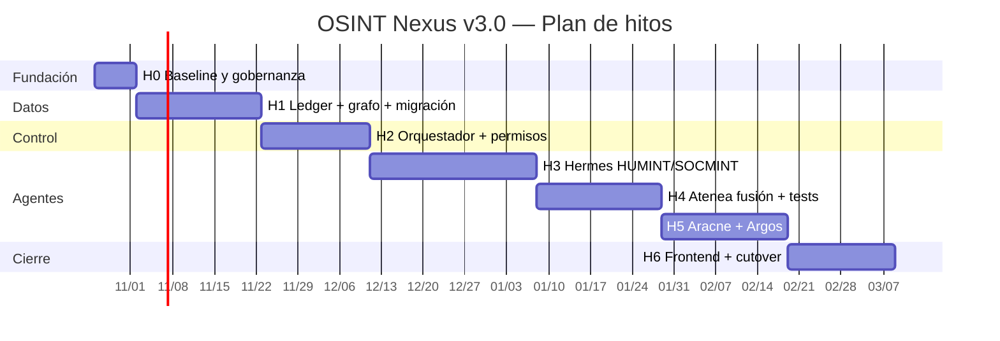

# PLAN.md — Plan de Refactorización Incremental (v3.0)

> **Fase 1 SDD · Plan de ejecución · Estado: APROBADO — 2026-10-23 (Hito 1 iniciado)**
> Proyecto: OSINT Nexus Platform · Baseline: v2.2.0 (`main` @ `e90ac34`)
> Fecha: **2026-10-23** · Autor: Arquitecto SDD (Agente 0)
> Documentos asociados: [`AUDIT.md`](./AUDIT.md) · [`SPEC.md`](./SPEC.md) · [`DB_CONTRACT.sql`](./DB_CONTRACT.sql) · [`DB_CONTRACT.json`](./DB_CONTRACT.json)

---

## 0. Principios de ejecución

> **Trazabilidad:** las referencias `R-xx` de este plan apuntan a los requisitos EARS de `SPEC.md` §10. Los riesgos de `AUDIT.md` §6.3 usan su propia numeración `R-01`…`R-12` y no deben confundirse con EARS.

1. **Un hito = un contrato sellado + un conjunto de tests verdes.** No se avanza con deuda de contrato.
2. **Ningún hito toca dos zonas a la vez sin coordinación del Orquestador.** Las zonas se definen en §2.
3. **Cada hito es reversible.** Todo cambio de datos tiene rollback probado.
4. **La migración es incremental y observable.** `GRAPH_BACKEND` permite volver a Neo4j en cualquier fase.
5. **Los tests EARS son la definición de “hecho”.** Sin `T-Rxx` verde, el requisito no existe.
6. **La seguridad no es un hito final.** RBAC, TLP y auditoría se implementan desde el Hito 1.
7. **El frontend no bloquea el backend.** Se adapta al final, con compatibilidad v2.

### 0.1 Secuencia

**Duración total:** ~19 semanas en secuencia; ~15–16 semanas con solapamiento controlado (H2/H3 y H5/H6).

### 0.2 Zonas de escritura v3 (propuesta de actualización de `AGENTS.md`)

| Agente | Zona | Incluye |
|---|---|---|
| **Agente 0** (Orquestador) | `specs/**`, `contracts/**`, `AUDIT.md`, `SPEC.md`, `PLAN.md`, `DB_CONTRACT.*`, `scripts/audit_sdd.py`, `.github/**` | Gobernanza, sellos, CI, revisión |
| **Agente 1** (Datos) | `apps/backend/app/db/**`, `apps/backend/app/services/entity_resolver.py`, `migrations/**`, `scripts/migrate/**` | Esquema, repositorio, ETL, integridad |
| **Agente 2** (Inteligencia) | `apps/backend/app/services/**` (excepto `entity_resolver.py`), `apps/backend/app/schemas/**`, `apps/backend/app/workers/**` | Fusión, NLP, Almirantazgo, orquestador |
| **Agente 3** (API/DevOps) | `apps/backend/app/api/**`, `apps/backend/app/core/**`, `apps/backend/app/main.py`, `deploy/**` | API v3, RBAC, auth, compose, observabilidad |
| **Agente 4** (Frontend) | `apps/frontend/**` | Vistas v3, contratos Zod |
| **Agente 5** (Agentes) | `apps/agents/**` (nuevo), `apps/informant-agent/**` | Hermes, Aracne, Argos, clientes de canal |
| **Humano** | Aprobaciones, legal, difusión | Aprobación de hitos y de informes |

> **Nota:** esta tabla **modifica** `AGENTS.md`; el cambio debe ser aprobado y registrado por el Orquestador antes del Hito 1. No se edita en esta fase.

---

## 1. Resumen de hitos

| Hito | Objetivo | Duración | Depende de | Entregable clave | Gate |
|---|---|---:|---|---|---|
| **H0** | Congelar baseline, gobernanza y CI | 1 sem | — | Baseline + CI + ADR-001 | `QG-00` |
| **H1** | Ledger inmutable + grafo STIX + migración | 3 sem | H0 | `DB_CONTRACT.sql` + ETL | `QG-01` |
| **H2** | Orquestador + permisos por agente | 2,5 sem | H1 | Misión/PIR/tasking + 5 roles DB | `QG-02` |
| **H3** | Hermes HUMINT/SOCMINT | 4 sem | H2 | `humint.*` + OPSEC + evidencia | `QG-03` |
| **H4** | Atenea fusión + suite EARS | 3 sem | H3 | Fusión + Almirantazgo + revisión | `QG-04` |
| **H5** | Aracne + Argos | 3 sem | H4 | Colectores + SNA + selectores | `QG-05` |
| **H6** | Frontend + cutover + observabilidad | 2,5 sem | H5 | UI v3 + smoke test VPS | `QG-06` |

---

## 2. Hito 0 — Baseline, gobernanza y CI (1 semana)

### 2.1 Objetivo

Congelar el estado v2.2, definir las zonas v3, preparar el CI y las decisiones de arquitectura. **No se escribe código de producto.**

### 2.2 Entregables

| # | Entregable | Zona | Detalle |
|---|---|---|---|
| 0.1 | `AUDIT.md`, `SPEC.md`, `PLAN.md`, `DB_CONTRACT.sql`, `DB_CONTRACT.json` | Agente 0 | Aprobados por el humano |
| 0.2 | ADR-001 (PostgreSQL 16 + pgvector) | Agente 0 | Registro de decisión |
| 0.3 | Actualización de `AGENTS.md` (zonas v3) | Agente 0 + humano | Aprobación explícita |
| 0.4 | `contracts/v3/` (esqueletos) | Agente 0 | OpenAPI, JSON Schema, DDL |
| 0.5 | CI GitHub Actions | Agente 0/3 | Contratos + tests + audit |
| 0.6 | `feature flags` (`GRAPH_BACKEND`, `AGENT_MODE`) | Agente 3 | `.env.example` + config |
| 0.7 | Baseline de métricas | Agente 0 | 389/2, 36, 12/12, 29 ops |
| 0.8 | Branch `v3.0-dev` + tag `v2.2.0-baseline` | Agente 0 | Git |

### 2.3 Tareas atómicas

1. Crear tag `v2.2.0-baseline` y branch `v3.0-dev`.
2. Ejecutar y archivar baseline (`pytest`, `audit_sdd`, contratos).
3. Aprobar `DEC-01`…`DEC-08` (o defaults de desarrollo).
4. Aprobar zonas v3 y actualizar `AGENTS.md`.
5. Crear `contracts/v3/` con esqueletos y `SEAL.md` vacío.
6. Añadir CI:
   - `contracts`: `bash scripts/validate-contracts.sh`;
   - `audit`: `python scripts/audit_sdd.py`;
   - `backend`: `pytest -q`;
   - `informant`: `pytest -q`;
   - `frontend`: `npm ci && npm run build`.
7. Añadir `pre-commit` (ruff, mypy, prettier, gitleaks).
8. Documentar `GRAPH_BACKEND` y `AGENT_MODE`.

### 2.4 Tests de aceptación

| Test | Criterio |
|---|---|
| `T-H0-01` | CI verde en un PR de prueba |
| `T-H0-02` | `audit_sdd.py` 12/12 |
| `T-H0-03` | Contratos v2.2 siguen válidos |
| `T-H0-04` | `docker compose config` OK |
| `T-H0-05` | `gitleaks` sin secretos |

### 2.5 Criterio de salida

- Documentos aprobados.
- CI operativo.
- Zonas v3 aprobadas.
- Baseline inmutable (tag).

### 2.6 Rollback

- Revertir branch; el tag `v2.2.0-baseline` permanece.
- CI no afecta producción.

---

## 3. Hito 1 — Base de datos, cadena de custodia y migración (3 semanas)

### 3.1 Objetivo

Implementar la doble capa, la integridad DB-level y la migración desde Neo4j, sin cambiar aún la experiencia de usuario.

### 3.2 Entregables

| # | Entregable | Zona | Detalle |
|---|---|---|---|
| 1.1 | PostgreSQL 16 + pgvector en compose | Agente 3 | Servicio `postgres`, volumen, healthcheck, sin puerto público |
| 1.2 | `contracts/v3/db-contract.sql` | Agente 1 | DDL completo, roles, triggers, funciones, vistas |
| 1.3 | `staging.raw_intel_ledger` + append-only + hash | Agente 1 | R-01, R-02, R-19, R-20 |
| 1.4 | `intel.intel_entities` / `intel.intel_relationships` + evidencia FK | Agente 1 | R-03, R-04, R-05, R-06, R-11 |
| 1.5 | Roles DB + RLS + grants | Agente 1 | R-09, R-10, R-12 |
| 1.6 | Repositorio PostgreSQL (`PostgresRepository`) | Agente 1 | Interfaz compatible con `GraphRepository` |
| 1.7 | ETL Neo4j → Postgres | Agente 1 | `scripts/migrate/neo4j_to_pg.py` |
| 1.8 | Cuarentena + reconciliación | Agente 1 | `staging.migration_quarantine`, `migration_reconciliation` |
| 1.9 | Dual-write + feature flag | Agente 1/3 | `GRAPH_BACKEND=dual` |
| 1.10 | Tests de integración con Testcontainers | Agente 1 | `tests/v3/db/` |
| 1.11 | ADR-002 (modelo de evidencia) | Agente 0/1 | Hash + cadena |

### 3.3 Tareas atómicas

1. Añadir `postgres:16` + `pgvector` + `pg_trgm` + `btree_gist` al compose.
2. Escribir DDL:
   - esquemas `staging`, `intel`, `humint`, `audit`, `api`;
   - enums (`collector_agent`, `tlp`, `admiralty`);
   - tablas y FKs;
   - triggers append-only/hash/evidencia/Almirantazgo/TLP;
   - funciones `append_evidence`, `upsert_entity`, `upsert_relationship`, `revoke_*`;
   - vistas `api.*`.
3. Crear roles y logins (sin contraseñas en el repo).
4. Implementar `PostgresRepository` con la misma interfaz que `GraphRepository`.
5. Implementar canonicalización JCS + SHA-256 en Python y verificación en DB.
6. Implementar ETL:
   - exportar Neo4j a JSONL;
   - normalizar;
   - cargar ledger (con `MIGRATION_LEGACY`);
   - cargar entidades/relaciones;
   - enlazar evidencia;
   - cuarentena de casos inválidos.
7. Implementar reconciliación (conteos, hashes, huérfanos).
8. Implementar dual-write y comparador.
9. Tests:
   - `T-R01` hash;
   - `T-R02` append-only;
   - `T-R03`/`T-R04` evidencia obligatoria;
   - `T-R05` Almirantazgo;
   - `T-R06` confianza;
   - `T-R11` temporalidad;
   - `T-R14` trazabilidad;
   - `T-R15` revocación;
   - `T-R27` LLM sin escritura.
10. Documentar runbook de migración y rollback.

### 3.4 Tests de aceptación

| Test | Criterio |
|---|---|
| `T-H1-01` | `payload_sha256` alterado → `23514` |
| `T-H1-02` | `UPDATE/DELETE/TRUNCATE` ledger → `42501` |
| `T-H1-03` | Entidad sin evidencia → `23514`/`23503` |
| `T-H1-04` | Relación sin evidencia → `23514`/`23503` |
| `T-H1-05` | `A1`→100, `F6`→10, `Z9`→`23514` |
| `T-H1-06` | Solape temporal → `23P01` |
| `T-H1-07` | Hermes no puede escribir como Argos → `42501` |
| `T-H1-08` | `v_orphan_check` = 0 |
| `T-H1-09` | Migración: conteos reconciliados ≥ 99,9 % |
| `T-H1-10` | Rollback a Neo4j < 30 min |

### 3.5 Criterio de salida

- Ledger inmutable y verificable.
- Grafo con evidencia FK y Almirantazgo.
- Migración reconciliada.
- Dual-write estable.
- Tests DB reales verdes.
- Contrato `db-contract.sql` sellado.

### 3.6 Rollback

- `GRAPH_BACKEND=neo4j`.
- Mantener el schema v3 vacío o dropearlo.
- Restaurar snapshot Neo4j.
- No tocar v2.2.

### 3.7 Riesgos específicos

| Riesgo | Mitigación |
|---|---|
| Divergencia ETL | Reconciliación + cuarentena + muestra 1 % |
| Rendimiento de triggers | Benchmark 1M filas; índices |
| Complejidad de RLS | Tests de matriz + revisión |
| Pérdida de datos legacy | Snapshot + rollback + no borrar Neo4j |

---

## 4. Hito 2 — Orquestador y separación de permisos (2,5 semanas)

### 4.1 Objetivo

Implementar el ciclo de dirección (misión/PIR/EEI/tasking), el orquestador y la autenticación/permisos de los 5 agentes.

### 4.2 Entregables

| # | Entregable | Zona | Detalle |
|---|---|---|---|
| 2.1 | Modelos `Mission`, `PIR`, `EEI`, `TaskingOrder` | Agente 2 | Pydantic + SQL |
| 2.2 | API v3 de misiones/PIR/tasking | Agente 3 | `app/api/v3/missions.py` |
| 2.3 | Orquestador (state machine) | Agente 2 | `app/services/orchestrator.py` |
| 2.4 | Registro de agentes + API keys + HMAC | Agente 3 | `agent_registry`, middleware |
| 2.5 | RBAC v3 (5 agentes + 3 humanos) | Agente 3 | Matriz + tests |
| 2.6 | Preflight de misión | Agente 2 | Generaliza `preflight.py` |
| 2.7 | Política OPSEC (modelo) | Agente 2/3 | `humint.opsec_policies` |
| 2.8 | Heartbeats + degradación | Agente 2/3 | R-23 |
| 2.9 | Idempotencia + reintentos + DLQ | Agente 2 | Redis/Celery |
| 2.10 | Tests de matriz RBAC y ciclo de misión | Agente 3 | `tests/v3/api/` |

### 4.3 Tareas atómicas

1. Crear migración de tablas de misión/PIR/EEI/tasking.
2. Implementar CRUD y validaciones (prioridad 1–5, estados, due date).
3. Implementar cierre de misión con reglas (R-26).
4. Implementar `agent_registry` + hashing de keys + HMAC.
5. Implementar pools DB por agente.
6. Implementar middleware de agente (firma, timestamp, replay).
7. Implementar RBAC v3 y tests 5×N.
8. Implementar orquestador:
   - asignación;
   - aceptación/completado/fallo;
   - reintentos;
   - DLQ;
   - heartbeat.
9. Generalizar preflight a `mission_id`/`task_id`.
10. Tests:
   - `T-R09`, `T-R10`, `T-R13`, `T-R23`, `T-R25`, `T-R26`.

### 4.4 Tests de aceptación

| Test | Criterio |
|---|---|
| `T-H2-01` | 5 agentes × 12 recursos: 0 escrituras cruzadas |
| `T-H2-02` | Misión `ACTIVE` → tarea → aceptar → completar |
| `T-H2-03` | Cierre con PIR `OPEN` → 409 |
| `T-H2-04` | Firma HMAC inválida → 403 |
| `T-H2-05` | Replay → 409 |
| `T-H2-06` | Sin heartbeat 2 intervalos → `DEGRADED` |
| `T-H2-07` | Rate limit → 429 + `Retry-After` |
| `T-H2-08` | Preflight ausente → 409 |

### 4.5 Criterio de salida

- Ciclo de dirección operativo.
- 5 agentes autenticados con roles DB.
- Orquestador con reintentos y DLQ.
- Matriz RBAC 100 % testeada.

### 4.6 Rollback

- Deshabilitar rutas v3 (`FEATURE_V3=false`).
- Mantener v2.2.
- Revocar keys nuevas.

### 4.7 Riesgos específicos

| Riesgo | Mitigación |
|---|---|
| Complejidad de firma/replay | Tests + reloj sincronizado |
| Pools DB por agente | Límites + monitorización |
| Estados inconsistentes | State machine + tests de transición |

---

## 5. Hito 3 — Hermes: HUMINT virtual y SOCMINT conversacional (4 semanas)

### 5.1 Objetivo

Convertir el agente genérico en un operador HUMINT/SOCMINT real, con identidades, elicitación, engaño, perfilado y OPSEC.

### 5.2 Entregables

| # | Entregable | Zona | Detalle |
|---|---|---|---|
| 3.1 | Schema `humint` + cifrado | Agente 1 | Tablas, RLS, KMS |
| 3.2 | `SockpuppetManager` | Agente 5 | CRUD, estado, compartimentación |
| 3.3 | `LegendGenerator` | Agente 5 | Leyenda coherente + validación |
| 3.4 | `FingerprintIsolator` | Agente 5 | Proxy, timezone, estilo |
| 3.5 | Adaptadores de canal | Agente 5 | Telegram/Discord/foros (solo canales autorizados) |
| 3.6 | `ElicitationEngine` | Agente 5 | Guion, objetivos, límites |
| 3.7 | `DeceptionDetector` | Agente 5/2 | Indicadores + score |
| 3.8 | `PsychProfiler` | Agente 5/2 | Perfil con evidencia |
| 3.9 | `OpsecGuard` + kill switch | Agente 5/3 | R-08 |
| 3.10 | Integración con `submitEvidence` | Agente 5 | RawEvidence + hash |
| 3.11 | Redacción de PII | Agente 2 | Minimización |
| 3.12 | Tests de conversación simulada | Agente 5 | `tests/v3/hermes/` |

### 5.3 Tareas atómicas

1. Crear `humint.*` y cifrado de leyendas/transcripciones.
2. Implementar `SockpuppetManager` con estados (`ACTIVE`, `DORMANT`, `BURNED`, `RETIRED`).
3. Implementar `LegendGenerator` con hechos consistentes y sin PII real.
4. Implementar aislamiento de huella (proxy, device, timezone, jitter).
5. Implementar adaptadores de canal con rate-limit y allowlist.
6. Implementar elicitación con objetivos y temas prohibidos.
7. Implementar detección de engaño (indicadores + score + explicación).
8. Implementar perfilado conductual (sin diagnóstico clínico).
9. Implementar `OpsecGuard`:
   - máx. interacciones/día;
   - máx. mensajes/target;
   - temas prohibidos;
   - exposición;
   - aborto + evento.
10. Integrar con el ledger (hash, TLP, `mission_pir_id`).
11. Implementar redacción de PII y retención.
12. Tests:
    - `T-R08` OPSEC;
    - `T-R09` identidad;
    - `T-R13` tasking;
    - `T-R20` idempotencia;
    - simulación de conversación;
    - 0 escrituras en grafo.

### 5.4 Tests de aceptación

| Test | Criterio |
|---|---|
| `T-H3-01` | Hermes produce `RawEvidence` con hash válido |
| `T-H3-02` | 6º mensaje → `ABORT` + `OpsecEvent` |
| `T-H3-03` | Hermes intenta escribir grafo → `42501` |
| `T-H3-04` | Leyenda sin PII real |
| `T-H3-05` | Engaño: 3 indicadores → score + explicación |
| `T-H3-06` | Perfil con evidencia; sin evidencia → abstención |
| `T-H3-07` | PII redactada en logs |
| `T-H3-08` | Canal no autorizado → 403 |

### 5.5 Criterio de salida

- Hermes operativo en canales autorizados.
- OPSEC con aborto y auditoría.
- Evidencia cruda íntegra.
- Cero escrituras en grafo.

### 5.6 Rollback

- `AGENT_MODE=disabled` para Hermes.
- Revocar keys.
- Pausar misiones.
- Conservar evidencia ya capturada (append-only).

### 5.7 Riesgos específicos

| Riesgo | Mitigación |
|---|---|
| Exposición de identidad | Aislamiento + OPSEC + kill switch |
| ToS/legal | Allowlist + base legal + revisión |
| Prompt injection | Payload como dato + sandbox |
| Sesgo del perfilado | Evidencia + revisión humana + límites |

---

## 6. Hito 4 — Atenea: fusión, Almirantazgo y suite EARS (3 semanas)

### 6.1 Objetivo

Implementar la fusión all-source, el gatekeeper y la suite de aceptación EARS.

### 6.2 Entregables

| # | Entregable | Zona | Detalle |
|---|---|---|---|
| 4.1 | `AdmiraltyEngine` | Agente 2 | Fórmula + override |
| 4.2 | `EntityResolver` → STIX/`ALIAS_OF` | Agente 1/2 | Candidatos + fusión |
| 4.3 | `FusionPipeline` | Agente 2 | Evidencia → propuesta |
| 4.4 | Detección de contradicción/engaño/alucinación | Agente 2 | `CoherenceAlert` |
| 4.5 | `ReviewQueue` + aprobar/rechazar | Agente 3 | API + UI |
| 4.6 | Recálculo de confianza | Agente 1 | R-06 |
| 4.7 | Validez temporal | Agente 1 | R-11 |
| 4.8 | STIX mapper + export | Agente 2 | R-16 |
| 4.9 | Suite EARS | Agente 2/3 | `tests/v3/ears/` |
| 4.10 | Golden dataset | Agente 2 | 100 casos etiquetados |

### 6.3 Tareas atómicas

1. Implementar Almirantazgo (fórmula + validación + override auditado).
2. Extender `EntityResolver` para proponer `ALIAS_OF` y candidatos.
3. Implementar `FusionPipeline`:
   - normalizar;
   - resolver;
   - evaluar;
   - detectar;
   - proponer.
4. Implementar detección de:
   - contradicción;
   - conflicto temporal;
   - afirmación sin evidencia;
   - señal de engaño;
   - posible alucinación.
5. Implementar `ReviewQueue` y decisiones.
6. Implementar recálculo de confianza y temporalidad.
7. Implementar STIX mapper/export.
8. Crear golden dataset y tests adversariales.
9. Tests:
   - `T-R03`, `T-R04`, `T-R05`, `T-R06`, `T-R07`, `T-R11`, `T-R16`, `T-R18`, `T-R21`.

### 6.4 Tests de aceptación

| Test | Criterio |
|---|---|
| `T-H4-01` | Propuesta sin evidencia → 422 |
| `T-H4-02` | `A1`→100, `F6`→10 |
| `T-H4-03` | Contradicción → alerta + 0 escrituras |
| `T-H4-04` | Alias → `ALIAS_OF`, no duplicado |
| `T-H4-05` | STIX Bundle válido |
| `T-H4-06` | Atenea no autoaprueba → 403 |
| `T-H4-07` | Golden dataset ≥ 90 % precisión |
| `T-H4-08` | `v_orphan_check` = 0 |

### 6.5 Criterio de salida

- Fusión operativa con evidencia FK.
- Almirantazgo y confianza correctos.
- Revisión humana.
- Suite EARS verde.

### 6.6 Rollback

- `AGENT_MODE=disabled` para Atenea.
- Las escrituras ya validadas quedan (inmutables); se revocan si es necesario.
- Mantener ledger.

### 6.7 Riesgos específicos

| Riesgo | Mitigación |
|---|---|
| Alucinación | Evidencia FK + abstención + revisión |
| Falsos positivos de engaño | Score + explicación + revisión |
| Coste LLM | Presupuesto + caché + modelo pequeño |
| Deriva de STIX | Validación + sello |

---

## 7. Hito 5 — Aracne y Argos (3 semanas)

### 7.1 Objetivo

Completar los dos colectores que faltan: SOCMINT pasivo/SNA y OSINT técnico/documental.

### 7.2 Entregables

| # | Entregable | Zona | Detalle |
|---|---|---|---|
| 5.1 | Colectores Aracne | Agente 5 | APIs públicas, rate-limit |
| 5.2 | SNA (comunidades, centralidad, puentes) | Agente 2/5 | Algoritmos |
| 5.3 | Detección de bots/astroturfing | Agente 5 | Heurísticas + evidencia |
| 5.4 | Pattern-of-life | Agente 5 | Zonas horarias, actividad |
| 5.5 | Colectores Argos | Agente 5 | DNS/WHOIS/certs/breaches/EXIF/registros |
| 5.6 | Normalización de selectores | Agente 2 | Dominio/IP/email/tel/wallet |
| 5.7 | Pivotaje | Agente 5 | Selector → evidencia |
| 5.8 | Tests con fixtures/mocks | Agente 5 | `tests/v3/aracne/`, `argos/` |

### 7.3 Tareas atómicas

1. Implementar colectores Aracne con allowlist y rate-limit.
2. Implementar SNA reutilizando `paths_of_influence`/`critical_brokers`.
3. Implementar detección de bots/astroturfing con evidencia.
4. Implementar pattern-of-life (timezone, frecuencia, ventanas).
5. Implementar colectores Argos (DNS/WHOIS/certs/breaches/EXIF/registros).
6. Implementar normalización y pivotaje.
7. Tests con fixtures y APIs mockeadas.
8. Documentar fuentes permitidas/prohibidas.

### 7.4 Tests de aceptación

| Test | Criterio |
|---|---|
| `T-H5-01` | Aracne produce evidencia con hash |
| `T-H5-02` | Comunidades/centralidad correctas en fixture |
| `T-H5-03` | Bot/astroturfing con explicación |
| `T-H5-04` | Argos normaliza selectores |
| `T-H5-05` | Fuente bloqueada → degradación, no invención |
| `T-H5-06` | 0 escrituras en grafo |

### 7.5 Criterio de salida

- Aracne y Argos operativos.
- Evidencia íntegra.
- Fuentes documentadas.

### 7.6 Rollback

- Deshabilitar colectores.
- Revocar keys.
- Conservar evidencia.

### 7.7 Riesgos específicos

| Riesgo | Mitigación |
|---|---|
| ToS/legal | Allowlist + revisión |
| Rate-limit de terceros | Backoff + caché |
| Datos erróneos | Evidencia + confianza + revisión |

---

## 8. Hito 6 — Frontend, cutover y observabilidad (2,5 semanas)

### 8.1 Objetivo

Adaptar la UI al ciclo completo, activar observabilidad y ejecutar el corte a producción con rollback probado.

### 8.2 Entregables

| # | Entregable | Zona | Detalle |
|---|---|---|---|
| 6.1 | Vistas de misión/PIR/tasking | Agente 4 | `frontend/src/app/missions/**` |
| 6.2 | Explorador de evidencia/ledger | Agente 4 | `frontend/src/app/evidence/**` |
| 6.3 | Cola de revisión/fusión | Agente 4 | `frontend/src/app/review/**` |
| 6.4 | Dashboard OPSEC | Agente 4 | `frontend/src/app/opsec/**` |
| 6.5 | Indicador TLP | Agente 4 | Componente global |
| 6.6 | Contratos Zod | Agente 4 | `frontend/src/contracts/**` |
| 6.7 | OpenTelemetry + dashboards | Agente 3 | Métricas/trazas |
| 6.8 | Load test | Agente 3 | k6/Locust |
| 6.9 | Threat model + pen test | Agente 3 | Informe |
| 6.10 | Cutover + rollback drill | Agente 0/3 | Runbook |
| 6.11 | Docs + licencia | Agente 0 | README/CHANGELOG/LICENSE |

### 8.3 Tareas atómicas

1. Migrar el frontend a `/api/v3` con feature flag.
2. Implementar vistas y formularios con Zod.
3. Implementar indicador TLP y control de visibilidad.
4. Instrumentar OpenTelemetry.
5. Crear dashboards y alertas.
6. Ejecutar load test y ajustar índices.
7. Ejecutar threat model y pen test; corregir.
8. Ensayar cutover y rollback en staging.
9. Ejecutar cutover productivo.
10. Smoke test real.
11. Publicar docs/licencia.

### 8.4 Tests de aceptación

| Test | Criterio |
|---|---|
| `T-H6-01` | Frontend build + e2e |
| `T-H6-02` | p95 dentro de SLO |
| `T-H6-03` | Smoke test VPS OK |
| `T-H6-04` | Rollback < 1 h |
| `T-H6-05` | 0 puertos DB expuestos |
| `T-H6-06` | Pen test sin críticos |
| `T-H6-07` | Alertas de huérfanos/OPSEC activas |
| `T-H6-08` | Licencia publicada |

### 8.5 Criterio de salida

- v3 en producción.
- SLOs cumplidos.
- Rollback probado.
- Documentación completa.

### 8.6 Rollback

- `GRAPH_BACKEND=neo4j`.
- Restaurar snapshot.
- Revertir frontend a v2.
- Invalidar cachés.

---

## 9. Trabajo transversal

| Workstream | Actividades | Responsable | Cadencia |
|---|---|---|---|
| **Contratos y sellos** | Actualizar, validar, sellar, auditar | Agente 0 | Cada hito |
| **CI/CD** | Tests, contratos, audit, build, deploy | Agente 3 | Cada PR |
| **Seguridad** | Threat model, secretos, RBAC, pen test | Agente 3 | H1, H2, H6 |
| **Observabilidad** | Métricas, logs, trazas, alertas | Agente 3 | H1–H6 |
| **Migración** | ETL, reconciliación, cuarentena, rollback | Agente 1 | H1, H6 |
| **Legal** | Base legal, ToS, retención, licencia | Humano + Agente 0 | H0, H3, H6 |
| **Documentación** | ADRs, runbooks, README, CHANGELOG | Agente 0 | Cada hito |
| **Calidad** | Ruff/mypy/eslint, cobertura, revisión | Todos | Cada PR |

---

## 10. RACI

| Actividad | Humano | Agente 0 | Agente 1 | Agente 2 | Agente 3 | Agente 4 | Agente 5 |
|---|---|---|---|---|---|---|---|
| Aprobar SPEC/PLAN | **A** | R | C | C | C | C | C |
| DDL y migración | I | C | **R/A** | C | C | — | C |
| Ledger/custodia | I | C | **R/A** | C | C | — | C |
| Orquestador | I | C | C | **R/A** | C | — | C |
| API v3/RBAC | I | C | C | C | **R/A** | C | C |
| Hermes | I | C | C | C | C | — | **R/A** |
| Atenea | I | C | C | **R/A** | C | — | C |
| Aracne/Argos | I | C | C | C | C | — | **R/A** |
| Frontend | I | C | — | C | C | **R/A** | — |
| Contratos/sellos | **A** | **R** | C | C | C | C | C |
| Cutover | **A** | **R** | C | C | **R** | C | C |

`R` = responsable; `A` = aprueba; `C` = consultado; `I` = informado.

---

## 11. Riesgos y mitigaciones

| ID | Riesgo | Hito | Prob. | Impacto | Mitigación | Dueño |
|---|---|---|---|---|---|---|
| R-01 | Pérdida de datos en migración | H1 | Media | Alto | Snapshot + reconciliación + rollback | A1 |
| R-02 | Divergencia dual-write | H1 | Media | Alto | Comparador + cuarentena + corte por misión | A1 |
| R-03 | Suplantación de agente | H2 | Media | Alto | HMAC + rol DB + no repudio | A3 |
| R-04 | Prompt injection | H3 | Alta | Alto | Sandbox + dato no instrucción + validación | A5 |
| R-05 | Exposición de sockpuppets | H3 | Media | Crítico | Aislamiento + cifrado + kill switch | A5 |
| R-06 | Legal/ToS/GDPR | H3 | Media | Alto | Base legal + allowlist + revisión | Humano |
| R-07 | Alucinación en fusión | H4 | Alta | Alto | Evidencia FK + abstención + revisión | A2 |
| R-08 | Rendimiento de CTEs | H4/H6 | Media | Medio | Índices + proyección + load test | A1/A3 |
| R-09 | Coste LLM | H3–H5 | Media | Medio | Presupuesto + caché + modelos pequeños | A2 |
| R-10 | Deriva de contratos | Todos | Media | Alto | Sellos + CI + audit | A0 |
| R-11 | Scope creep | Todos | Alta | Medio | Hitos cerrados + change control | A0 |
| R-12 | Deuda de tests | Todos | Media | Medio | EARS + cobertura + DB real | Todos |

---

## 12. Quality gates

| Gate | Hito | Criterio | Bloqueante |
|---|---|---|---|
| **QG-00** | H0 | CI verde + docs aprobados + baseline tag | Sí |
| **QG-01** | H1 | Ledger/hash/evidencia/migración + `T-H1-*` | Sí |
| **QG-02** | H2 | RBAC 5 agentes + ciclo misión + `T-H2-*` | Sí |
| **QG-03** | H3 | Hermes + OPSEC + 0 escrituras grafo + `T-H3-*` | Sí |
| **QG-04** | H4 | Fusión + Almirantazgo + STIX + `T-H4-*` | Sí |
| **QG-05** | H5 | Aracne/Argos + evidencia + `T-H5-*` | Sí |
| **QG-06** | H6 | SLOs + smoke VPS + rollback + pen test | Sí |
| **QG-07** | Todos | `audit_sdd.py` ≥ 12/12 + checks v3 | Sí |
| **QG-08** | Todos | 0 huérfanos, 0 secretos, 0 puertos DB | Sí |
| **QG-09** | Todos | Contratos sellados y hashes válidos | Sí |
| **QG-10** | Publicación | Licencia + README + CHANGELOG | Sí |

---

## 13. Rollback y continuidad

### 13.1 Principios

- **Nunca** se borra evidencia ni inteligencia para “volver atrás”.
- El rollback es de **superficie** (API/flag) y de **proyección** (Neo4j), no de datos append-only.
- Toda migración tiene snapshot previo y prueba de restauración.

### 13.2 Matriz de rollback

| Hito | Trigger | Acción | Tiempo objetivo |
|---|---|---|---|
| H1 | Divergencia > 0,1 % | `GRAPH_BACKEND=neo4j`; pausar ETL | 30 min |
| H2 | Fallo de RBAC | `FEATURE_V3=false`; revocar keys | 15 min |
| H3 | Incidente OPSEC | `AGENT_MODE=disabled`; pausar misión; revocar keys | 10 min |
| H4 | Alucinación crítica | Deshabilitar Atenea; pasar a revisión manual | 30 min |
| H5 | Bloqueo de fuente | Deshabilitar colector; conservar evidencia | 15 min |
| H6 | Fallo en producción | `GRAPH_BACKEND=neo4j`; restaurar snapshot; frontend v2 | 60 min |

### 13.3 Continuidad

- La v2.2 permanece desplegable hasta el corte.
- El ledger v3 no se borra en un rollback.
- Los informes ya difundidos no se retiran sin decisión humana.

---

## 14. Definition of Done (global)

Un hito se considera **DONE** solo si:

- [ ] Spec del hito actualizada y aprobada.
- [ ] Contrato actualizado y sellado (si aplica).
- [ ] Código en la zona correcta, sin escrituras cruzadas.
- [ ] Tests unitarios + integración + EARS verdes.
- [ ] `audit_sdd.py` ≥ 12/12.
- [ ] `v_orphan_check` = 0.
- [ ] Sin secretos en el repo (`gitleaks`).
- [ ] Sin puertos de DB expuestos.
- [ ] Observabilidad del hito (métricas/logs/trazas).
- [ ] Documentación/ADR/runbook actualizados.
- [ ] Rollback probado.
- [ ] Revisión humana y aprobación.

---

## 15. Aprobación y siguiente paso

### 15.1 Lo que se necesita del usuario

1. **Aprobar o rechazar** `SPEC.md` y este `PLAN.md`.
2. **Responder** `DEC-01`…`DEC-08` (o aceptar los defaults de desarrollo).
3. **Autorizar** el sellado de contratos v3.0.0.
4. **Confirmar** el alcance de los Hitos 1–6.

### 15.2 Qué ocurre tras la aprobación

1. Se actualiza `AGENTS.md` con las zonas v3.
2. Se crea `contracts/v3/` y se sellan los contratos.
3. Se inicia el **Hito 1** con la migración de base de datos y cadena de custodia.
4. Cada hito termina con un `gate` y una revisión humana.

### 15.3 Qué **no** ocurre hasta la aprobación

- No se modifica `/apps`.
- No se modifica `/deploy`.
- No se alteran los contratos v2.2.
- No se migran datos.
- No se despliega nada.

---

## Anexo A — Checklist de arranque del Hito 1

- [ ] `DEC-01` aprobado (Postgres+pgvector).
- [ ] `DEC-05` base legal definida.
- [ ] `DB_CONTRACT.sql` revisado por Agente 1 y Agente 0.
- [ ] `DB_CONTRACT.sql` sellado (hash en `SEAL.md`).
- [ ] Compose con Postgres + pgvector.
- [ ] Testcontainers operativo.
- [ ] Snapshot Neo4j.
- [ ] Runbook de migración.
- [ ] Plan de rollback probado.
- [ ] CI con tests DB.

## Anexo B — Estimación por rol

| Rol | H0 | H1 | H2 | H3 | H4 | H5 | H6 | Total |
|---|---:|---:|---:|---:|---:|---:|---:|---:|
| Agente 0 | 1 | 0,5 | 0,5 | 0,5 | 0,5 | 0,5 | 1 | 4,5 sem |
| Agente 1 | — | 3 | 0,5 | 0,5 | 1 | — | 0,5 | 5,5 sem |
| Agente 2 | — | 1 | 2 | 1 | 3 | 1 | — | 8 sem |
| Agente 3 | 0,5 | 1 | 2,5 | 0,5 | 1 | — | 2 | 7,5 sem |
| Agente 4 | — | — | — | — | 0,5 | — | 2,5 | 3 sem |
| Agente 5 | — | — | — | 4 | — | 3 | — | 7 sem |
| Humano | 0,5 | 0,5 | 0,5 | 1 | 1 | 0,5 | 1 | 5 sem |

> Las estimaciones son orientativas y asumen dedicación parcial; el calendario real se ajusta tras la aprobación.

---

*Fin de PLAN.md — v3.0.0-draft. Pendiente de aprobación para iniciar el Hito 1.*
