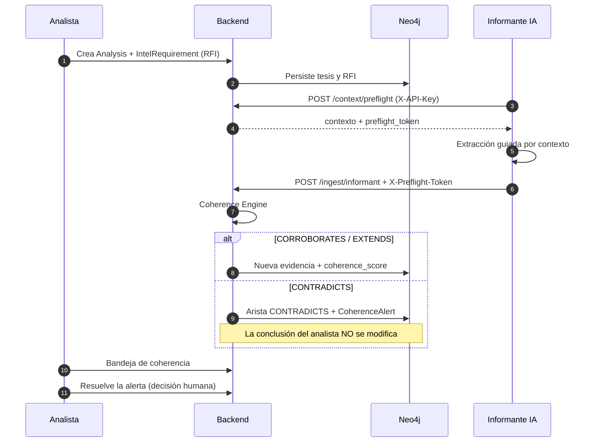

<div align="center">

# OSINT Nexus Platform

**Plataforma de inteligencia de fuentes abiertas con grafo de conocimiento, ingesta NLP y coherencia Humano–IA.**

[](.antigravity/sdd-constitution.md)
[](contracts/SEAL.md)
[](.antigravity/audit/2026-10-17-sdd-v2.0.md)
[](apps/backend)
[](apps/informant-agent)
[](https://www.python.org/)
[](https://fastapi.tiangolo.com/)
[](https://nextjs.org/)
[](https://neo4j.com/)
[](deploy/docker-compose.prod.yml)

<sub>OSINT · SOCMINT · SIGINT — inteligencia estructurada, trazable y auditable.</sub>

</div>

---

> **Spec-Driven Development (SDD).** La especificación es la única fuente de
> verdad. El código se deriva de [`/specs`](specs) a través de los contratos
> congelados en [`/contracts`](contracts). Si el código contradice un contrato
> sellado, **gana el contrato**: se corrige el código o se abre una nueva spec y
> se re-sella. Ningún agente escribe `/apps` o `/deploy` sin una spec que lo
> autorice.

## Índice

- [1. Visión general](#1-visión-general)
- [2. Capacidades](#2-capacidades)
- [3. Arquitectura](#3-arquitectura)
- [4. Motor de Coherencia Simbiótica](#4-motor-de-coherencia-simbiótica)
- [5. Stack tecnológico](#5-stack-tecnológico)
- [6. Estructura del repositorio](#6-estructura-del-repositorio)
- [7. SDD: specs, contratos y sellado](#7-sdd-specs-contratos-y-sellado)
- [8. Puesta en marcha (desarrollo)](#8-puesta-en-marcha-desarrollo)
- [9. Despliegue en producción](#9-despliegue-en-producción)
- [10. API](#10-api)
- [11. Seguridad y cumplimiento](#11-seguridad-y-cumplimiento)
- [12. Verificación y calidad](#12-verificación-y-calidad)
- [13. Estado y hoja de ruta](#13-estado-y-hoja-de-ruta)
- [14. Gobernanza de agentes](#14-gobernanza-de-agentes)
- [15. Solución de problemas](#15-solución-de-problemas)
- [16. Aviso legal](#16-aviso-legal)

---

## 1. Visión general

**OSINT Nexus** es un monorepo de grado institucional para convertir informes y
fuentes abiertas en **conocimiento estructurado, verificable y auditable**. El
sistema ingiere documentos, extrae entidades y relaciones con su evidencia
literal, construye un grafo de conocimiento y pone a disposición del analista un
dashboard para investigar, contrastar y decidir.

Su elemento diferencial es el **Motor de Coherencia Simbiótica**: un Informante
IA que **no sustituye** al analista, sino que contrasta cada nueva evidencia con
las tesis humanas y eleva contradicciones en lugar de sobrescribirlas.

| Principio | Implementación |
| :--- | :--- |
| **Trazabilidad doble** | Toda arista lleva `source_report_id` + `page_number` + `exact_quote` y, si aplica, contexto analítico (`referenced_analysis_id`, `impact_type`). |
| **Inmutabilidad analítica** | Un nodo/arista con `locked_by_analyst: true` no puede ser alterado por automatización; solo se añade evidencia o se crea una `CoherenceAlert`. |
| **Prohibición de ingesta ciega** | El Informante IA debe ejecutar `POST /context/preflight` y presentar `X-Preflight-Token`; sin él, la ingesta responde `409`. |
| **Cero exposición de la base de datos** | Neo4j y Redis nunca publican puertos; todo pasa por FastAPI con JWT o API Key M2M. |
| **Verificación cruzada** | Cada tarea termina con tests de aceptación; la conformidad spec → contrato → código → test se audita de forma independiente. |

---

## 2. Capacidades

### Inteligencia y grafo
- **Grafo de conocimiento Neo4j** con **11 labels** y **16 relaciones** (ontología v2.0).
- **5 entidades OSINT**: `Person`, `Organization`, `CyberAsset`, `Location`, `Event`.
- **Nodos analíticos**: `Analysis`, `IntelRequirement`, `CoherenceAlert`.
- **Provenance por arista**: cita literal, página y documento de origen.
- **Entity Resolution** con identificadores canónicos y revisión de duplicados.
- **Búsqueda GraphRAG** con recuperación aumentada y **citas obligatorias**.

### Ingesta y coherencia
- Ingesta de **PDF y texto** con pipeline NLP y validación estricta contra
  [`extraction-schema.json`](contracts/extraction-schema.json).
- **Pre-Flight** con contexto analítico (tesis, RFI abiertos, entidades canónicas).
- **Coherence Engine**: clasifica cada vínculo como `CORROBORATES`,
  `CONTRADICTS`, `EXTENDS` o `ANSWERS_REQUIREMENT`.
- **Alertas de contradicción** con severidad y `conflict_detail`, sin tocar la
  conclusión del analista.
- **Ingesta asíncrona** con Celery + Redis y progreso por WebSocket.

### Operación y gobierno
- **RBAC de 4 actores**: `ADMIN`, `ANALYST`, `VIEWER` y el principal M2M
  `AI_INFORMANT`.
- **JWT** de 15 minutos + refresh en cookie HttpOnly/Secure.
- **2FA TOTP** para `ADMIN`, con rotación y bloqueo por fuerza bruta (`429`).
- **Bitácora de auditoría** JSON por petición (`osint.audit`) y `X-Request-ID`.
- **Backups cifrados**, rotación de logs y `healthcheck` de servicios.
- **Nginx TLS 1.3** como único punto de entrada.

### Dashboard (4 vistas + apoyo)
1. **Grafo interactivo** (Cytoscape) con filtros y expansión de vecindad.
2. **Visor Split-View** de dossier con subrayado de evidencia sobre el PDF.
3. **Workspace de Análisis**: tesis, conclusión, RFI y evidencias.
4. **Bandeja de Coherencia**: alertas de contradicción y resolución.
5. **Consola GraphRAG** y **ingesta drag & drop**.

---

## 3. Arquitectura

```mermaid
flowchart LR
    subgraph CLIENTE["Cliente"]
        UI["Dashboard<br/>Next.js 14"]
    end

    subgraph BORDE["Borde"]
        NG["Nginx<br/>TLS 1.3 · 80/443"]
    end

    subgraph APP["Aplicación"]
        API["FastAPI<br/>/api/v1"]
        W["Celery Worker<br/>ingesta NLP"]
        IA["Informant Agent<br/>M2M · X-API-Key"]
    end

    subgraph DATOS["Datos (red interna)"]
        N4J[("Neo4j 5<br/>grafo + vectores")]
        RDS[("Redis 7<br/>broker + estado")]
        FS[("Storage<br/>informes + chunks")]
    end

    EXT["Proveedor LLM<br/>opcional"]

    UI -->|HTTPS| NG
    IA -->|HTTPS M2M| NG
    NG --> API
    API -->|Bolt| N4J
    API -->|Redis| RDS
    API -->|PDF/chunks| FS
    W -->|Bolt| N4J
    W -->|Redis| RDS
    W -->|PDF/chunks| FS
    W -.->|LLM_PROVIDER| EXT
    API -.->|GraphRAG| EXT
```



| Componente | Responsabilidad | Tecnología |
| :--- | :--- | :--- |
| `apps/backend` | API REST, RBAC, ingesta, Coherence Engine, GraphRAG | Python 3.12 · FastAPI · Pydantic v2 |
| `apps/frontend` | Dashboard de 4 vistas y consola | Next.js 14 · TypeScript · Tailwind · Cytoscape |
| `apps/informant-agent` | Recolección OSINT y extracción guiada (M2M) | Python · httpx · jsonschema |
| `neo4j` | Grafo de conocimiento, constraints e índices | Neo4j 5 Enterprise + APOC |
| `redis` | Broker Celery y estado de jobs | Redis 7 |
| `nginx` | Terminación TLS, proxy y único puerto publicado | Nginx 1.27 |
| `worker` | Pipeline de ingesta asíncrono | Celery |

> **Aislamiento de red:** `internal_intel_net` es una red `internal: true`.
> Neo4j y Redis viven ahí y **jamás** publican puertos. Solo Nginx publica
> `80/443`. El worker es dual-homed únicamente para alcanzar el proveedor LLM
> cuando se configura uno.

---

## 4. Motor de Coherencia Simbiótica

El ciclo separa con nitidez **quiénes pueden decidir**: la IA aporta evidencia y
señala conflictos; el analista conserva la autoridad sobre la tesis.



**Fases**

| Fase | Qué ocurre | Garantía |
| :--- | :--- | :--- |
| **0 · Pre-Flight** | El Informante consulta análisis activos, RFI abiertos y entidades canónicas. | Sin contexto no hay token; sin token no hay ingesta (`409`). |
| **1 · Extracción** | Tripletas y vínculos con `exact_quote`, `page_number` y confianza. | El extractor descarta citas que no aparecen literalmente. |
| **2 · Coherencia** | El backend aplica el vínculo: corrobora, contradice, extiende o responde. | `CONTRADICTS` crea alerta y **nunca** sobrescribe `conclusion_body`. |
| **3 · Decisión** | El analista revisa la bandeja y resuelve. | La autoridad analítica permanece en el humano. |

**Vínculos analíticos**

| `link_category` | Efecto |
| :--- | :--- |
| `CORROBORATES` | Añade evidencia y eleva `coherence_score`. |
| `CONTRADICTS` | Crea arista `[:CONTRADICTS]` + `CoherenceAlert` prioritaria. |
| `EXTENDS` | Amplía el análisis con evidencia nueva. |
| `ANSWERS_REQUIREMENT` | Vincula la evidencia con un `IntelRequirement`. |

---

## 5. Stack tecnológico

| Capa | Tecnologías |
| :--- | :--- |
| **Backend** | Python 3.12 · FastAPI · Pydantic v2 · Uvicorn · PyJWT · Argon2id · jsonschema |
| **Grafos** | Neo4j 5 Enterprise · APOC · Cypher · índices vectoriales por label |
| **Asíncrono** | Celery 5 · Redis 7 · WebSocket |
| **Frontend** | Next.js 14 (App Router) · React 18 · TypeScript estricto · Tailwind CSS · Cytoscape.js |
| **Informante IA** | Python · httpx · Pydantic · jsonschema |
| **Infraestructura** | Docker Compose · Nginx 1.27 · TLS 1.3 · UFW · fail2ban |
| **Calidad** | pytest · ESLint · `tsc` · Redocly · ajv · auditoría SDD propia |

---

## 6. Estructura del repositorio

```text
osint-nexus-platform/
├── .antigravity/            Gobernanza SDD: constitución, prompts y auditoría
├── specs/                   Especificaciones (fuente de verdad)
│   ├── 00-system-overview.spec.md
│   ├── 01-graph-ontology.spec.md
│   ├── 02-ingestion-pipeline.spec.md
│   ├── 03-api-and-graphrag.spec.md
│   ├── 04-security-and-rbac.spec.md
│   ├── 05-dashboard-ui-ux.spec.md
│   └── 06-operations-and-compliance.spec.md
├── contracts/               Contratos ejecutables SELLADOS
│   ├── graph-constraints.cypher
│   ├── extraction-schema.json
│   ├── openapi.yaml
│   └── SEAL.md              Registro de sellado y hashes
├── apps/
│   ├── backend/             API, ingesta, coherencia, GraphRAG
│   ├── frontend/            Dashboard Next.js (4 vistas)
│   └── informant-agent/     Informante IA M2M
├── storage/
│   ├── raw_reports/         Informes originales (no versionados)
│   └── processed_chunks/    Chunks con coordenadas de evidencia
├── deploy/                  Compose, Nginx, scripts y runbook VPS
├── scripts/                 Validación de contratos y auditoría SDD
├── AGENTS.md                Reglas operativas y zonas de escritura
├── CHANGELOG.md             Historial de versiones
└── README.md
```

---

## 7. SDD: specs, contratos y sellado

### Specs rectoras

| Spec | Ámbito |
| :--- | :--- |
| **SPEC-00** | Visión, principios y ciclo del sistema |
| **SPEC-01** | Ontología del grafo, constraints e índices |
| **SPEC-02** | Pipeline de ingesta, Pre-Flight y Coherence Engine |
| **SPEC-03** | API REST, GraphRAG y contrato OpenAPI |
| **SPEC-04** | Seguridad, RBAC, M2M y hardening |
| **SPEC-05** | Dashboard y experiencia de las 4 vistas |
| **SPEC-06** | Auditoría, cumplimiento, backups y operación |

### Contratos sellados

| Contrato | Deriva de | Versión |
| :--- | :--- | :--- |
| [`graph-constraints.cypher`](contracts/graph-constraints.cypher) | SPEC-01 | v2.1.0 |
| [`extraction-schema.json`](contracts/extraction-schema.json) | SPEC-02 | v2.0.0 |
| [`openapi.yaml`](contracts/openapi.yaml) | SPEC-03 + SPEC-04 | **v2.2.0** |

El sello vigente y los hashes SHA-256 están en [`contracts/SEAL.md`](contracts/SEAL.md).
**Cualquier cambio de contrato exige una nueva spec y un nuevo sello.**

```bash
# 1) Validar contratos (esquema JSON, OpenAPI y coherencia de grafo)
bash scripts/validate-contracts.sh

# 2) Auditar la trazabilidad spec → contrato → código → test
python scripts/audit_sdd.py
```

---

## 8. Puesta en marcha (desarrollo)

### Prerrequisitos

- **Python 3.12+**
- **Node.js 20+** y npm
- **Docker** (recomendado para Neo4j y Redis)
- **Neo4j 5** con APOC y **Redis 7**

### 8.1 Backend

```bash
cd apps/backend
python -m venv .venv

# Windows
.venv\Scripts\activate
# Linux/macOS
source .venv/bin/activate

pip install -r requirements.txt -r requirements-dev.txt
uvicorn app.main:app --reload --port 8000
```

API interactiva: <http://localhost:8000/docs>

### 8.2 Neo4j y Redis (desarrollo)

```bash
docker run -d --name osint-neo4j \
  -p 7474:7474 -p 7687:7687 \
  -e NEO4J_AUTH=neo4j/CHANGE_ME \
  -e NEO4J_PLUGINS='["apoc"]' \
  neo4j:5-enterprise

docker run -d --name osint-redis -p 6379:6379 redis:7-alpine
```

Aplica las constraints del contrato:

```bash
docker exec -i osint-neo4j cypher-shell -u neo4j -p CHANGE_ME \
  < contracts/graph-constraints.cypher
```

> En producción **no** se publican estos puertos; este paso es solo para
> desarrollo local.

### 8.3 Frontend

```bash
cd apps/frontend
npm install
npm run gen:api        # tipos desde openapi.yaml (29 operationId)
npm run dev            # http://localhost:3000
```

### 8.4 Informante IA

```bash
cd apps/informant-agent
pip install -r requirements.txt

python -m informant_agent run \
  --source-dir ./fuentes \
  --base-url http://localhost:8000/api/v1 \
  --api-key "$INFORMANT_API_KEY"
```

> El sistema arranca por defecto en **modo recuperación** (`LLM_PROVIDER=null`):
> opera sin clave de LLM. Un proveedor real se configura por entorno.

---

## 9. Despliegue en producción

La guía completa, paso a paso, está en **[`deploy/README.md`](deploy/README.md)**.

```bash
# 1) Configurar secretos
cp deploy/.env.example deploy/.env
#    editar: PUBLIC_HOSTNAME, NEO4J_PASSWORD, JWT_SECRET_KEY, PREFLIGHT_SECRET...

# 2) Construir y levantar
docker compose -f deploy/docker-compose.prod.yml build
docker compose -f deploy/docker-compose.prod.yml up -d

# 3) Aplicar constraints del grafo (idempotente)
bash deploy/scripts/apply-constraints.sh

# 4) Crear el primer ADMIN y la API Key M2M
python deploy/scripts/init-admin-user.py
python deploy/scripts/init-api-keys.py

# 5) Verificación de aceptación
bash deploy/scripts/smoke-test.sh
```

| Servicio | Red | Puertos | Rol |
| :--- | :--- | :--- | :--- |
| `nginx` | `public_net` | **80/443** | Único punto de entrada TLS |
| `frontend` | `public_net` | — | Dashboard Next.js |
| `backend` | `public_net` + `internal_intel_net` | — | FastAPI `/api/v1` |
| `worker` | `public_net` + `internal_intel_net` | — | Celery (egreso LLM) |
| `informant-agent` | `internal_intel_net` | — | Recolección M2M |
| `neo4j` | `internal_intel_net` | — | Grafo (jamás expuesto) |
| `redis` | `internal_intel_net` | — | Broker y estado |

Comprobación de la regla de aislamiento:

```bash
docker compose -f deploy/docker-compose.prod.yml config | grep -c '^ *ports:'
# => 1   (solo Nginx)
```

---

## 10. API

- **Base:** `/api/v1`
- **Autenticación humana:** `Authorization: Bearer <JWT>` (15 min) + refresh en
  cookie HttpOnly/Secure.
- **Autenticación M2M:** `X-API-Key` (principal `AI_INFORMANT`).
- **Contrato:** [`contracts/openapi.yaml`](contracts/openapi.yaml) — **29 `operationId`**.

| Grupo | Métodos y rutas |
| :--- | :--- |
| **Auth** | `POST /auth/login` · `POST /auth/refresh` · `POST /auth/logout` · `GET /auth/me` |
| **Grafo** | `GET /graph/nodes` · `GET /graph/nodes/{id}` · `PUT /graph/nodes/{id}` · `DELETE /graph/nodes/{id}` · `POST /graph/nodes/{id}/lock` · `GET /graph/edges` · `GET /graph/neighborhood/{id}` |
| **Coherencia** | `POST /context/preflight` · `GET /coherence/alerts` · `PATCH /coherence/alerts/{alert_id}/resolve` |
| **Ingesta** | `POST /ingest` · `POST /ingest/informant` · `GET /ingest/{job_id}` · `WS /ingest/{job_id}/ws` |
| **Informes** | `GET /reports/{id}` · `GET /reports/{id}/file` · `GET /reports/{id}/chunks` |
| **Análisis** | `GET /analyses` · `POST /analyses` · `GET /analyses/{id}` · `PUT /analyses/{id}` · `POST /analyses/{id}/requirements` · `GET /analyses/{id}/requirements` |
| **Búsqueda** | `POST /search/rag` |
| **Sistema** | `GET /info` |

### Matriz RBAC (resumen)

| Acción | ADMIN | ANALYST | VIEWER | AI_INFORMANT |
| :--- | :---: | :---: | :---: | :---: |
| Leer grafo, informes, análisis | ✓ | ✓ | ✓ | ✓ |
| Crear/editar análisis y RFI | ✓ | ✓ | — | — |
| Bloquear nodo (`locked_by_analyst`) | ✓ | ✓ | — | — |
| Resolver alertas de coherencia | ✓ | ✓ | — | — |
| Pre-Flight + ingesta M2M | — | — | — | ✓ |
| Administración de usuarios/claves | ✓ | — | — | — |

---

## 11. Seguridad y cumplimiento

| Control | Implementación |
| :--- | :--- |
| **Contraseñas** | Argon2id (time cost 3, memory 64 MiB) |
| **Sesión** | JWT 15 min + refresh 7 días en cookie HttpOnly/Secure |
| **2FA** | TOTP obligatorio para `ADMIN`, con rotación |
| **Fuerza bruta** | Ventana de intentos + `429` con `Retry-After` |
| **M2M** | API Key con hash en reposo y ámbito `AI_INFORMANT` |
| **Ingesta ciega** | `X-Preflight-Token` HMAC obligatorio (`409` sin él) |
| **Inmutabilidad** | `locked_by_analyst` → `409` ante sobrescritura automática |
| **Aislamiento** | Neo4j/Redis sin puertos; solo Nginx expone TLS 1.3 |
| **Auditoría** | Evento JSON por petición en `osint.audit` + `X-Request-ID` |
| **Operación** | Backups cifrados, rotación de logs y healthchecks |
| **Hardening** | UFW, fail2ban y SSH endurecido (`vps-hardening.sh`) |

> **Cumplimiento:** la plataforma está diseñada para uso institucional con
> evidencia trazable. No incluye ni promueve vigilancia masiva, acceso no
> autorizado ni tratamiento de datos personales fuera del marco legal aplicable.

---

## 12. Verificación y calidad

```bash
# Contratos (esquema + OpenAPI + coherencia de grafo)
bash scripts/validate-contracts.sh

# Auditoría SDD (12 checks independientes)
python scripts/audit_sdd.py

# Backend
cd apps/backend && python -m pytest -q

# Informante IA
cd apps/informant-agent && python -m pytest -q

# Frontend
cd apps/frontend
npx tsc --noEmit
npm run lint
npm run build
```

### Resultado actual

| Verificación | Resultado |
| :--- | :--- |
| Contratos vs `SEAL.md` | **3/3 hashes OK** |
| Auditoría SDD | **12/12** |
| Backend | **389 passed**, 2 skipped |
| Informant Agent | **36 passed** |
| Frontend | `tsc` ✓ · `lint` ✓ · `build` ✓ |
| Docker Compose | `config` ✓ · **1** solo `ports:` |
| E2E ciclo simbiótico | ✓ |

El test de aceptación
[`apps/backend/tests/e2e/test_symbiotic_cycle.py`](apps/backend/tests/e2e/test_symbiotic_cycle.py)
recorre el ciclo completo: creación de tesis y RFI, Pre-Flight, ingesta no ciega,
corroboración y contradicción, grafo, inmutabilidad, bandeja, dossier, GraphRAG y
RBAC.

---

## 13. Estado y hoja de ruta

- [x] **Fase 1** — Esqueleto SDD y gobernanza de agentes.
- [x] **Fase 2** — Contratos congelados y sellados.
- [x] **Fase 3** — Implementación v2.0: grafo, ingesta, coherencia y dashboard.
- [x] **Fase 4** — Auditoría SDD (12/12) y E2E del ciclo simbiótico.
- [x] **v2.1** — Listados `GET /analyses` y `GET /analyses/{id}/requirements`.
- [x] **v2.2** — 2FA TOTP, JWT 15 min, `429`, auditoría y operación.
- [ ] **Despliegue real en VPS** — pendiente de un entorno con daemon Docker.
- [ ] **Smoke test con servicios vivos** (Neo4j/Redis/Celery/LLM real).

Consulta el detalle en [`CHANGELOG.md`](CHANGELOG.md) y el informe de auditoría
en [`.antigravity/audit/2026-10-17-sdd-v2.0.md`](.antigravity/audit/2026-10-17-sdd-v2.0.md).

---

## 14. Gobernanza de agentes

El proyecto se construye con un **Agente 0 (Orquestador)** y cinco agentes
técnicos con zonas de escritura **no solapadas**:

| Agente | Rol | Zona de escritura |
| :--- | :--- | :--- |
| **0 · Orchestrator** | Gobierna fases y sella contratos | `specs/`, `contracts/` (sello) |
| **1 · Graph DB** | Ontología, coherencia y Entity Resolution | `app/db/**`, `entity_resolver.py` |
| **2 · Ingestion NLP** | Pre-Flight, extracción y Coherence Engine | `app/services/**`, `app/schemas/**`, `app/workers/**` |
| **3 · DevOps/Sec** | API, RBAC, seguridad y VPS | `app/api/**`, `app/core/**`, `deploy/**` |
| **4 · Frontend UI** | Grafo, dossier, workspace y bandeja | `apps/frontend/**` |
| **5 · Informant AI** | Recolección OSINT M2M | `apps/informant-agent/**` |

Las reglas completas están en [`AGENTS.md`](AGENTS.md) y
[`.antigravity/sdd-constitution.md`](.antigravity/sdd-constitution.md).

---

## 15. Solución de problemas

| Síntoma | Causa / solución |
| :--- | :--- |
| `EISDIR: illegal operation on a directory, readlink ...` al hacer `npm run build` | Incompatibilidad de Node moderno + webpack en Windows. Ya está integrado el preload `apps/frontend/scripts/readlink-eisdir-preload.cjs`; `npm run build` lo aplica automáticamente. |
| `failed to connect to the docker API` | El daemon de Docker no está en ejecución. Inicia Docker Desktop / `systemctl start docker`. |
| `409` en `POST /ingest/informant` | Falta `X-Preflight-Token` o ha caducado. Ejecuta antes `POST /context/preflight`. |
| `409` al actualizar un nodo | El nodo tiene `locked_by_analyst: true`. Añade evidencia o resuelve la `CoherenceAlert`; no lo sobrescribas. |
| `LLM_PROVIDER=null` | Modo recuperación: el sistema funciona sin LLM. Configura un proveedor para extracción generativa. |
| Contratos "modificados" | Compara con `contracts/SEAL.md`. Si el cambio es intencional, abre una spec y re-sella. |

---

## 16. Aviso legal

Este software se distribuye para **investigación, auditoría y colaboración
institucional**. Su uso operativo debe realizarse únicamente sobre **fuentes
abiertas y lícitas**, con autorización de la entidad titular y cumpliendo la
normativa aplicable de protección de datos, secreto de comunicaciones y
ciberseguridad.

Los autores no se responsabilizan del uso indebido, del tratamiento ilícito de
datos personales ni de actividades de vigilancia no autorizadas.

---

<div align="center">

**OSINT Nexus Platform** · Spec-Driven Development · 2026

<sub>Construido con trazabilidad, inmutabilidad analítica y coherencia Humano–IA.</sub>

</div>
