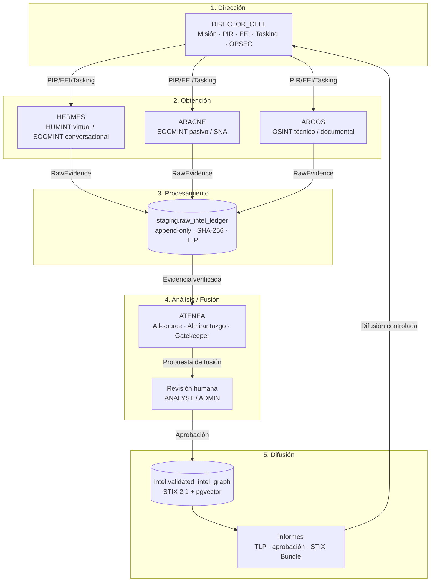
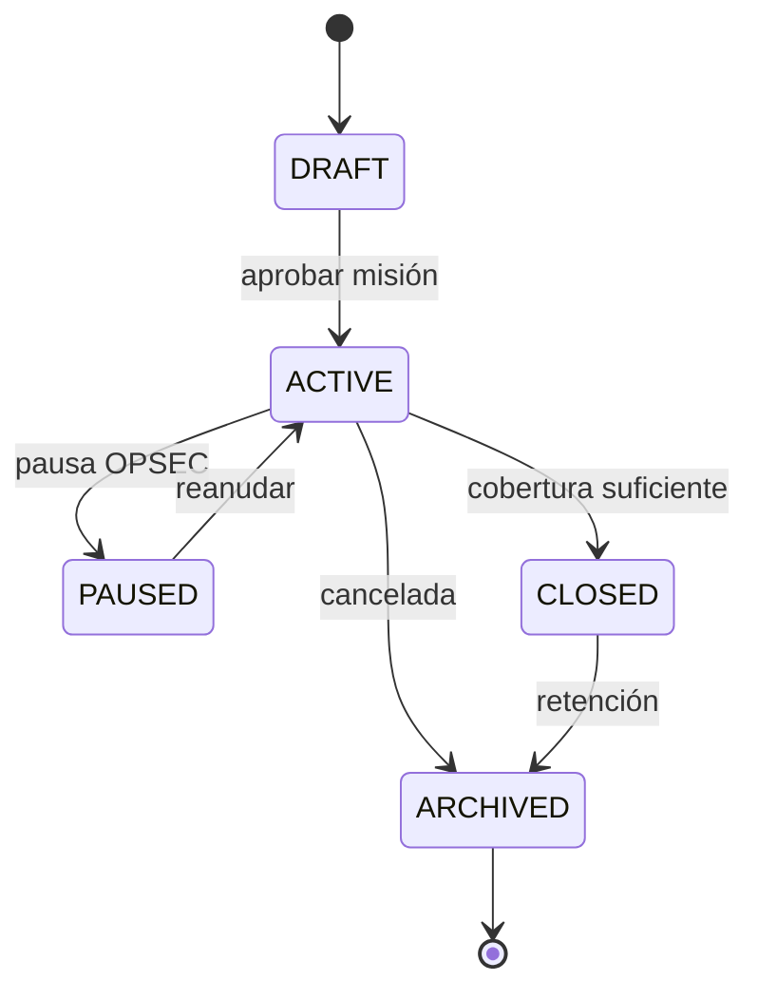
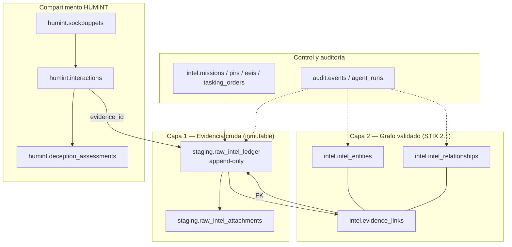
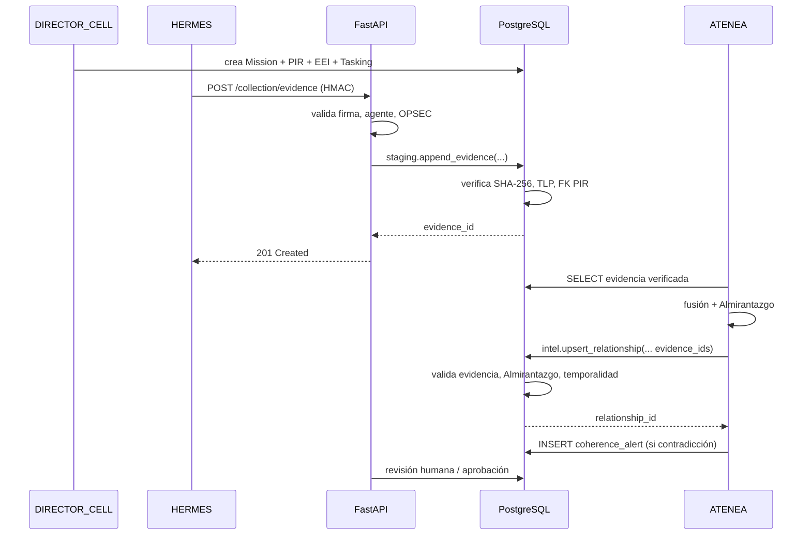
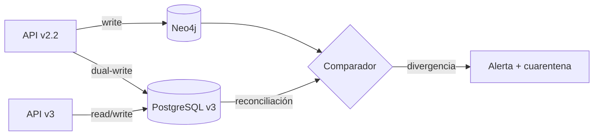

# SPEC.md — Plataforma de Inteligencia Multi-Agente de Nivel Institucional (v3.0)

> **Fase 1 SDD · Especificación técnica ejecutable · Estado: APROBADA — 2026-10-23**
> Proyecto: OSINT Nexus Platform · Baseline: v2.2.0 (`main` @ `e90ac34`)
> Fecha: **2026-10-23** · Autor: Arquitecto SDD (Agente 0) · Aprobador: usuario
> Documentos asociados: [`AUDIT.md`](./AUDIT.md) · [`PLAN.md`](./PLAN.md) · [`DB_CONTRACT.sql`](./DB_CONTRACT.sql) · [`DB_CONTRACT.json`](./DB_CONTRACT.json)

---

## 0. Control del documento

| Campo | Valor |
|---|---|
| ID | `SPEC-00-v3` |
| Versión | **3.0.0** |
| Estado | **APROBADA** (Hito 1 en curso; contrato DB pendiente de sello) |
| Reemplaza | `specs/00-system-overview.spec.md` v2.0 (solo para el alcance v3) |
| Contratos que deriva | `contracts/v3/openapi.yaml`, `contracts/v3/agent-contracts.json`, `contracts/v3/db-contract.sql` |
| Sello requerido | `contracts/SEAL.md` v3.0.0 (nuevo) |
| Idioma normativo | Español; identificadores técnicos en inglés |
| Convención de requisitos | **EARS** (`WHEN / IF / THEN / SHALL`) |
| Nivel de obligación | `SHALL` = obligatorio; `SHOULD` = recomendado; `MAY` = opcional |

### 0.1 Regla de oro

> **Ningún archivo de `/apps` o `/deploy` se modifica hasta que este documento sea aprobado y los contratos v3 estén sellados.** Cualquier ambigüedad se eleva como `SPEC-GAP` (§15) y detiene la implementación del hito afectado.

> **Excepción controlada del Hito 1 (2026-10-23):** la aprobación de esta spec autoriza implementar el contrato DB en estado DRAFT y el código de validación en `apps/backend/tests/v3/**`, `apps/backend/app/db/postgres_*`, `deploy/docker-compose.prod.yml` (servicio `postgres`) y `scripts/migrate/**`. El sello v3.0.0 sigue siendo obligatorio antes de que la API o los agentes consuman PostgreSQL en producción; hasta entonces el valor por defecto es `GRAPH_BACKEND=neo4j`.

### 0.2 Resumen ejecutivo

La v3.0 transforma el backend monológico v2.2 en una **célula de inteligencia** regida por el ciclo clásico (Dirección → Obtención → Procesamiento → Análisis/Fusión → Difusión), con **cinco funciones de agente** (`DIRECTOR_CELL`, `HERMES`, `ARACNE`, `ARGOS`, `ATENEA`) y una **doble capa de datos**:

1. **`staging.raw_intel_ledger`**: bóveda de evidencia cruda, append-only, con SHA-256 sobre los bytes exactos de captura, TLP y cadena de custodia.
2. **`intel.*` (validated_intel_graph)**: grafo STIX 2.1 en PostgreSQL 16 + JSONB + pgvector, con evaluación Almirantazgo `[A-F][1-6]`, confianza 0–100, evidencia FK obligatoria y validez temporal.

La separación de permisos es **física**: cada agente tiene su propio rol de base de datos y solo puede ejecutar las funciones que le corresponden. `HERMES`, `ARACNE` y `ARGOS` **no pueden escribir** en el grafo validado; `ATENEA` es el único que puede hacerlo, y solo con evidencia verificada. `DIRECTOR_CELL` dirige mediante PIR/EEI/tasking, sin escribir inteligencia.

**Decisión de motor (ADR-001):** PostgreSQL 16 + pgvector como fuente de verdad; Neo4j queda como proyección de lectura opcional para la UI de grafo.

---

## 1. Referencias normativas y convenciones

### 1.1 Referencias

| Referencia | Uso |
|---|---|
| STIX 2.1 (OASIS) | Modelado de SDO/SRO/SCO, `confidence` 0–100, TLP marking definitions |
| Admiralty/NATO source reliability | Código `[A-F][1-6]` |
| TLP 2.0 (FIRST) | `TLP:RED`, `TLP:AMBER+STRICT`, `TLP:AMBER`, `TLP:GREEN`, `TLP:CLEAR` |
| JSON Schema 2020-12 | Contratos inter-agente |
| OpenAPI 3.1 | Contrato HTTP v3 |
| RFC 7807 | `application/problem+json` |
| RFC 8785 (JCS) | Canonicalización JSON para hash |
| RFC 9562 (UUIDv7) | Identificadores ordenados temporalmente |
| PostgreSQL 16 | Motor relacional, JSONB, RLS, CTEs |
| pgvector | Embeddings y búsqueda HNSW |
| EARS | Sintaxis de requisitos |
| Constitución SDD v2.0 | Reglas de gobernanza del repositorio |

### 1.2 Convenciones de identificadores

| Entidad | Formato | Ejemplo |
|---|---|---|
| Evidencia | UUIDv7 | `0192f3a1-...` |
| Entidad validada | UUIDv7 + `stix_id` | `identity--0192f3a1-...` |
| Relación validada | UUIDv7 + `stix_id` | `relationship--0192f3a1-...` |
| Misión | UUIDv7 | `0192f3a1-...` |
| PIR/EEI/Tarea | UUIDv7 | `0192f3a1-...` |
| Agente | UUIDv7 + `agent_type` | `HERMES` |
| Hash | SHA-256 hex minúsculas (64 chars) | `a3f1...` |
| TLP | Enum cerrado | `TLP:AMBER` |
| Almirantazgo | `^[A-F][1-6]$` | `B2` |

### 1.3 Principios de diseño

| ID | Principio | Implicación |
|---|---|---|
| P-01 | **Spec First / Contract First** | Ningún cambio sin spec y contrato sellado |
| P-02 | **Dato crudo inmutable** | El ledger no se actualiza ni borra; solo se añade |
| P-03 | **Inteligencia sin evidencia = rechazo** | FK + trigger a nivel DB/ORM |
| P-04 | **Un solo gatekeeper** | Solo Atenea escribe el grafo validado |
| P-05 | **Permisos físicos, no convenciones** | Roles DB + funciones `SECURITY DEFINER` |
| P-06 | **Trazabilidad total** | `mission → PIR → EEI → tarea → evidencia → aserción` |
| P-07 | **Tiempo explícito** | `valid_from` / `valid_until` en toda aserción |
| P-08 | **TLP por dato** | Clasificación en ledger y grafo; difusión controlada |
| P-09 | **Human-in-the-loop** | Aprobación humana para difusión y acciones de alto riesgo |
| P-10 | **Cero exposición de DB** | Solo FastAPI; sin puertos de DB/Redis |
| P-11 | **No repudio** | Identidad de agente + firma + auditoría |
| P-12 | **Abstención antes que alucinación** | Sin evidencia, el sistema no concluye |

---

## 2. Visión del sistema y ciclo de inteligencia

### 2.1 Contexto



### 2.2 Ciclo de inteligencia (flujo normativo)

| Fase | Actor | Entrada | Salida | Gate |
|---|---|---|---|---|
| **1. Dirección** | `DIRECTOR_CELL` | Objetivo del usuario, política OPSEC, base legal | `Mission`, `PIR`, `EEI`, `TaskingOrder` | Aprobación humana de la misión |
| **2. Obtención** | `HERMES`, `ARACNE`, `ARGOS` | `TaskingOrder` | `RawEvidence` en ledger | Hash + TLP + preflight de misión |
| **3. Procesamiento** | Pipeline + agentes | `RawEvidence` | Evidencia normalizada, embeddings, adjuntos | Verificación de integridad |
| **4. Análisis/Fusión** | `ATENEA` | Evidencia de los 3 colectores | `FusionProposal` (entidades/relaciones + Almirantazgo) | Evidencia FK + contradicciones |
| **5. Difusión** | `ANALYST`/`ADMIN` + `ATENEA` | Propuesta aprobada | `IntelligenceReport` + STIX Bundle | Aprobación humana + TLP |

### 2.3 Máquina de estados de una misión



**Regla:** una misión no puede pasar a `CLOSED` si tiene PIR `OPEN` sin justificación, evidencia sin procesar o alertas `CRITICAL` sin resolver.

---

## 3. Topología de agentes y orquestación

### 3.1 Principios de la célula

1. **Especialización estricta:** cada agente tiene un rol, un contrato de entrada/salida y una zona de escritura.
2. **No solapamiento:** ningún agente escribe en la zona de otro.
3. **Dirección separada de ejecución:** `DIRECTOR_CELL` no recolecta ni fusiona; dirige.
4. **Gatekeeper único:** `ATENEA` es el único con escritura en `intel.intel_entities` / `intel.intel_relationships`.
5. **Evidencia primero:** ningún agente valida sin `evidence_id` verificable.
6. **OPSEC transversal:** `HERMES` no actúa sin política OPSEC activa; el orquestador puede abortar.

### 3.2 `DIRECTOR_CELL` — Dirección y Control

| Atributo | Especificación |
|---|---|
| **Misión** | Traducir objetivos en PIR/EEI, asignar tareas, fijar límites OPSEC y evitar bucles/fuera de alcance |
| **Entradas** | Objetivo del usuario, política de misión, base legal, clasificación TLP, restricciones |
| **Salidas** | `Mission`, `PIR`, `EEI`, `TaskingOrder`, `OpsecPolicy`, decisión de cierre |
| **Herramientas** | API de misiones/PIR/tasking; consulta de cobertura; no acceso a grafos de escritura |
| **Permisos DB** | `osint_director`: SELECT/INSERT/UPDATE en `intel.missions`, `intel.pirs`, `intel.eeis`, `intel.tasking_orders`; SELECT en vistas de cobertura |
| **Prohibido** | Escribir entidades/relaciones; leer `humint` sin necesidad operacional; aprobar difusión (lo hace ANALYST/ADMIN) |
| **KPIs** | PIR con EEI válidos, tareas aceptadas, cobertura, tiempo de ciclo |
| **Fallo** | Si no hay PIR, no se autoriza recolección; si hay conflicto de alcance, se detiene |

**Contrato de dirección:**

```json
{
  "mission_id": "0192...",
  "code": "MIS-2026-001",
  "name": "Campaña de desinformación sector X",
  "classification": "TLP:AMBER",
  "legal_basis": "interés público / investigación periodística",
  "opsec_policy": {
    "max_interactions_per_day": 20,
    "max_messages_per_target": 5,
    "forbidden_topics": ["datos personales sensibles", "menores"],
    "exposure_rules": {"no_media_contact": true, "no_meetings": true}
  },
  "pirs": [
    {
      "code": "PIR-001",
      "question": "¿Qué actores coordinan la campaña?",
      "priority": 1,
      "due_at": "2026-11-15T00:00:00Z",
      "eeis": [
        {"code": "EEI-001", "question": "¿Qué cuentas publican el mismo contenido en <2h?"},
        {"code": "EEI-002", "question": "¿Qué infraestructura comparten?"}
      ]
    }
  ]
}
```

### 3.3 `HERMES` — HUMINT Virtual y SOCMINT Conversacional

| Atributo | Especificación |
|---|---|
| **Misión** | Operar identidades virtuales, elicitar información, analizar lenguaje/engaño y producir reportes HUMINT/SOCMINT crudos |
| **Entradas** | `TaskingOrder`, política OPSEC, identidades (sockpuppets), objetivos, canales autorizados |
| **Salidas** | `RawEvidence` (transcripciones, capturas, metadatos), `DeceptionAssessment`, `PsychProfile`, `OpsecEvent` |
| **Herramientas** | Gestor de sockpuppets, cliente de canales, transcriptor, analizador de lenguaje, detector de engaño |
| **Permisos DB** | `osint_hermes`: EXECUTE `staging.append_evidence(...)`; INSERT/UPDATE en `humint.sockpuppets`, `humint.legends`, `humint.interactions`, `humint.deception_assessments`, `humint.psych_profiles`; SELECT en misiones/tareas asignadas |
| **Prohibido** | Escribir en `intel.intel_entities` / `intel.intel_relationships`; operar sin OPSEC; contactar fuera de canal autorizado; usar datos de menores |
| **KPIs** | Tasa de elicitación, calidad de evidencia, incidents OPSEC = 0, tiempo de interacción |
| **Fallo** | Si OPSEC se viola → abortar, registrar `OpsecEvent`, notificar a Dirección |

**Subsistema de identidades operativas:**

| Componente | Función | Controles |
|---|---|---|
| `SockpuppetManager` | Crear/activar/retirar avatares | Compartimentación por misión; aprobación humana |
| `LegendGenerator` | Leyenda coherente (biografía, zona horaria, intereses) | Datos consistentes; sin reutilizar leyendas |
| `FingerprintIsolator` | Aislar huella (IP, device, horario, estilo) | Proxy dedicado, jitter, coherencia de estilo |
| `ElicitationEngine` | Guion conversacional y objetivos | Límites de tasa; temas prohibidos |
| `DeceptionDetector` | Indicadores de engaño | Score 0–1 + explicación; revisión humana |
| `PsychProfiler` | Perfil conductual/psicográfico | Solo con evidencia; sin diagnóstico clínico |
| `OpsecGuard` | Reglas de exposición/rate-limit | Aborto automático + alerta |

**Regla de oro HUMINT:** Hermes **nunca** afirma un hecho en el grafo. Su salida es siempre `RawEvidence` + evaluación; Atenea decide.

### 3.4 `ARACNE` — SOCMINT Pasivo y Grafos de Red

| Atributo | Especificación |
|---|---|
| **Misión** | Mapear topología de redes, comunidades, puentes, bots, campañas coordinadas y patrones de vida |
| **Entradas** | `TaskingOrder`, fuentes públicas, datasets de plataformas, selectores de Argos/Hermes |
| **Salidas** | `RawEvidence` (nodos/aristas observados, cronologías, métricas SNA), `NetworkAssessment` |
| **Herramientas** | Colectores pasivos, SNA (centralidad, comunidades, puentes), detección de bots/astroturfing, pattern-of-life |
| **Permisos DB** | `osint_aracne`: EXECUTE `staging.append_evidence(...)`; SELECT en misiones/tareas; sin escritura en grafo |
| **Prohibido** | Interacción activa (eso es Hermes); escribir en grafo; doxxing; almacenar PII no minimizada |
| **KPIs** | Cobertura de red, precisión de comunidades, falsos positivos de bots, latencia |
| **Fallo** | Si la fuente cambia o bloquea, degradar y reportar; no inventar |

**Algoritmos reutilizables de v2.2:** `paths_of_influence`, `critical_brokers`, `neighborhood` (ya existen en `repository.py`); se adaptan a SQL/CTE o a la proyección Neo4j.

### 3.5 `ARGOS` — OSINT Técnico y Documental

| Atributo | Especificación |
|---|---|
| **Misión** | Correlacionar selectores técnicos y documentales; pivotar sobre indicadores de Hermes/Aracne |
| **Entradas** | `TaskingOrder`, selectores (alias, email, teléfono, dominio, IP, wallet), documentos, registros |
| **Salidas** | `RawEvidence` (hallazgos, metadatos, capturas), `SelectorGraph` |
| **Herramientas** | Resolución DNS/WHOIS, certificados, breaches públicas, EXIF, registros mercantiles, boletines, archives |
| **Permisos DB** | `osint_argos`: EXECUTE `staging.append_evidence(...)`; SELECT en misiones/tareas; sin escritura en grafo |
| **Prohibido** | Acceder a datos filtrados ilícitos; eludir paywalls/ToS; almacenar credenciales; escribir en grafo |
| **KPIs** | Selectores resueltos, precisión, fuentes verificadas, tiempo de pivote |
| **Fallo** | Si la fuente es no concluyente, marcar `INCONCLUSIVE`; no forzar matching |

**Normalización de selectores:** cada selector se normaliza (lowercase, trim, IDN→punycode, E.164 para teléfonos, checksum para wallets cuando aplique) antes de comparar; se guarda el valor original y el normalizado.

### 3.6 `ATENEA` — Fusión All-Source y Gatekeeper

| Atributo | Especificación |
|---|---|
| **Misión** | Cruzar evidencia, evaluar Almirantazgo, detectar contradicciones/engaño/alucinación y escribir el grafo validado |
| **Entradas** | `RawEvidence` de los 3 colectores, PIR/EEI, diccionario canónico, alertas |
| **Salidas** | `FusionProposal`, entidades/relaciones validadas, `CoherenceAlert`, `IntelligenceReport` (borrador) |
| **Herramientas** | Entity resolution, Admiralty engine, contradiction/deception detector, confidence calculator, STIX mapper |
| **Permisos DB** | `osint_atenea`: EXECUTE `intel.upsert_entity(...)`, `intel.upsert_relationship(...)`, `intel.revoke_*`, `intel.create_coherence_alert(...)`, `intel.create_resolution_candidate(...)`; SELECT en `staging.raw_intel_ledger` y grafo; escritura de evidencia/alertas solo vía funciones; sin escritura en misiones |
| **Prohibido** | Escribir sin evidencia; borrar (solo revocar); autoaprobar difusión; ignorar TLP |
| **KPIs** | Precisión de fusión, huérfanos = 0, contradicciones detectadas, tiempo de fusión |
| **Fallo** | Si no hay evidencia suficiente → abstenerse y crear `CoherenceAlert`; nunca inventar |

**Algoritmo de fusión (normativo):**

1. **Recibir** evidencia verificada de una misión/PIR.
2. **Normalizar** entidades/selectores y resolver alias (`ALIAS_OF` o fusión).
3. **Evaluar** cada aserción con Almirantazgo `[A-F][1-6]`.
4. **Calcular** `confidence_score` 0–100.
5. **Detectar** contradicciones, conflictos temporales, duplicados y señales de engaño/alucinación.
6. **Proponer** entidades/relaciones con `supporting_evidence_ids[]`.
7. **Validar** en DB: evidencia existente, Almirantazgo válido, sin huérfanos.
8. **Enviar** a revisión humana si `confidence < 70` o hay contradicción `HIGH/CRITICAL`.
9. **Escribir** solo tras aprobación (o automáticamente si `confidence ≥ 90` y sin alertas, según política).
10. **Registrar** auditoría y métricas.

### 3.7 Orquestador (Agente 0)

El orquestador es el **plano de control**, no un agente de inteligencia. Implementa:

- máquina de estados de misión;
- asignación de tareas y reintentos;
- *idempotency keys* y *dead-letter queue*;
- *feature flags* (`GRAPH_BACKEND`, `AGENT_MODE`);
- *kill switch* por agente/misión;
- *heartbeats* y detección de agentes caídos;
- presupuesto de tokens/coste por misión;
- auditoría de cada transición.

**Estados de tarea:** `ISSUED → ACCEPTED → IN_PROGRESS → COMPLETED | FAILED | CANCELLED`.

**Reglas de orquestación:**

| Regla | Condición | Acción |
|---|---|---|
| O-01 | Tarea sin `mission_id`/`pir_id` | Rechazar |
| O-02 | Agente no registrado o `status != ACTIVE` | Rechazar |
| O-03 | Agente sin OPSEC policy activa (Hermes) | Rechazar |
| O-04 | Tarea excede presupuesto | Pausar y notificar |
| O-05 | 3 fallos consecutivos | Abrir `OpsecEvent`/`CoherenceAlert` y escalar |
| O-06 | Misión `PAUSED`/`CLOSED` | No emitir nuevas tareas |
| O-07 | Evidencia duplicada (`payload_sha256`) | Marcar `DUPLICATE`, no reingerir |
| O-08 | Agente caído > 2 × heartbeat | Reasignar o pausar |

---

## 4. Roles, principales y permisos

### 4.1 Actores humanos

| Rol | Descripción | Autenticación | Permisos clave |
|---|---|---|---|
| `ADMIN` | Operador con control total | JWT + 2FA TOTP | Gestión de usuarios/agentes, configuración, *break-glass*, revocación, aprobación de difusión |
| `ANALYST` | Analista de inteligencia | JWT | Crear/editar misiones, PIR, revisar fusión, aprobar informes, consultar grafo |
| `VIEWER` | Solo lectura | JWT | Consultar grafo, informes y búsqueda; sin mutaciones |

> **Cambio respecto a v2.2:** `ANALYST` ya **no** edita directamente nodos/aristas. Su poder se ejerce vía **revisión/aprobación** de propuestas de Atenea y vía misiones/PIR. `ADMIN` conserva *break-glass* auditado, pero no borra: revoca.

### 4.2 Principales de agente (M2M)

| Principal | `agent_type` | Autenticación | Rol DB | Zona de escritura |
|---|---|---|---|---|
| `DIRECTOR_CELL` | `DIRECTOR_CELL` | `X-Agent-Key` + HMAC | `osint_director` | `intel.missions`, `intel.pirs`, `intel.eeis`, `intel.tasking_orders` |
| `HERMES` | `HERMES` | `X-Agent-Key` + HMAC (+ mTLS opcional) | `osint_hermes` | `staging.raw_intel_ledger` (vía función), `humint.*` |
| `ARACNE` | `ARACNE` | `X-Agent-Key` + HMAC (+ mTLS opcional) | `osint_aracne` | `staging.raw_intel_ledger` (vía función) |
| `ARGOS` | `ARGOS` | `X-Agent-Key` + HMAC (+ mTLS opcional) | `osint_argos` | `staging.raw_intel_ledger` (vía función) |
| `ATENEA` | `ATENEA` | `X-Agent-Key` + HMAC (+ mTLS opcional) | `osint_atenea` | `intel.intel_entities`, `intel.intel_relationships`, `intel.evidence_links`, `intel.coherence_alerts`, `intel.entity_resolution_candidates` (vía funciones) + borradores de informe |

**Regla de no repudio:** el `collector_agent` de una evidencia **no** se acepta como parámetro libre. La función `staging.append_evidence(...)` lo deriva de `session_user` (login DB) mediante `staging.agent_role_map` y rechaza si no coincide con el `agent_type` autenticado. Un Hermes comprometido no puede escribir evidencia como Argos.

### 4.3 Matriz de permisos (resumen)

| Recurso | DIRECTOR | HERMES | ARACNE | ARGOS | ATENEA | ANALYST | VIEWER |
|---|:---:|:---:|:---:|:---:|:---:|:---:|:---:|
| Misión / PIR / EEI | **RW** | R* | R* | R* | R | RW | R |
| Tasking | **RW** | R* | R* | R* | R | RW | R |
| Raw ledger (insert) | — | **W** | **W** | **W** | — | — | — |
| Raw ledger (read) | — | R* | R* | R* | **R** | R** | R** |
| Entidades/relaciones | — | — | — | — | **RW** | R | R |
| Evidencia FK | — | — | — | — | **W** | — | — |
| Coherence alerts | R | — | — | — | **W** | RW | R |
| OPSEC policy | **RW** | R | — | — | — | — | — |
| OPSEC events | R | **W** | — | — | — | — | — |
| Informes | R | — | — | — | **W** (borrador) | **RW** (aprobar) | R |
| Difusión | R | — | — | — | — | **W** (aprobar) | — |
| Agentes | R | — | — | — | — | R | — |
| Auditoría | — | — | — | — | — | R** | — |

`RW` = lectura/escritura; `W` = solo escritura; `R` = lectura; `R*` = solo misiones/tareas asignadas; `R**` = sujeto a TLP/clearance.

### 4.4 Autenticación de agentes

```http
POST /api/v3/collection/evidence
X-Agent-Key: <key-id>
X-Agent-Timestamp: 1761177600
X-Agent-Signature: HMAC-SHA256(secret, timestamp + "\n" + method + "\n" + path + "\n" + sha256(body))
X-Request-ID: 0192...
Content-Type: application/json
```

Reglas:

| Regla | Especificación |
|---|---|
| A-01 | La key se almacena **hasheada** (Argon2id) en `intel.agent_registry.api_key_hash`; nunca en claro |
| A-02 | La firma cubre método, path, timestamp y hash del body; ventana ±300 s |
| A-03 | Replay: nonce/timestamp + caché Redis por `key-id`; rechazo `409` |
| A-04 | El API resuelve `agent_type` y abre una conexión con el rol DB correspondiente (pool por agente) |
| A-05 | `X-Request-ID` se propaga a auditoría y logs |
| A-06 | mTLS opcional para agentes en red externa; obligatorio si salen del `internal_intel_net` |
| A-07 | Rotación de keys cada 90 días; revocación inmediata en `agent_registry.status='REVOKED'` |

### 4.5 Cero exposición de base de datos

- PostgreSQL, Redis y Neo4j (si se mantiene) **no publican puertos** en producción.
- El backend es el único cliente de DB.
- El frontend nunca recibe credenciales de DB.
- Las vistas `api.*` son la única superficie de lectura directa para el backend de solo lectura; no se concede `SELECT` sobre tablas base a `osint_api_ro`.
- Los backups se cifran y se almacenan fuera del host.

---

## 5. Arquitectura de datos

### 5.1 ADR-001 — Motor de datos: PostgreSQL 16 + pgvector

| Campo | Decisión |
|---|---|
| **ID** | ADR-001 |
| **Estado** | Propuesto (requiere aprobación) |
| **Contexto** | Se necesita doble capa (ledger inmutable + grafo validado), permisos por agente a nivel DB, evidencia FK, STIX 2.1, búsqueda híbrida y validez temporal |
| **Decisión** | PostgreSQL 16 + JSONB + pgvector como fuente de verdad; Neo4j 5 solo como proyección de lectura opcional |
| **Alternativas** | (B) Postgres ledger + Neo4j grafo; (C) Neo4j + Apache AGE |
| **Consecuencias** | (+) FK reales, roles/GRANT, RLS, transacciones atómicas, un solo motor; (−) traversía profunda menos eficiente, requiere CTEs y proyección para la UI |
| **Mitigación** | Índices, vistas materializadas, CTEs con límite de profundidad, proyección Neo4j si p95 > objetivo |

### 5.2 Doble capa



**Invariantes:**

| ID | Invariante |
|---|---|
| I-01 | Toda fila del ledger es inmutable (`UPDATE`/`DELETE`/`TRUNCATE` bloqueados) |
| I-02 | `payload_sha256` = SHA-256 de `raw_payload_bytes` exactos |
| I-03 | Toda entidad/relación validada tiene ≥ 1 `evidence_id` existente |
| I-04 | Toda relación tiene `admiralty_rating` válido y `confidence_score` 0–100 |
| I-05 | `valid_until > valid_from` (o `NULL`) |
| I-06 | Una entidad/relación no se borra: se revoca |
| I-07 | El TLP no se degrada sin autorización auditada |
| I-08 | `collector_agent` se deriva del rol DB, no del payload |

### 5.3 Flujo de evidencia (end-to-end)



### 5.4 Mapeo STIX 2.1

#### 5.4.1 SDO/SCO/SRO

| Entidad objetivo | `stix_type` | Campos clave | Notas |
|---|---|---|---|
| `Person` | `identity` | `identity_class=individual`, `name`, `aliases` | Persona física |
| `Organization` | `identity` | `identity_class=organization`, `name` | Organización/grupo |
| `Persona_Avatar` | `user-account` | `account_login`, `display_name`, `platform` | Handle, alias digital, sockpuppet |
| `Threat_Actor` / `Target_Subject` | `threat-actor` | `threat_actor_types`, `aliases`, `goals` | Sujeto de interés |
| `Infrastructure` / `Selector` | `infrastructure` + SCO | `infrastructure_types`, `name` | Dominio/IP/email/teléfono/wallet |
| `Location` | `location` | `name`, `latitude`, `longitude`, `country` | Geografía |
| `Event_Incident` | `x-osint-event` | `start_time`, `end_time`, `location_ref` | Extensión custom documentada |
| `Intelligence_Report` | `report` | `report_types`, `published`, `object_refs` | Informe final |
| Observación cruda | `observed-data` | `first_observed`, `last_observed`, `number_observed` | Puente con SCOs |
| Anotación humana | `note` / `opinion` | `content`, `object_refs` | Revisión analítica |
| Relación | `relationship` | `relationship_type`, `source_ref`, `target_ref` | SRO |

#### 5.4.2 SCOs para selectores

| Selector | `stix_type` | Normalización |
|---|---|---|
| Dominio | `domain-name` | lowercase, IDN→punycode, sin punto final |
| IPv4/IPv6 | `ipv4-addr` / `ipv6-addr` | Formato canónico |
| Email | `email-addr` | lowercase, trim |
| Teléfono | `x-osint-phone` | E.164 cuando sea posible; original preservado |
| Wallet | `x-osint-wallet` | lowercase; validar checksum si la cadena lo permite |
| Handle | `user-account` | lowercase, sin `@` |
| Nombre | `identity` | Normalización Unicode + aliases |

> **Nota STIX:** `phone-number` y `wallet` no son SCOs core en STIX 2.1; se modelan como extensiones `x-osint-*` documentadas y exportables. No se inventan tipos core.

#### 5.4.3 Propiedades comunes

Toda entidad/relación validada expone:

```json
{
  "type": "identity",
  "spec_version": "2.1",
  "id": "identity--0192f3a1-7d4e-7c3a-9b2f-1a2b3c4d5e6f",
  "created": "2026-10-23T10:00:00Z",
  "modified": "2026-10-23T10:00:00Z",
  "created_by_ref": "identity--<atenea-id>",
  "confidence": 82,
  "lang": "es",
  "object_marking_refs": ["marking-definition--f88d31f6-486f-44da-b317-01333bde0b82"],
  "external_references": [],
  "revoked": false,
  "x_admiralty_rating": "B2",
  "x_supporting_evidence_ids": ["0192..."],
  "x_valid_from": "2026-10-23T10:00:00Z",
  "x_valid_until": null,
  "x_mission_id": "0192...",
  "x_pir_id": "0192..."
}
```

#### 5.4.4 Mapeo de relaciones

| `relationship_type` (contrato) | STIX `relationship_type` | Simétrica |
|---|---|---|
| `CONTROLS_ACCOUNT` | `controls-account` | No |
| `COMMUNICATES_WITH` | `communicates-with` | Sí |
| `FINANCED_BY` | `financed-by` | No |
| `LOCATED_AT` | `located-at` | No |
| `ALIAS_OF` | `alias-of` | Sí |
| `AFFILIATED_WITH` | `affiliated-with` | Sí |
| `MEMBER_OF` | `member-of` | No |
| `OWNS` | `owns` | No |
| `USES` | `uses` | No |
| `TARGETS` | `targets` | No |
| `PARTICIPATED_IN` | `participated-in` | No |
| `OBSERVED_AT` | `observed-at` | No |
| `MENTIONS` | `mentions` | No |
| `RELATED_TO` | `related-to` | Sí |

> Los 6 tipos del objetivo original están cubiertos; se añaden 8 tipos de uso frecuente. La tabla `intel.relationship_types` es la fuente de verdad y permite añadir tipos con contrato sellado.

#### 5.4.5 TLP marking definitions

| TLP | `marking-definition` STIX |
|---|---|
| `TLP:CLEAR` | `marking-definition--613f2e26-407d-48c7-9eca-b8e91df99dc9` |
| `TLP:GREEN` | `marking-definition--34098fce-860f-48ae-8e50-ebd3cc5e41da` |
| `TLP:AMBER` | `marking-definition--f88d31f6-486f-44da-b317-01333bde0b82` |
| `TLP:AMBER+STRICT` | `marking-definition--826578e1-40ad-459f-bc73-ede076f81f37` |
| `TLP:RED` | `marking-definition--5e57c739-391a-4eb3-b6be-7d15ca92d5ed` |

### 5.5 Evaluación Almirantazgo

| Fuente | Puntos | Información | Puntos |
|---|---:|---|---:|
| A — completamente fiable | 100 | 1 — confirmada por fuentes independientes | 100 |
| B — generalmente fiable | 80 | 2 — probablemente cierta | 80 |
| C — bastante fiable | 60 | 3 — posiblemente cierta | 60 |
| D — no generalmente fiable | 40 | 4 — dudosa | 40 |
| E — no fiable | 20 | 5 — improbable | 20 |
| F — no se puede juzgar | 10 | 6 — no se puede juzgar | 10 |

**Fórmula normativa:**

```
confidence_base = round(0.60 * source_points + 0.40 * info_points)
confidence = clamp(
    confidence_base
    + min(10, 5 * independent_sources)
    - min(30, 15 * high_severity_contradictions),
    0, 100
)
```

- `independent_sources` = número de evidencias de colectores distintos que corroboran.
- `high_severity_contradictions` = contradicciones `HIGH`/`CRITICAL` abiertas.
- Un `ANALYST` puede override con motivo; se audita y se marca `x_confidence_override=true`.

### 5.6 Modelo temporal

| Campo | Tipo | Semántica |
|---|---|---|
| `valid_from` | `timestamptz` | Inicio de validez de la aserción |
| `valid_until` | `timestamptz NULL` | Fin de validez; `NULL` = vigente |
| `first_seen_at` | `timestamptz` | Primera observación de la entidad |
| `last_seen_at` | `timestamptz` | Última observación |
| `captured_at_utc` | `timestamptz` | Instante de captura de la evidencia |
| `ingested_at` | `timestamptz` | Instante de inserción en el ledger |

**Consulta “as-of”:**

```sql
SELECT *
FROM intel.intel_relationships
WHERE source_entity_id = $1
  AND valid_from <= $as_of
  AND (valid_until IS NULL OR valid_until > $as_of);
```

**Regla:** una nueva aserción que contradiga otra en el mismo intervalo **no se inserta**; se crea `CoherenceAlert` y se resuelve humanamente.

### 5.7 Embeddings y búsqueda híbrida

| Elemento | Especificación |
|---|---|
| Columna | `embedding vector(1024)` (dimensión configurable `EMBEDDING_DIM`) |
| Índice | HNSW `vector_cosine_ops` (`m=16`, `ef_construction=64`) |
| Texto | `search_tsv tsvector` generado desde `name` + `aliases` + `properties->>'description'` |
| Índice texto | GIN |
| Fusión | Reciprocal Rank Fusion (RRF, `k=60`) entre BM25 y coseno |
| Abstención | Si `score < 0.35`, devolver “sin evidencia suficiente” |
| Reindexado | Job nocturno; `embedding_model` versionado en `properties` |

---

## 6. Contrato físico de datos

> **DDL completo:** [`DB_CONTRACT.sql`](./DB_CONTRACT.sql). Esta sección es normativa y resume tablas, columnas y reglas. En caso de discrepancia, prevalece `DB_CONTRACT.sql` una vez sellado.

### 6.1 Esquemas

| Esquema | Propósito | Roles con acceso |
|---|---|---|
| `staging` | Evidencia cruda inmutable | `osint_hermes`, `osint_aracne`, `osint_argos`, `osint_atenea` (read), `osint_api` (read TLP), `osint_auditor` (metadatos) |
| `intel` | Grafo validado STIX + control | `osint_director`, `osint_atenea`, `osint_api`, `osint_api_ro` (vistas) |
| `humint` | Identidades y operaciones HUMINT | `osint_director` (política OPSEC), `osint_hermes` |
| `audit` | Auditoría append-only | `osint_auditor`, `osint_api` (RBAC), `osint_admin`; escritura vía función |
| `api` | Vistas de lectura para API/UI | `osint_api`, `osint_api_ro`, `osint_director`, `osint_auditor` |

### 6.2 Catálogo de tablas

> **Mapeo de nombres:** en los contratos JSON el campo TLP se llama `tlp`; en la base de datos es `tlp_classification` (`staging.tlp_enum`). Son el mismo concepto; los adaptadores traducen en el borde.

#### Capa 1 — `staging`

| Tabla | Propósito | Columnas clave |
|---|---|---|
| `staging.raw_intel_ledger` | Evidencia cruda append-only | `evidence_id`, `mission_pir_id`, `collector_agent`, `source_platform`, `source_uri`, `raw_payload`, `raw_payload_bytes`, `payload_sha256`, `captured_at_utc`, `tlp_classification`, `retention_until`, `legal_hold` |
| `staging.raw_intel_attachments` | Adjuntos con hash | `attachment_id`, `evidence_id`, `filename`, `mime_type`, `size_bytes`, `sha256`, `storage_uri` |

#### Capa 2 — `intel`

| Tabla | Propósito | Columnas clave |
|---|---|---|
| `intel.missions` | Misión de inteligencia | `mission_id`, `code`, `name`, `classification`, `status`, `opsec_policy`, `legal_basis` |
| `intel.pirs` | Priority Intelligence Requirement | `pir_id`, `mission_id`, `code`, `question`, `priority`, `status`, `due_at` |
| `intel.eeis` | Essential Element of Information | `eei_id`, `pir_id`, `code`, `question`, `indicators`, `status` |
| `intel.tasking_orders` | Tarea asignada a agente | `task_id`, `mission_id`, `pir_id`, `eei_id`, `assignee_agent`, `objective`, `constraints`, `status` |
| `intel.stix_types` | Catálogo de tipos STIX | `stix_type`, `category`, `is_custom` |
| `intel.relationship_types` | Catálogo de relaciones | `relationship_type`, `stix_equivalent`, `is_symmetric`, `allowed_source_types`, `allowed_target_types` |
| `intel.intel_entities` | Entidades validadas | `entity_id`, `stix_id`, `stix_type`, `name`, `aliases`, `properties`, `admiralty_rating`, `confidence`, `tlp_classification`, `valid_from`, `valid_until`, `revoked`, `embedding` |
| `intel.intel_relationships` | Relaciones validadas | `relationship_id`, `stix_id`, `relationship_type`, `source_entity_id`, `target_entity_id`, `admiralty_rating`, `confidence_score`, `valid_from`, `valid_until`, `revoked` |
| `intel.evidence_links` | FK evidencia ↔ aserción | `link_id`, `entity_id`, `relationship_id`, `evidence_id`, `linked_by_agent` |
| `intel.entity_aliases` | Alias normalizados | `alias_id`, `entity_id`, `alias`, `alias_type`, `normalized_value`, `source_evidence_id` |
| `intel.entity_resolution_candidates` | Candidatos de fusión | `candidate_id`, `source_entity_id`, `target_entity_id`, `score`, `status` |
| `intel.coherence_alerts` | Alertas de contradicción/engaño | `alert_id`, `mission_id`, `alert_type`, `severity`, `status`, `details` |
| `intel.intelligence_reports` | Informes finales | `report_id`, `mission_id`, `title`, `tlp_classification`, `status`, `stix_bundle`, `approved_by` |
| `intel.dissemination` | Registro de difusión | `dissemination_id`, `report_id`, `recipient`, `channel`, `released_at` |
| `intel.agent_registry` | Agentes y keys | `agent_id`, `agent_type`, `name`, `api_key_hash`, `db_role`, `status`, `last_heartbeat_at` |

#### Compartimento HUMINT — `humint`

| Tabla | Propósito | Columnas clave |
|---|---|---|
| `humint.sockpuppets` | Identidades operativas | `sockpuppet_id`, `codename`, `platform`, `handle`, `status`, `risk_score`, `legend_id` |
| `humint.legends` | Leyendas coherentes | `legend_id`, `sockpuppet_id`, `backstory`, `consistent_facts` |
| `humint.interactions` | Interacciones | `interaction_id`, `sockpuppet_id`, `target_selector`, `channel`, `transcript_sha256`, `opsec_decision`, `evidence_id` |
| `humint.deception_assessments` | Detección de engaño | `assessment_id`, `interaction_id`, `indicators`, `deception_probability` |
| `humint.psych_profiles` | Perfiles conductuales | `profile_id`, `target_entity_id`, `traits`, `confidence`, `evidence_ids` |
| `humint.opsec_policies` | Políticas por misión | `policy_id`, `mission_id`, `max_interactions_per_day`, `forbidden_topics`, `exposure_rules` |
| `humint.opsec_events` | Violaciones/alertas | `event_id`, `sockpuppet_id`, `severity`, `rule_code`, `description` |

#### Auditoría — `audit`

| Tabla | Propósito | Columnas clave |
|---|---|---|
| `audit.events` | Eventos tamper-evident | `event_id`, `occurred_at`, `actor_type`, `actor_id`, `action`, `object_type`, `object_id`, `request_id`, `details`, `prev_hash`, `record_hash` |
| `audit.agent_runs` | Ejecuciones de agente | `run_id`, `agent_type`, `mission_id`, `task_id`, `status`, `input_hash`, `output_hash`, `tokens_in`, `tokens_out`, `cost_usd` |

### 6.3 Reglas de integridad (triggers y funciones)

| Regla | Implementación | Error |
|---|---|---|
| IR-01 Append-only ledger | Trigger `BEFORE UPDATE OR DELETE` + `BEFORE TRUNCATE` | `42501` |
| IR-02 Hash de captura | Trigger `BEFORE INSERT` compara `payload_sha256` con `digest(raw_payload_bytes,'sha256')` | `23514` |
| IR-03 Cadena de ledger | `ledger_seq` + `prev_hash` + `record_hash` (advisory lock) | `23514` |
| IR-04 Evidencia obligatoria | `intel.upsert_entity/relationship` rechaza array vacío o IDs inexistentes | `23503` |
| IR-05 Almirantazgo | Check `^[A-F][1-6]$` + función de confianza | `23514` |
| IR-06 Temporalidad | Check `valid_until > valid_from` + trigger de solapamiento con índice GiST parcial (permite histórico revocado) | `23P01` |
| IR-07 No borrado validado | Trigger `BEFORE DELETE` en entidades/relaciones | `42501` |
| IR-08 Revocación | `revoked=true` exige `revoked_at` + `revoked_reason` | `23514` |
| IR-09 TLP no downgrade | Trigger compara rango TLP anterior/nuevo | `42501` |
| IR-10 STIX ID | Check `stix_id LIKE stix_type || '--%'` + formato UUID | `23514` |
| IR-11 Collector no spoof | `append_evidence` deriva de `session_user` vía `staging.agent_role_map` | `42501` |
| IR-12 Auditoría append-only | Trigger en `audit.events` + hash chain | `42501` |
| IR-13 OPSEC | `humint.check_opsec(...)` antes de interacción | `P0001` |
| IR-14 Misión cerrada | Trigger impide nuevas tareas/evidencias | `23514` |
| IR-15 TLP en difusión | Trigger `tlp_rank(dissemination.tlp) >= tlp_rank(report.tlp)` (la difusión no puede ser menos restrictiva) | `23514` |

### 6.4 Vistas normativas

| Vista | Propósito |
|---|---|
| `api.v_graph_nodes` | Nodos compatibles con el frontend actual |
| `api.v_graph_edges` | Aristas con `confidence`, evidencia agregada y TLP |
| `api.v_mission_coverage` | PIR → EEI → tareas → evidencia → entidades |
| `api.v_orphan_check` | Debe devolver **0 filas** siempre |
| `api.v_evidence_chain` | Evidencia + integridad + enlaces |
| `intel.v_intel_entities_stix` | Entidad en formato STIX 2.1 |
| `intel.v_intel_relationships_stix` | Relación en formato STIX 2.1 + `supporting_evidence_ids` |

### 6.5 Roles de base de datos

| Rol | Tipo | Permisos |
|---|---|---|
| `osint_graph_owner` | NOLOGIN, owner | Owns tablas/funciones de `intel`/`staging`; sin login |
| `osint_director` | NOLOGIN | RW misiones/PIR/EEI/tasking; R cobertura |
| `osint_hermes` | NOLOGIN | EXECUTE `append_evidence`; RW `humint.*` (excepto políticas); R misiones asignadas |
| `osint_aracne` | NOLOGIN | EXECUTE `append_evidence`; R misiones asignadas |
| `osint_argos` | NOLOGIN | EXECUTE `append_evidence`; R misiones asignadas |
| `osint_atenea` | NOLOGIN | EXECUTE `upsert_*`/`revoke_*`/`create_*`; R ledger/grafo; W evidencia/alertas vía funciones; borradores de informe |
| `osint_api` | NOLOGIN | R/W control de misión, revisión de alertas/candidatos, informes y difusión; R grafo/ledger con TLP |
| `osint_api_ro` | NOLOGIN | SELECT en `api.*` |
| `osint_auditor` | NOLOGIN | SELECT en `audit.*` y metadatos; sin PII HUMINT |
| `osint_admin` | NOLOGIN | Break-glass auditado: `verify_evidence`, `revoke_*`; sin acceso rutinario |

**Logins:** `svc_hermes`, `svc_aracne`, `svc_argos`, `svc_atenea`, `svc_director`, `svc_api`, `svc_api_ro`, `svc_auditor`, `svc_admin`. Cada login es miembro de **exactamente un** rol de agente; las contraseñas se inyectan desde el gestor de secretos, nunca desde el contrato.

### 6.6 Row-Level Security (RLS)

| Tabla | Política |
|---|---|
| `intel.missions` | Director: all; collectors: solo misiones con tarea asignada; Atenea: all; API: all (RBAC de la API ya validó el rol humano) |
| `intel.pirs` / `intel.eeis` / `intel.tasking_orders` | Igual que misión |
| `staging.raw_intel_ledger` | Colectores: solo su propio `collector_agent`; Atenea: all; API: `tlp_rank(tlp) <= current_setting('osint.clearance')`; auditor: metadatos |
| `intel.intel_entities` / `intel.intel_relationships` | API: `tlp_rank(tlp) <= current_setting('osint.clearance')`; Atenea: all |
| `humint.*` | Hermes; Director solo política OPSEC/eventos; sin acceso para Atenea/API |

**Contexto de sesión:** el backend ejecuta, por request:

```sql
SET LOCAL osint.clearance = 'TLP:AMBER';
SET LOCAL osint.agent = 'ANALYST';
SET LOCAL osint.request_id = '0192...';
SET LOCAL osint.mission_id = '0192...';
```

### 6.7 Índices y rendimiento

| Índice | Tabla | Tipo |
|---|---|---|
| `idx_ledger_pir_time` | `staging.raw_intel_ledger` | B-tree (`mission_pir_id`, `captured_at_utc`) |
| `idx_ledger_hash` | `staging.raw_intel_ledger` | B-tree (`payload_sha256`) |
| `idx_entities_stix` | `intel.intel_entities` | B-tree (`stix_type`, `stix_id`) |
| `idx_entities_name_trgm` | `intel.intel_entities` | GIN `pg_trgm` (`name`) |
| `idx_entities_aliases` | `intel.intel_entities` | GIN (`aliases`) |
| `idx_entities_embedding` | `intel.intel_entities` | HNSW (`embedding vector_cosine_ops`) |
| `idx_entities_tsv` | `intel.intel_entities` | GIN (`search_tsv`) |
| `idx_rel_source_target` | `intel.intel_relationships` | B-tree (`source_entity_id`, `target_entity_id`) |
| `idx_rel_type_valid` | `intel.intel_relationships` | B-tree (`relationship_type`, `valid_from`, `valid_until`) |
| `idx_rel_evidence` | `intel.evidence_links` | B-tree (`evidence_id`) |
| `idx_alerts_status` | `intel.coherence_alerts` | B-tree (`status`, `severity`) |
| `idx_audit_time` | `audit.events` | BRIN (`occurred_at`) |

### 6.8 Retención y minimización

| Dato | Retención por defecto | Excepción |
|---|---|---|
| Evidencia cruda | 5 años | `legal_hold` bloquea purga |
| PII en evidencia | 90 días (minimizada) | Base legal específica |
| Entidades/relaciones | 10 años | Misión cerrada + revisión |
| `humint` (transcripciones) | 2 años | `legal_hold` / investigación |
| Auditoría | 7 años | Requisito legal |
| Embeddings | Ligados a la entidad | Se borran con la entidad (revocada) |

**Purga:** solo un job `SECURITY DEFINER` con rol `osint_graph_owner`, auditado, y nunca sobre filas con `legal_hold=true`, `revoked=false` o evidencia enlazada.

---

## 7. Contratos de funciones de base de datos

Las funciones son la **única puerta de escritura** para los agentes. Las tablas base no conceden `INSERT/UPDATE` directo a los roles de agente; solo `EXECUTE` sobre funciones `SECURITY DEFINER` con `search_path` fijado.

### 7.1 `staging.append_evidence(...)`

```sql
staging.append_evidence(
    p_idempotency_key     text,
    p_mission_pir_id      uuid,
    p_source_platform     text,
    p_source_uri          text,
    p_raw_payload         jsonb,
    p_raw_payload_bytes   bytea,
    p_payload_sha256      text,  -- 64 hex chars (se valida con regex)
    p_captured_at_utc     timestamptz,
    p_tlp_classification  staging.tlp_enum,
    p_collection_method   text,
    p_legal_basis         text,
    p_confidence_hint     numeric DEFAULT NULL,
    p_attachments         jsonb DEFAULT '[]',
    p_metadata            jsonb DEFAULT '{}'
) RETURNS uuid
```

**Precondiciones:**

| # | Condición | Error |
|---|---|---|
| 1 | `current_user` ∈ {`svc_hermes`, `svc_aracne`, `svc_argos`} | `42501` |
| 2 | `collector_agent` derivado de `current_user` | — |
| 3 | `mission_pir_id` existe y su misión está `ACTIVE` | `23514` |
| 4 | `p_idempotency_key` no vacío | `22023` |
| 5 | `p_payload_sha256` = SHA-256(`p_raw_payload_bytes`) | `23514` |
| 6 | `p_tlp_classification` válido | `22P02` |
| 7 | `p_captured_at_utc` ≤ `now() + 5 min` | `22007` |
| 8 | `p_confidence_hint` ∈ [0,1] o `NULL` | `23514` |
| 9 | `p_attachments` es array JSON | `22023` |

**Postcondiciones:**

- Inserta una fila append-only; `evidence_id` = UUIDv7.
- Calcula `record_hash` encadenado con `prev_hash` bajo `pg_advisory_xact_lock`.
- Devuelve el `evidence_id` existente si `(collector_agent, idempotency_key)` ya existe (idempotencia).
- Registra `audit.events` (`action='EVIDENCE_APPENDED'`).

**Prohibiciones:** no actualiza, no borra, no permite `collector_agent` como parámetro.

### 7.2 `intel.upsert_entity(...)`

```sql
intel.upsert_entity(
    p_stix_type           text,
    p_name                text,
    p_admiralty_rating    text,  -- ^[A-F][1-6]$
    p_tlp_classification  staging.tlp_enum,
    p_evidence_ids        uuid[],
    p_aliases             text[] DEFAULT NULL,  -- NULL conserva los alias existentes
    p_properties          jsonb DEFAULT '{}',
    p_valid_from          timestamptz DEFAULT NULL,  -- NULL = now() al crear
    p_valid_until         timestamptz DEFAULT NULL,
    p_confidence_override smallint DEFAULT NULL,
    p_stix_id             text DEFAULT NULL
) RETURNS uuid
```

**Precondiciones:**

| # | Condición | Error |
|---|---|---|
| 1 | `current_user` = `svc_atenea` | `42501` |
| 2 | `p_stix_type` ∈ `intel.stix_types` | `23503` |
| 3 | `cardinality(p_evidence_ids) >= 1` | `23514` |
| 4 | Todos los `evidence_id` existen en `staging.raw_intel_ledger` | `23503` |
| 5 | `p_admiralty_rating ~ '^[A-F][1-6]$'` | `23514` |
| 6 | `p_valid_until IS NULL OR p_valid_until > p_valid_from` | `23514` |
| 7 | `p_confidence_override` ∈ [0,100] o `NULL` | `23514` |
| 8 | Si `p_stix_id` no es `NULL`, coincide con `stix_type--uuid` y existe | `23514` |
| 9 | TLP no inferior al anterior (si es update) | `42501` |

**Postcondiciones:**

- Calcula `confidence` (Almirantazgo + corroboración − contradicciones) salvo override.
- Genera `stix_id` si es nuevo.
- Inserta/actualiza la entidad y los `evidence_links`.
- Devuelve `entity_id`.
- Si hay contradicción de nombre/alias con otra entidad, crea `entity_resolution_candidates` / `CoherenceAlert` (no duplica).

### 7.3 `intel.upsert_relationship(...)`

```sql
intel.upsert_relationship(
    p_relationship_type   text,
    p_source_entity_id    uuid,
    p_target_entity_id    uuid,
    p_admiralty_rating    text,  -- ^[A-F][1-6]$
    p_evidence_ids        uuid[],
    p_properties          jsonb DEFAULT '{}',
    p_valid_from          timestamptz DEFAULT NULL,  -- NULL = now() al crear
    p_valid_until         timestamptz DEFAULT NULL,
    p_confidence_override smallint DEFAULT NULL,
    p_stix_id             text DEFAULT NULL
) RETURNS uuid
```

**Precondiciones adicionales:**

| # | Condición | Error |
|---|---|---|
| 1 | `p_relationship_type` ∈ `intel.relationship_types` | `23503` |
| 2 | `source_entity_id <> target_entity_id` | `23514` |
| 3 | Tipos de origen/destino permitidos por `relationship_types` | `23514` |
| 4 | Sin solapamiento temporal para `(source, target, type)` | `23P01` |
| 5 | Evidencia ≥ 1 y existente | `23503` |

**Postcondiciones:**

- Inserta/actualiza la relación y los `evidence_links`.
- `stix_relationship_type` se genera como `lower(replace(p_relationship_type,'_','-'))`.
- Devuelve `relationship_id`.
- Si la evidencia contradice una relación vigente, **no** inserta: crea `CoherenceAlert` `CONTRADICTION`.

### 7.4 `intel.revoke_entity(...)` / `intel.revoke_relationship(...)`

```sql
intel.revoke_entity(p_entity_id uuid, p_reason text) RETURNS void
intel.revoke_relationship(p_relationship_id uuid, p_reason text) RETURNS void
```

- No borra: marca `revoked=true`, `revoked_at=now()`, `revoked_reason`.
- Exige `p_reason` no vacío.
- Requiere `svc_atenea` o `ADMIN` *break-glass* auditado.
- Las relaciones que referencian una entidad revocada se marcan `revoked` en cascada lógica (no `DELETE`).

### 7.5 `intel.resolve_candidate(...)`

```sql
intel.resolve_candidate(
    p_candidate_id uuid,
    p_decision     text,  -- ACCEPTED | REJECTED
    p_reason       text
) RETURNS uuid
```

- `ACCEPTED`: crea relación `ALIAS_OF` (o fusiona alias) con evidencia del candidato.
- `REJECTED`: marca el candidato y no toca el grafo.
- Requiere `ANALYST`/`ADMIN`.

### 7.6 `intel.admiralty_confidence(...)`

```sql
intel.admiralty_confidence(p_rating text) RETURNS smallint
```

- Valida `^[A-F][1-6]$`.
- Aplica la fórmula de §5.5 (sin corroboración/contradicción).
- `IMMUTABLE`.

### 7.6.1 `intel.recalculate_confidence(...)`

```sql
intel.recalculate_confidence(
    p_entity_id       uuid DEFAULT NULL,
    p_relationship_id uuid DEFAULT NULL
) RETURNS smallint
```

- Exige exactamente uno de los dos IDs.
- Solo `svc_atenea` (o `break-glass` auditado).
- Cuenta fuentes independientes (`collector_agent` distintos) y contradicciones `HIGH`/`CRITICAL` abiertas.
- Aplica la fórmula de §5.5, actualiza `confidence`/`confidence_score` y audita `CONFIDENCE_RECALCULATED`.
- `upsert_entity`/`upsert_relationship` la invocan salvo que exista `p_confidence_override`.

### 7.7 `audit.log_event(...)`

```sql
audit.log_event(
    p_actor_type  text,
    p_actor_id    text,
    p_action      text,
    p_object_type text,
    p_object_id   text,
    p_mission_id  uuid,
    p_request_id  text,
    p_outcome     text,
    p_details     jsonb
) RETURNS uuid
```

- Append-only + hash chain.
- `p_details` se sanea (sin secretos, sin PII innecesaria).
- Se invoca desde la API y desde funciones de escritura.

### 7.8 `humint.check_opsec(...)`

```sql
humint.check_opsec(
    p_sockpuppet_id uuid,
    p_interaction_id uuid,
    p_action        text
) RETURNS text  -- ALLOW | ABORT | ESCALATE
```

- Evalúa política activa de la misión.
- Rate-limit por día/target, temas prohibidos, exposición.
- Si `ABORT`/`ESCALATE`, inserta `humint.opsec_events` y devuelve el veredicto.
- Hermes **debe** llamarla antes de cada interacción.

### 7.9 `api.search_hybrid(...)`

```sql
api.search_hybrid(
    p_query      text,
    p_embedding  vector(1024) DEFAULT NULL,
    p_limit      int DEFAULT 20,
    p_stix_types text[] DEFAULT NULL,
    p_as_of      timestamptz DEFAULT now()
) RETURNS TABLE (
    entity_id uuid,
    stix_id text,
    stix_type text,
    name text,
    score double precision,
    confidence smallint,
    tlp text,
    snippet text
)
```

- BM25 (`ts_rank_cd`) + coseno (`<=>`) + RRF.
- Filtra por `p_stix_types` y `p_as_of`.
- Aplica TLP de la sesión.
- Si no hay resultados con `score >= 0.35`, devuelve vacío (abstención).
- `p_embedding` es opcional; si es `NULL`, la búsqueda degrada a BM25 puro.

### 7.10 `intel.create_coherence_alert(...)`

```sql
intel.create_coherence_alert(
    p_mission_id      uuid,
    p_entity_id       uuid,
    p_relationship_id uuid,
    p_alert_type      text,
    p_severity        text,
    p_details         jsonb DEFAULT '{}',
    p_evidence_ids    uuid[] DEFAULT '{}'
) RETURNS uuid
```

- Solo `svc_atenea` (o `break-glass` auditado).
- Valida misión, entidad/relación y evidencia; inserta alerta `PENDING_ANALYST`.
- No modifica el grafo validado.

### 7.11 `intel.create_resolution_candidate(...)`

```sql
intel.create_resolution_candidate(
    p_source_entity_id uuid,
    p_target_entity_id uuid,
    p_score            numeric,  -- [0,1]
    p_algorithm        text,
    p_admiralty_rating text DEFAULT 'F6',
    p_evidence_ids     uuid[] DEFAULT '{}'
) RETURNS uuid
```

- Solo `svc_atenea` (o `break-glass` auditado).
- Evita auto-fusión y valida evidencia; crea un candidato `PENDING` para revisión humana.
- La aceptación se ejecuta con `intel.resolve_candidate(...)`.

---

## 8. Contratos inter-agente

### 8.1 Sobre común (`AgentEnvelope`)

Todos los mensajes entre agentes usan este sobre:

```json
{
  "schema_version": "3.0.0",
  "message_id": "0192f3a1-7d4e-7c3a-9b2f-1a2b3c4d5e6f",
  "correlation_id": "0192f3a1-7d4e-7c3a-9b2f-1a2b3c4d5e70",
  "mission_id": "0192f3a1-7d4e-7c3a-9b2f-1a2b3c4d5e71",
  "sender": "HERMES",
  "recipient": "ATENEA",
  "message_type": "RAW_EVIDENCE",
  "created_at": "2026-10-23T10:00:00Z",
  "tlp": "TLP:AMBER",
  "idempotency_key": "0192f3a1-7d4e-7c3a-9b2f-1a2b3c4d5e72",
  "payload": {},
  "signature": {
    "alg": "HMAC-SHA256",
    "key_id": "hermes-2026-10",
    "value": "base64url..."
  }
}
```

**Reglas:**

| Regla | Especificación |
|---|---|
| C-01 | `schema_version` semver; cambio mayor rompe compatibilidad |
| C-02 | `message_id` y `idempotency_key` únicos (UUIDv7) |
| C-03 | `sender`/`recipient` ∈ {`DIRECTOR_CELL`,`HERMES`,`ARACNE`,`ARGOS`,`ATENEA`} |
| C-04 | `tlp` nunca inferior al de la evidencia referenciada |
| C-05 | `additionalProperties: false` en todos los schemas de mensaje; los mapas libres `payload`, `properties`, `metadata` y `raw_payload` se declaran explícitamente como abiertos |
| C-06 | Canonicalización JCS para hash/firma |
| C-07 | Validación Pydantic v2 (`extra='forbid'`) + JSON Schema 2020-12 |
| C-08 | Zod espejo en frontend para formularios |
| C-09 | Mensajes no autenticados → `401`; firma inválida → `403`; replay → `409` |

### 8.2 `RawEvidence`

```json
{
  "mission_pir_id": "0192...",
  "collector_agent": "HERMES_HUMINT",
  "source_platform": "telegram",
  "source_uri": "https://t.me/...",
  "captured_at_utc": "2026-10-23T09:58:00Z",
  "collection_method": "conversational_elicitation",
  "legal_basis": "interés público",
  "raw_payload": {
    "channel": "grupo X",
    "messages": [
      {"ts": "2026-10-23T09:55:00Z", "author": "@target", "text": "..."}
    ],
    "context": "..."
  },
  "raw_payload_sha256": "e3b0c442...",
  "attachments": [
    {"filename": "captura.png", "mime_type": "image/png", "size_bytes": 12345, "sha256": "...", "storage_uri": "s3://osint-evidence/..."}
  ],
  "confidence_hint": 0.7,
  "metadata": {
    "sockpuppet_id": "0192...",
    "interaction_id": "0192...",
    "language": "es",
    "timezone": "Europe/Madrid"
  }
}
```

**Regla de hash:** `raw_payload_sha256` se calcula sobre los **bytes exactos** del JSON canónico (JCS) antes de enviar; el servidor recalcula y rechaza si no coincide.

### 8.3 `FusionProposal`

```json
{
  "proposal_id": "0192...",
  "mission_id": "0192...",
  "pir_id": "0192...",
  "entities": [
    {
      "temp_id": "e1",
      "stix_type": "identity",
      "name": "Juan Pérez",
      "aliases": ["@jperez"],
      "properties": {"identity_class": "individual"},
      "admiralty_rating": "B2",
      "tlp": "TLP:AMBER",
      "valid_from": "2026-10-01T00:00:00Z",
      "valid_until": null,
      "evidence_ids": ["0192...", "0192..."],
      "confidence": 82
    }
  ],
  "relationships": [
    {
      "relationship_type": "CONTROLS_ACCOUNT",
      "source_ref": "e1",
      "target_ref": "e2",
      "admiralty_rating": "B2",
      "valid_from": "2026-10-01T00:00:00Z",
      "valid_until": null,
      "evidence_ids": ["0192..."],
      "properties": {"platform": "telegram"}
    }
  ],
  "contradictions": [],
  "rationale": "Dos fuentes independientes coinciden en el handle y la infraestructura.",
  "model_version": "atenea-3.0",
  "created_at": "2026-10-23T10:05:00Z"
}
```

**Validaciones:**

| Regla | Condición |
|---|---|
| F-01 | `entities` y `relationships` pueden ser vacíos, pero no ambos |
| F-02 | Cada `evidence_ids` ≥ 1 y existente |
| F-03 | `source_ref`/`target_ref` resuelven a `temp_id` o `stix_id` |
| F-04 | `admiralty_rating` válido |
| F-05 | Sin contradicción `CRITICAL` sin resolver |
| F-06 | `confidence` coherente con la fórmula (tolerancia ±2) |

### 8.4 `AdmiraltyAssessment`

```json
{
  "rating": "B2",
  "source_reliability": "B",
  "information_credibility": 2,
  "confidence": 82,
  "independent_sources": 2,
  "contradictions": 0,
  "rationale": "Fuente con historial verificable; información corroborada por segunda fuente independiente."
}
```

### 8.5 `OpsecEvent`

```json
{
  "event_id": "0192...",
  "mission_id": "0192...",
  "sockpuppet_id": "0192...",
  "interaction_id": "0192...",
  "severity": "HIGH",
  "rule_code": "MAX_MESSAGES_EXCEEDED",
  "description": "Se superó el límite de 5 mensajes al objetivo en 24 h.",
  "action_taken": "ABORT",
  "occurred_at": "2026-10-23T10:10:00Z"
}
```

### 8.6 `PIR` / `EEI` / `TaskingOrder`

```json
{
  "pir": {
    "code": "PIR-001",
    "question": "¿Qué actores coordinan la campaña?",
    "priority": 1,
    "due_at": "2026-11-15T00:00:00Z",
    "eeis": [
      {"code": "EEI-001", "question": "¿Qué cuentas publican el mismo contenido en <2h?"}
    ]
  },
  "tasking": {
    "task_id": "0192...",
    "assignee_agent": "ARACNE",
    "objective": "Mapear la red de cuentas y detectar coordinación",
    "constraints": {
      "max_nodes": 5000,
      "platforms": ["x", "telegram"],
      "no_active_interaction": true
    },
    "due_at": "2026-10-30T00:00:00Z"
  }
}
```

### 8.7 `DisseminationPackage`

```json
{
  "report_id": "0192...",
  "mission_id": "0192...",
  "title": "Campaña coordinada en el sector X",
  "tlp": "TLP:AMBER",
  "audience": ["ANALYST", "ADMIN"],
  "stix_bundle": {"type": "bundle", "id": "bundle--...", "objects": []},
  "approved_by": "analyst-01",
  "released_at": "2026-10-23T12:00:00Z"
}
```

### 8.8 Artefactos de contrato

| Artefacto | Ruta (borrador) | Ruta final | Formato |
|---|---|---|---|
| OpenAPI v3 | — | `contracts/v3/openapi.yaml` | YAML 3.1 |
| JSON Schema bundle | `DB_CONTRACT.json` | `contracts/v3/agent-contracts.json` | JSON Schema 2020-12 |
| DDL | `DB_CONTRACT.sql` | `contracts/v3/db-contract.sql` | PostgreSQL 16 |
| Pydantic | — | `apps/backend/app/schemas/agents/*.py` | Python 3.12+ |
| Zod | — | `apps/frontend/src/contracts/*.ts` | TypeScript |
| Sello | — | `contracts/SEAL.md` v3.0.0 | SHA-256 |

> Los borradores `DB_CONTRACT.sql` y `DB_CONTRACT.json` viven en la raíz hasta la aprobación de esta spec; en el Hito 1 se promueven a `contracts/v3/` y se sellan. No se modifica `contracts/` antes de esa aprobación.

---

## 9. Contrato de API v3

### 9.1 Convenciones

| Elemento | Especificación |
|---|---|
| Base | `/api/v3` |
| Formato | JSON UTF-8; `application/json` |
| Autenticación humana | `Authorization: Bearer <JWT>` |
| Autenticación agente | `X-Agent-Key` + `X-Agent-Timestamp` + `X-Agent-Signature` |
| Correlación | `X-Request-ID` (UUIDv7) en toda request/response |
| Idempotencia | `Idempotency-Key` en POST de escritura |
| Paginación | Cursor (`cursor`, `limit` ≤ 200) |
| Errores | RFC 7807 `application/problem+json` |
| Versionado | v3 nuevo; v1 congelado como compatibilidad de lectura |
| OpenAPI | 3.1, `operationId` único, `4XX` documentado |
| Rate limit | Cabeceras `X-RateLimit-*` + `429` + `Retry-After` |

### 9.2 Catálogo de operaciones

#### Autenticación (alias de v1)

| `operationId` | Método | Ruta | Actores |
|---|---|---|---|
| `authLogin` | POST | `/api/v3/auth/login` | Público |
| `authRefresh` | POST | `/api/v3/auth/refresh` | Refresh token |
| `authLogout` | POST | `/api/v3/auth/logout` | Autenticado |
| `authMe` | GET | `/api/v3/auth/me` | Autenticado |

#### Misiones

| `operationId` | Método | Ruta | Actores |
|---|---|---|---|
| `createMission` | POST | `/missions` | ANALYST, ADMIN |
| `listMissions` | GET | `/missions` | Todos |
| `getMission` | GET | `/missions/{mission_id}` | Todos |
| `updateMission` | PATCH | `/missions/{mission_id}` | ANALYST, ADMIN |
| `closeMission` | POST | `/missions/{mission_id}/close` | ANALYST, ADMIN |
| `getMissionCoverage` | GET | `/missions/{mission_id}/coverage` | ANALYST, ADMIN, DIRECTOR |

#### PIR / EEI

| `operationId` | Método | Ruta | Actores |
|---|---|---|---|
| `createPir` | POST | `/missions/{mission_id}/pirs` | ANALYST, ADMIN, DIRECTOR |
| `listPirs` | GET | `/missions/{mission_id}/pirs` | Todos |
| `updatePir` | PATCH | `/pirs/{pir_id}` | ANALYST, ADMIN, DIRECTOR |
| `createEei` | POST | `/pirs/{pir_id}/eeis` | ANALYST, ADMIN, DIRECTOR |
| `listEeis` | GET | `/pirs/{pir_id}/eeis` | Todos |

#### Tasking

| `operationId` | Método | Ruta | Actores |
|---|---|---|---|
| `createTaskingOrder` | POST | `/missions/{mission_id}/tasks` | DIRECTOR, ANALYST, ADMIN |
| `listTaskingOrders` | GET | `/missions/{mission_id}/tasks` | Todos |
| `getTaskingOrder` | GET | `/tasks/{task_id}` | Todos |
| `acceptTaskingOrder` | POST | `/tasks/{task_id}/accept` | Agente asignado |
| `completeTaskingOrder` | POST | `/tasks/{task_id}/complete` | Agente asignado |
| `failTaskingOrder` | POST | `/tasks/{task_id}/fail` | Agente asignado |

#### Evidencia

| `operationId` | Método | Ruta | Actores |
|---|---|---|---|
| `submitEvidence` | POST | `/collection/evidence` | HERMES, ARACNE, ARGOS |
| `getEvidence` | GET | `/collection/evidence/{evidence_id}` | ANALYST, ADMIN, ATENEA |
| `listMissionEvidence` | GET | `/missions/{mission_id}/evidence` | ANALYST, ADMIN, ATENEA |
| `verifyEvidence` | POST | `/collection/evidence/{evidence_id}/verify` | ANALYST, ADMIN, ATENEA |
| `listEvidenceAttachments` | GET | `/collection/evidence/{evidence_id}/attachments` | ANALYST, ADMIN, ATENEA |

#### Fusión y revisión

| `operationId` | Método | Ruta | Actores |
|---|---|---|---|
| `submitFusionProposal` | POST | `/fusion/proposals` | ATENEA |
| `getFusionProposal` | GET | `/fusion/proposals/{proposal_id}` | ANALYST, ADMIN, ATENEA |
| `approveFusionProposal` | POST | `/fusion/proposals/{proposal_id}/approve` | ANALYST, ADMIN |
| `rejectFusionProposal` | POST | `/fusion/proposals/{proposal_id}/reject` | ANALYST, ADMIN |
| `listReviewQueue` | GET | `/review/queue` | ANALYST, ADMIN |

#### Grafo validado

| `operationId` | Método | Ruta | Actores |
|---|---|---|---|
| `listEntities` | GET | `/graph/entities` | Todos |
| `getEntity` | GET | `/graph/entities/{entity_id}` | Todos |
| `listRelationships` | GET | `/graph/relationships` | Todos |
| `getNeighborhood` | GET | `/graph/neighborhood/{entity_id}` | Todos |
| `revokeEntity` | POST | `/graph/entities/{entity_id}/revoke` | ATENEA, ADMIN |
| `revokeRelationship` | POST | `/graph/relationships/{relationship_id}/revoke` | ATENEA, ADMIN |
| `exportStixBundle` | GET | `/graph/export/stix` | ANALYST, ADMIN |

#### OPSEC

| `operationId` | Método | Ruta | Actores |
|---|---|---|---|
| `getOpsecPolicy` | GET | `/missions/{mission_id}/opsec` | DIRECTOR, ADMIN, HERMES |
| `upsertOpsecPolicy` | PUT | `/missions/{mission_id}/opsec` | DIRECTOR, ADMIN |
| `listOpsecEvents` | GET | `/opsec/events` | DIRECTOR, ADMIN |
| `resolveOpsecEvent` | POST | `/opsec/events/{event_id}/resolve` | DIRECTOR, ADMIN |

#### Informes y difusión

| `operationId` | Método | Ruta | Actores |
|---|---|---|---|
| `createIntelligenceReport` | POST | `/reports` | ATENEA, ANALYST, ADMIN |
| `getIntelligenceReport` | GET | `/reports/{report_id}` | Todos (TLP) |
| `approveReport` | POST | `/reports/{report_id}/approve` | ANALYST, ADMIN |
| `releaseReport` | POST | `/reports/{report_id}/release` | ANALYST, ADMIN |
| `getReportStixBundle` | GET | `/reports/{report_id}/stix-bundle` | ANALYST, ADMIN |

#### Agentes

| `operationId` | Método | Ruta | Actores |
|---|---|---|---|
| `listAgents` | GET | `/agents` | ANALYST, ADMIN |
| `getAgentHealth` | GET | `/agents/{agent_id}/health` | ANALYST, ADMIN |
| `agentHeartbeat` | POST | `/agents/{agent_id}/heartbeat` | Agente autenticado |

#### Búsqueda y sistema

| `operationId` | Método | Ruta | Actores |
|---|---|---|---|
| `searchHybrid` | POST | `/search/hybrid` | Todos (TLP) |
| `searchRag` | POST | `/search/rag` | Todos (TLP) |
| `getInfo` | GET | `/info` | Público |

**Total:** 4 + 6 + 5 + 6 + 5 + 5 + 7 + 4 + 5 + 3 + 3 = **53 operaciones**.

### 9.3 Ejemplo: `submitEvidence`

```http
POST /api/v3/collection/evidence HTTP/1.1
Host: api.osint.local
X-Agent-Key: hermes-2026-10
X-Agent-Timestamp: 1761177600
X-Agent-Signature: base64url...
X-Request-ID: 0192f3a1-...
Idempotency-Key: 0192f3a1-...
Content-Type: application/json

{
  "mission_pir_id": "0192...",
  "source_platform": "telegram",
  "source_uri": "https://t.me/...",
  "captured_at_utc": "2026-10-23T09:58:00Z",
  "collection_method": "conversational_elicitation",
  "legal_basis": "interés público",
  "raw_payload": {"messages": [{"ts": "...", "text": "..."}]},
  "raw_payload_sha256": "e3b0c442...",
  "attachments": [],
  "confidence_hint": 0.7,
  "metadata": {"sockpuppet_id": "0192...", "interaction_id": "0192..."}
}
```

```http
HTTP/1.1 201 Created
Location: /api/v3/collection/evidence/0192...
X-Request-ID: 0192f3a1-...

{
  "evidence_id": "0192...",
  "payload_sha256": "e3b0c442...",
  "collector_agent": "HERMES_HUMINT",
  "captured_at_utc": "2026-10-23T09:58:00Z",
  "tlp_classification": "TLP:AMBER",
  "verified": true
}
```

### 9.4 Modelo de errores

```json
{
  "type": "https://osint-nexus/errors/orphan-evidence",
  "title": "Evidencia inexistente",
  "status": 422,
  "detail": "supporting_evidence_ids[0] no existe en raw_intel_ledger",
  "instance": "/api/v3/fusion/proposals",
  "request_id": "0192...",
  "errors": [
    {"field": "supporting_evidence_ids[0]", "code": "FK_NOT_FOUND"}
  ]
}
```

| Código | Uso |
|---|---|
| `400` | JSON malformado, parámetro inválido |
| `401` | Sin credenciales o token inválido |
| `403` | Rol/agente sin permiso; firma inválida; TLP insuficiente |
| `404` | Recurso inexistente |
| `409` | Preflight requerido, replay, duplicado, misión cerrada |
| `422` | Schema inválido, evidencia ausente, Almirantazgo inválido |
| `423` | Entidad bloqueada (`locked_by_analyst`) |
| `429` | Rate limit |
| `451` | Restricción legal |
| `503` | DB/LLM/Redis no disponible |

### 9.5 Rate limits

| Ámbito | Límite | Ventana |
|---|---:|---|
| Login | 5 intentos | 15 min (lockout) |
| Humano autenticado | 300 req | 1 min |
| Agente (general) | 60 req | 1 min |
| `submitEvidence` | 30 req | 1 min |
| `submitFusionProposal` | 10 req | 1 min |
| `searchHybrid` | 60 req | 1 min |
| WebSocket | 1 conexión | por job |

### 9.6 Compatibilidad con v2.2

| Superficie v2 | Estado en v3 |
|---|---|
| `/api/v1/auth/*` | **Se mantiene** (mismos tokens) |
| `/api/v1/graph/*` (lectura) | **Se mantiene** como adaptador a vistas v3 |
| `/api/v1/graph/*` (escritura) | **Se desactiva** en el cutover (`410 Gone`); se usa revisión v3 |
| `/api/v1/ingest/*` | **Se mantiene** durante Hitos 1–5; el informe se escribe en el ledger |
| `/api/v1/analyses/*` | **Se mantiene** como compatibilidad; se mapea a misiones/PIR |
| `/api/v1/coherence/*` | **Se mantiene**; se mapea a `intel.coherence_alerts` |
| `/api/v1/search/rag` | **Se mantiene**; v3 añade `searchHybrid` |
| `/api/v1/info` | **Se mantiene**; v3 añade versión/build |

---

## 10. Requisitos funcionales deterministas (EARS)

> **Convención:** `WHEN` = evento; `IF` = condición; `THEN` = respuesta obligatoria; `SHALL` = obligatorio. Cada requisito tiene un test de aceptación trazable. Ningún requisito se considera cumplido sin test verde.

### 10.1 Custodia y evidencia

| ID | Requisito EARS | Test de aceptación | Traza |
|---|---|---|---|
| **R-01** | **WHEN** `HERMES`, `ARACNE` o `ARGOS` capturan un dato, **THE SYSTEM SHALL** calcular SHA-256 sobre los bytes exactos de captura y almacenarlo en `staging.raw_intel_ledger` **antes** de cualquier procesamiento por LLM. | `T-R01`: hash correcto aceptado; hash alterado → `23514`; sin hash → `NOT NULL` | `staging.append_evidence`, `DB_CONTRACT.sql` |
| **R-02** | **IF** cualquier actor intenta `UPDATE`, `DELETE` o `TRUNCATE` sobre `staging.raw_intel_ledger`, **THEN THE SYSTEM SHALL** rechazar la operación con `42501`. | `T-R02`: 3 operaciones rechazadas; fila intacta | Trigger `trg_ledger_immutable` |
| **R-03** | **IF** `ATENEA` intenta insertar o actualizar una entidad en `intel.intel_entities` sin al menos un `evidence_id` válido, **THEN THE SYSTEM SHALL** rechazar la transacción a nivel de base de datos. | `T-R03`: array vacío → `23514`; ID inexistente → `23503`; válido → OK | `intel.upsert_entity` |
| **R-04** | **IF** `ATENEA` intenta insertar o actualizar una relación en `intel.intel_relationships` sin al menos un `evidence_id` válido, **THEN THE SYSTEM SHALL** rechazar la transacción a nivel de base de datos. | `T-R04`: idem R-03 para relaciones | `intel.upsert_relationship` |
| **R-05** | **WHEN** se registra o actualiza un nodo o relación validada, **THE SYSTEM SHALL** exigir un código Almirantazgo válido `^[A-F][1-6]$` y recalcular el `confidence_score` 0-100. | `T-R05`: base `A1`→100, `F6`→10; `Z9`→`23514`; con una fuente `F6`→15 | `intel.admiralty_confidence`, `intel.recalculate_confidence` |
| **R-06** | **WHEN** cambia la evidencia, la corroboración o una contradicción, **THE SYSTEM SHALL** recalcular `confidence` y persistir el nuevo valor con auditoría. | `T-R06`: +2 fuentes → bonus; contradicción → penalización | `intel.recalculate_confidence` |
| **R-07** | **WHEN** `HERMES` detecta un alias o cuenta que coincide semántica o técnicamente con un selector previo de `ARGOS`, **THE SYSTEM SHALL** proponer una relación `ALIAS_OF` o una fusión, en vez de duplicar nodos. | `T-R07`: alias duplicado → candidato/`ALIAS_OF`; no nuevo nodo | `entity_resolver`, `resolve_candidate` |
| **R-08** | **IF** una acción de `HERMES` viola las reglas de exposición del avatar o los límites de tasa de la misión, **THEN THE SYSTEM SHALL** abortar la interacción y registrar un `OpsecEvent`. | `T-R08`: 6º mensaje → `ABORT` + evento; sin envío | `humint.check_opsec` |
| **R-09** | **WHEN** un agente envía evidencia, **THE SYSTEM SHALL** derivar `collector_agent` del rol de base de datos autenticado y rechazar cualquier valor que no coincida. | `T-R09`: Hermes intenta `ARGOS_OSINT` → `42501` | `append_evidence` |
| **R-10** | **WHEN** un agente se autentica, **THE SYSTEM SHALL** abrir una conexión con su rol DB y **SHALL NOT** permitir escrituras fuera de su zona. | `T-R10`: matriz 5 agentes × 8 tablas; 0 escrituras cruzadas | `GRANT/REVOKE` |
| **R-11** | **WHEN** se registra una aserción validada, **THE SYSTEM SHALL** exigir `valid_from` y `valid_until > valid_from` (o `NULL`) y **SHALL** impedir solapamientos contradictorios. | `T-R11`: rango inválido → `23514`; solape → `23P01` | Trigger + índice GiST |
| **R-12** | **WHEN** se lee o difunde inteligencia, **THE SYSTEM SHALL** aplicar el rango TLP y **SHALL NOT** permitir degradación sin autorización `ADMIN` auditada. | `T-R12`: `VIEWER` TLP:GREEN no ve AMBER; downgrade → `42501` | RLS + trigger |
| **R-13** | **WHEN** un agente envía evidencia, **THE SYSTEM SHALL** exigir una tarea/misión activa (preflight) y **SHALL** responder `409` si no existe. | `T-R13`: sin tasking → 409; con tasking → 201 | `preflight`/`submitEvidence` |
| **R-14** | **WHEN** se crea evidencia o inteligencia, **THE SYSTEM SHALL** exigir la cadena `mission → PIR → EEI → tarea` y **SHALL NOT** permitir registros huérfanos. | `T-R14`: sin PIR → `23503`; cadena completa → OK | FK + `v_mission_coverage` |
| **R-15** | **WHEN** se retracta inteligencia, **THE SYSTEM SHALL** marcarla `revoked=true` con motivo y **SHALL NOT** borrarla físicamente. | `T-R15`: `DELETE` → `42501`; `revoke` → OK | `revoke_*` |
| **R-16** | **WHEN** se solicita exportación, **THE SYSTEM SHALL** producir un `bundle` STIX 2.1 válido con `object_marking_refs` TLP. | `T-R16`: bundle valida contra STIX 2.1; TLP correcto | `exportStixBundle` |
| **R-17** | **WHEN** se ejecuta una búsqueda, **THE SYSTEM SHALL** combinar BM25 y coseno (RRF) y **SHALL** abstenerse si el mejor score < 0,35. | `T-R17`: recall mejora vs BM25; abstención | `api.search_hybrid` |
| **R-18** | **WHEN** se difunde un informe, **THE SYSTEM SHALL** exigir aprobación humana `ANALYST`/`ADMIN`; `ATENEA` **SHALL NOT** autoaprobar. | `T-R18`: Atenea → 403; ANALYST → 200 | `approveReport` |
| **R-19** | **WHEN** ocurre una acción de escritura o lectura sensible, **THE SYSTEM SHALL** anexar un evento de auditoría con hash chain y **SHALL** detectar manipulación. | `T-R19`: evento creado; alteración → detección | `audit.events` |
| **R-20** | **WHEN** se repite una petición con el mismo `Idempotency-Key`, **THE SYSTEM SHALL** devolver el mismo resultado sin duplicar datos. | `T-R20`: 2 POST → 1 fila; mismo `evidence_id` | `append_evidence` |
| **R-21** | **WHEN** `ATENEA` detecta una contradicción, un conflicto temporal o una afirmación sin evidencia, **THE SYSTEM SHALL** crear una `CoherenceAlert` y **SHALL NOT** escribir la aserción. | `T-R21`: contradicción → alerta; 0 escrituras | `coherence_engine` |
| **R-22** | **WHEN** expira la retención, **THE SYSTEM SHALL** purgar solo si no hay `legal_hold` ni evidencia enlazada, y **SHALL** auditarlo. | `T-R22`: con hold → no purga; sin hold → purga + auditoría | Job de retención |
| **R-23** | **IF** un agente no envía heartbeat en 2 intervalos, **THEN THE SYSTEM SHALL** marcarlo `DEGRADED` y pausar sus tareas. | `T-R23`: sin heartbeat → `DEGRADED`; tareas pausadas | Orquestador |
| **R-24** | **THE SYSTEM SHALL NOT** exponer puertos de PostgreSQL, Redis o Neo4j; todo acceso **SHALL** pasar por FastAPI. | `T-R24`: `docker compose config` sin `ports` en DB/Redis | `deploy` |
| **R-25** | **WHEN** un agente excede su límite, **THE SYSTEM SHALL** responder `429` con `Retry-After` y **SHALL NOT** ejecutar la acción. | `T-R25`: 31 evidencias/min → 429 | Rate limiter |
| **R-26** | **WHEN** se cierra una misión, **THE SYSTEM SHALL** rechazar el cierre si hay PIR `OPEN` sin justificación o alertas `CRITICAL` abiertas. | `T-R26`: con PIR open → 409; sin → 200 | `closeMission` |
| **R-27** | **THE SYSTEM SHALL NOT** permitir que la salida de un LLM escriba directamente en DB; toda escritura **SHALL** pasar por funciones validadas. | `T-R27`: test arquitectónico: no `INSERT` desde `llm_client` | Revisión estática |
| **R-28** | **WHEN** se crea una misión o evidencia, **THE SYSTEM SHALL** exigir `legal_basis` no vacío y **SHALL** registrar la base legal. | `T-R28`: sin base → `23514`; con base → OK | `missions`, `ledger` |

### 10.2 Matriz de trazabilidad resumida

| Requisito | Contrato | Implementación | Test |
|---|---|---|---|
| R-01 | `DB_CONTRACT.sql` §ledger | `staging.append_evidence` | `T-R01` |
| R-02 | `DB_CONTRACT.sql` trigger | `trg_ledger_immutable` | `T-R02` |
| R-03/R-04 | `DB_CONTRACT.sql` funciones | `intel.upsert_*` | `T-R03`, `T-R04` |
| R-05/R-06 | `agent-contracts.json` `Admiralty` | `intel.admiralty_confidence`, `intel.recalculate_confidence` | `T-R05`, `T-R06` |
| R-07 | `agent-contracts.json` `FusionProposal` | `entity_resolver`, `resolve_candidate` | `T-R07` |
| R-08 | `agent-contracts.json` `OpsecEvent` | `humint.check_opsec` | `T-R08` |
| R-09/R-10 | `DB_CONTRACT.sql` roles | `append_evidence`, `GRANT` | `T-R09`, `T-R10` |
| R-11 | `DB_CONTRACT.sql` constraints | Trigger + índice GiST | `T-R11` |
| R-12 | `DB_CONTRACT.sql` RLS | `tlp_rank`, policies | `T-R12` |
| R-13 | `openapi.yaml` `submitEvidence` | Preflight | `T-R13` |
| R-14 | `DB_CONTRACT.sql` FKs | `missions/pirs/eeis/tasks` | `T-R14` |
| R-15 | `DB_CONTRACT.sql` funciones | `revoke_*` | `T-R15` |
| R-16 | `agent-contracts.json` `StixBundle` | `exportStixBundle` | `T-R16` |
| R-17 | `DB_CONTRACT.sql` `search_hybrid` | `api.search_hybrid` | `T-R17` |
| R-18 | `openapi.yaml` `approveReport` | RBAC | `T-R18` |
| R-19 | `DB_CONTRACT.sql` `audit.events` | `audit.log_event` | `T-R19` |
| R-20 | `openapi.yaml` `Idempotency-Key` | `append_evidence` | `T-R20` |
| R-21 | `agent-contracts.json` `CoherenceAlert` | `coherence_engine` | `T-R21` |
| R-22 | `DB_CONTRACT.sql` retention | Job | `T-R22` |
| R-23 | `agent-contracts.json` `Heartbeat` | Orquestador | `T-R23` |
| R-24 | `deploy/docker-compose.prod.yml` | Red interna | `T-R24` |
| R-25 | `openapi.yaml` rate limit | Middleware | `T-R25` |
| R-26 | `openapi.yaml` `closeMission` | Orquestador | `T-R26` |
| R-27 | Arquitectura | Revisión estática | `T-R27` |
| R-28 | `DB_CONTRACT.sql` checks | `missions`, `ledger` | `T-R28` |

---

## 11. Seguridad, OPSEC y cumplimiento

### 11.1 Modelo de amenazas (STRIDE)

| Amenaza | Escenario | Control |
|---|---|---|
| **Spoofing** | Un agente se hace pasar por otro | API key + HMAC + rol DB + `collector_agent` derivado |
| **Tampering** | Alterar evidencia o inteligencia | SHA-256 + append-only + hash chain + firma |
| **Repudiation** | Negar una acción | Auditoría append-only + identidad de agente + `X-Request-ID` |
| **Information disclosure** | Fuga de TLP/PII/sockpuppets | RLS + TLP + schema `humint` aislado + cifrado |
| **Denial of service** | Inundar la API/DB | Rate limit + cuotas + timeouts + circuit breaker |
| **Elevation of privilege** | Hermes escribe en el grafo | `GRANT` mínimo + funciones `SECURITY DEFINER` + tests de matriz |
| **Prompt injection** | Payload malicioso intenta instruir al LLM | Tratar payload como dato; sandbox; validación posterior; sin tool-calling directo a DB |
| **Data poisoning** | Evidencia falsa corrompe el grafo | Almirantazgo + corroboración + contradicción + revisión humana |
| **Model hallucination** | Atenea inventa una relación | Evidencia FK obligatoria + abstención + revisión |
| **Insider threat** | Analista abusa de privilegios | RBAC + 2FA + auditoría + *break-glass* con doble control |

### 11.2 Controles contra prompt injection

| Control | Implementación |
|---|---|
| Separación instrucción/dato | El `raw_payload` se etiqueta como `UNTRUSTED_DATA`; nunca se concatena como instrucción de sistema |
| Sin tool-calling directo | El LLM no tiene credenciales ni acceso a DB; solo devuelve JSON validado |
| Validación estricta | JSON Schema + Pydantic + límites de tamaño/tokens |
| Sandbox | Procesamiento en worker aislado; sin red salvo fuentes permitidas |
| Detección | Patrones de “ignore previous instructions”, exfiltración, URLs sospechosas → `CoherenceAlert` |
| Doble modelo | Un modelo extractor y otro verificador (opcional) para alta criticidad |
| Revisión humana | Todo lo que supera el umbral de riesgo se revisa |

### 11.3 OPSEC HUMINT

| Regla | Especificación |
|---|---|
| OPSEC-01 | Toda interacción requiere `OpsecPolicy` activa |
| OPSEC-02 | Límite diario por sockpuppet y por objetivo |
| OPSEC-03 | Temas prohibidos (menores, datos sensibles, incitación) |
| OPSEC-04 | Prohibido contacto fuera de canal autorizado |
| OPSEC-05 | Prohibido usar datos reales de identidad para la leyenda |
| OPSEC-06 | Aislamiento de huella (proxy, device, timezone, estilo) |
| OPSEC-07 | Abortar si el objetivo pide encuentro físico o datos personales |
| OPSEC-08 | *Kill switch* por misión/sockpuppet |
| OPSEC-09 | Rotación/retiro de avatar tras exposición |
| OPSEC-10 | Registro de cada interacción y decisión |

### 11.4 Compartimentación de `humint`

- Schema separado, sin `SELECT` para `osint_api_ro`.
- `legend_encrypted` con cifrado de sobre (KMS) y clave por misión.
- `transcript_uri` apunta a almacenamiento cifrado; `transcript_sha256` en DB.
- Acceso de Atenea solo a extractos aprobados por función, no a la tabla completa.
- Auditoría de cada lectura (no solo escritura).
- Retención más corta y purga verificable.

### 11.5 Gestión de secretos

| Secreto | Almacenamiento | Rotación |
|---|---|---|
| DB passwords | Gestor de secretos (Vault/KMS/SSM) | 90 días |
| Agent API keys | Hash Argon2id en DB; clave en gestor | 90 días |
| HMAC secrets | Gestor de secretos | 90 días |
| JWT signing key | Gestor de secretos | 30 días (con `kid`) |
| LLM API keys | Gestor de secretos | 90 días |
| TLP/clearance | Configuración por usuario | — |

### 11.6 Cumplimiento y ética

| Requisito | Implementación |
|---|---|
| Base legal por misión | `legal_basis` obligatorio |
| Minimización | Solo selectores necesarios; PII etiquetada |
| Retención | `retention_until` + `legal_hold` |
| Derecho de acceso/rectificación | Procedimiento documentado; auditoría |
| ToS de plataformas | Lista de fuentes permitidas/prohibidas por misión |
| No daño | Prohibido contacto con menores, incitación, doxxing |
| Supervisión humana | Aprobación de difusión y de acciones de alto riesgo |
| Transparencia | Informe de fuentes y limitaciones |
| Jurisdicción | `DEC-05` debe resolverse antes del Hito 1 |

### 11.7 Kill switch y respuesta a incidentes

| Nivel | Acción |
|---|---|
| **L1** | Pausar un agente (`agent_registry.status='PAUSED'`) |
| **L2** | Pausar una misión (`missions.status='PAUSED'`) |
| **L3** | Revocar todas las keys de un agente |
| **L4** | Aislar el schema `humint` (revocar roles) |
| **L5** | Modo retrieval-only (deshabilitar LLM) |
| **L6** | Congelar escrituras (`osint_graph_owner` revoca `EXECUTE`) |

**Runbook:** detectar → contener → erradicar → recuperar → lecciones. Todo incidente con `audit.events` y informe post-mortem.

---

## 12. Requisitos no funcionales

### 12.1 Rendimiento

| Operación | Objetivo (p95) | Condición |
|---|---:|---|
| `getNeighborhood` (1–2 saltos) | < 300 ms | 1M entidades / 5M relaciones |
| `searchHybrid` | < 2 s | 1M entidades, HNSW |
| `submitEvidence` | < 200 ms | 1 KB–1 MB |
| Ingesta PDF 10 MB | < 60 s | Worker, 1 LLM |
| `getMissionCoverage` | < 500 ms | 10k evidencias |
| `exportStixBundle` | < 5 s | 10k objetos |

### 12.2 Disponibilidad y recuperación

| Métrica | Objetivo |
|---|---|
| Disponibilidad API | 99,5 % mensual |
| RPO | ≤ 15 min |
| RTO | ≤ 1 h |
| Backup | Diario completo + WAL continuo |
| Restauración probada | Trimestral |
| Degradación | Sin DB → 503; sin LLM → retrieval-only |

### 12.3 Escalabilidad

| Dimensión | Objetivo |
|---|---|
| Evidencia | 10M filas |
| Entidades | 1M |
| Relaciones | 5M |
| Misiones concurrentes | 50 |
| Agentes concurrentes | 20 |
| Tamaño de payload | ≤ 5 MB (JSON), ≤ 50 MB (adjunto) |

### 12.4 Observabilidad

| Señal | Implementación |
|---|---|
| Logs | JSON estructurado, `request_id`, `mission_id`, `agent_id` |
| Métricas | Prometheus: latencia, errores, colas, huérfanos, OPSEC |
| Trazas | OpenTelemetry (API → worker → DB) |
| Alertas | Huérfanos > 0, OPSEC HIGH, cola > 100, p95 > SLO |
| Dashboards | Misión, agentes, evidencia, fusión, OPSEC |
| Auditoría | `audit.events` + export SIEM |

### 12.5 Mantenibilidad y portabilidad

| Requisito | Especificación |
|---|---|
| Cobertura de tests | ≥ 80 % en módulos críticos; 100 % EARS |
| Complejidad | Sin funciones > 50 líneas sin justificación |
| Tipado | Python 3.12+, `mypy`/`ruff`; TypeScript strict |
| Migraciones | Versionadas, idempotentes, con rollback |
| Contenedores | Multi-stage, non-root, SBOM |
| Compatibilidad | Linux/macOS/Windows (dev); producción Linux |
| Documentación | OpenAPI + ADRs + runbooks |

### 12.6 Accesibilidad y UX (frontend)

| Requisito | Especificación |
|---|---|
| WCAG | 2.2 AA |
| Teclado | Navegación completa |
| Contraste | ≥ 4.5:1 |
| i18n | ES/EN, fechas UTC + local |
| TLP | Indicador visual persistente |
| Estados | Cargando/error/vacío/abstención |

---

## 13. Migración desde v2.2 (Neo4j → PostgreSQL v3)

### 13.1 Estrategia

Se adopta un **strangler pattern con doble escritura controlada**:



| Fase | `GRAPH_BACKEND` | Lectura | Escritura | Uso |
|---|---|---|---|---|
| A. Baseline | `neo4j` | Neo4j | Neo4j | Estado actual |
| B. Sombra | `dual` | Neo4j | Neo4j + Postgres | Validar ETL |
| C. Canario | `dual` | Postgres (10 %) | Dual | Prueba real |
| D. Corte | `postgres` | Postgres | Postgres | v3 |
| E. Rollback | `neo4j` | Neo4j | Neo4j | Emergencia |

### 13.2 Mapeo de datos

| v2.2 | v3 | Regla |
|---|---|---|
| `Report` (`file_path`, `ingested_at`) | `staging.raw_intel_ledger` | `raw_payload` = texto extraído + metadatos; `raw_payload_bytes` = JSON UTF-8; `payload_sha256` = SHA-256 del archivo original; `collector_agent='MIGRATION_LEGACY'` |
| `Person` | `intel.intel_entities` (`stix_type='identity'`, `identity_class='individual'`) | `name=canonical_name`; `aliases` desde `aliases`; `properties` conserva campos |
| `Organization` | `identity` (`identity_class='organization'`) | `registration_id` → `external_references` |
| `CyberAsset` | `infrastructure` + SCO | `asset_type` decide `domain-name`/`ipv4-addr`/`email-addr`/`x-osint-phone`/`x-osint-wallet`; `value` normalizado |
| `Location` | `location` | `name`, `lat`, `lon`, `country` |
| `Event` | `x-osint-event` | `title`, `event_date`, `location_ref` |
| Relaciones OSINT (7) | `intel.intel_relationships` | Mapeo §5.4.4; `confidence` float → `confidence_score` int; `source_report_id` → `evidence_id` |
| Relaciones de coherencia (9) | `intel.coherence_alerts` / `intel.intelligence_reports` | No se migran como aristas del grafo; se conservan como alertas/anotaciones |
| `Analysis` | `intel.intelligence_reports` | `thesis_summary` → `summary`; `status` mapeado |
| `IntelRequirement` | `intel.pirs` + `intel.eeis` | `question` → PIR; sin EEI → EEI genérica “Responder PIR” |
| `CoherenceAlert` | `intel.coherence_alerts` | `alert_type` mapeado; `status` mapeado |
| `User` | Store de auth (sin cambio) | Se conserva |
| `ApiKey` | `intel.agent_registry` | `key_hash` → `api_key_hash`; `AI_INFORMANT` → `ARGOS` (temporal) |

### 13.3 Reglas de calidad de migración

| Regla | Descripción | Acción si falla |
|---|---|---|
| M-01 | Toda arista migrada tiene `source_report_id` existente | Cuarentena |
| M-02 | Todo `evidence_id` referenciado existe | Cuarentena |
| M-03 | `payload_sha256` del archivo original coincide | Bloquear lote |
| M-04 | `confidence` 0–1 se convierte a 0–100 con `round(x*100)` | Revisar outliers |
| M-05 | Almirantazgo ausente → `F6` + alerta | Revisión humana |
| M-06 | Entidades duplicadas → candidato `ALIAS_OF` | No fusionar automáticamente |
| M-07 | TLP ausente → `TLP:AMBER` por defecto + revisión | Revisión |
| M-08 | Conteos por label/edge reconciliados | Bloquear corte |
| M-09 | Muestra del 1 % revisada por analista | Bloquear corte |
| M-10 | Cero huérfanos (`v_orphan_check`) | Bloquear corte |

### 13.4 Cuarentena

Las filas que no cumplen M-01/M-02/M-03 se escriben en `staging.migration_quarantine` con:

- `quarantine_id`, `source_label`, `source_id`, `payload jsonb`, `reason`, `created_at`, `reviewed_by`, `decision`.

**Regla:** la cuarentena **no** es inteligencia; no se expone en la API. Se revisa antes del corte.

### 13.5 Reconciliación

```sql
-- Conteos
SELECT 'Person' AS label, count(*) FROM neo4j_export.person
UNION ALL ...
-- Comparación
SELECT * FROM staging.migration_reconciliation
WHERE source_count <> target_count OR hash_mismatch;
```

- Job `scripts/migrate/reconcile.py` (Hito 1).
- Reporte JSON + tabla `staging.migration_reconciliation`.
- Bloqueo de corte si cualquier diferencia > 0,1 %.

### 13.6 Rollback

1. Congelar escrituras v3.
2. Restaurar snapshot Neo4j (pre-corte).
3. Cambiar `GRAPH_BACKEND=neo4j`.
4. Invalidar cachés.
5. Verificar smoke test v2.
6. Post-mortem.

**Condición:** el rollback debe probarse en staging antes del corte.

---

## 14. Criterios de aceptación y Definition of Done

### 14.1 Aceptación de esta especificación

La SPEC se considera aprobada cuando el usuario:

1. Confirma **ADR-001** (PostgreSQL 16 + pgvector) o elige una alternativa.
2. Responde **DEC-01**…**DEC-08** (§15).
3. Aprueba el alcance de los Hitos 1–6 (`PLAN.md`).
4. Autoriza el sellado de los contratos v3.0.0.

### 14.2 Definition of Done por hito

| Dimensión | Criterio |
|---|---|
| **Especificación** | Spec del hito actualizada y aprobada |
| **Contrato** | Contrato v3 actualizado + hash + sello |
| **Código** | Implementación en la zona del agente, sin escrituras cruzadas |
| **Tests** | Unitarios + integración + EARS del hito, 100 % verdes |
| **Migración** | Idempotente + rollback probado (si aplica) |
| **Seguridad** | Matriz RBAC + revisión de secretos + threat model |
| **Observabilidad** | Métricas/logs/trazas del hito |
| **Documentación** | README/ADR/runbook actualizados |
| **Auditoría** | `audit_sdd.py` ≥ 12/12 + checks v3 |
| **Revisión** | Aprobación humana del hito |

### 14.3 Checklist de aceptación global

- [ ] ADR-001 aprobado.
- [ ] Contratos v3 sellados (OpenAPI, JSON Schema, DDL).
- [ ] `staging.raw_intel_ledger` append-only con hash verificado.
- [ ] `intel.intel_entities/relationships` con evidencia FK y Almirantazgo.
- [ ] 5 agentes con roles DB separados y tests de no escritura cruzada.
- [ ] `humint` aislado y cifrado.
- [ ] PIR/EEI/tasking operativos.
- [ ] OPSEC con aborto y eventos.
- [ ] STIX Bundle válido.
- [ ] Búsqueda híbrida con abstención.
- [ ] Migración reconciliada y rollback probado.
- [ ] Smoke test en VPS.
- [ ] Threat model + revisión legal.
- [ ] Licencia definida.
- [ ] CI con contratos + tests + auditoría.

### 14.4 Lo que **no** se acepta como “hecho”

- Un agente que “funciona” sin evidencia FK.
- Un grafo con huérfanos.
- Un `DELETE` de inteligencia.
- Un `confidence` inventado sin Almirantazgo.
- Un Hermes sin OPSEC.
- Un Atenea que se autoaprueba.
- Un TLP solo en la UI.
- Un test con dobles que no toca PostgreSQL real para las reglas DB.

---

## 15. Decisiones abiertas y SPEC-GAPs

> **Bloqueantes:** los `SPEC-GAP` marcados como **BLOQUEANTE** impiden iniciar el hito indicado. No se improvisa una solución.

| ID | Tipo | Pregunta | Opciones | Recomendación | Bloquea |
|---|---|---|---|---|---|
| **DEC-01** | Arquitectura | ¿Motor de datos? | A) Postgres+pgvector; B) Híbrido; C) Neo4j+AGE | **A** | Hito 1 |
| **DEC-02** | API | ¿Versionado? | A) `/api/v3`; B) romper v1 | **A** | Hito 2 |
| **DEC-03** | LLM | ¿Proveedor? | OpenAI/Azure/local/multi | **Multi + retrieval-only** | Hito 3 |
| **DEC-04** | Despliegue | ¿Destino? | VPS/cloud/on-prem | **VPS Docker + KMS** | Hito 6 |
| **DEC-05** | Legal | ¿Jurisdicción/base legal? | UE/LATAM/otra | **Definir** | Hito 1 |
| **DEC-06** | STIX | ¿Perfil? | Core + `x-osint-*` | **Core + extensiones** | Hito 1 |
| **DEC-07** | Neo4j | ¿Proyección? | Sí/No | **Sí, solo lectura** | Hito 6 |
| **DEC-08** | Licencia | ¿Propietaria/open? | — | **Definir** | Publicación |
| **SPEC-GAP-001** | Datos | ¿Se migran las aristas sin `source_report_id`? | Cuarentena / descartar | **Cuarentena** | Hito 1 |
| **SPEC-GAP-002** | Datos | ¿`MIGRATION_LEGACY` como collector? | Sí/No | **Sí** (no operacional) | Hito 1 |
| **SPEC-GAP-003** | HUMINT | ¿Canales permitidos? | Telegram/Discord/foros/X | **Lista por misión** | Hito 3 |
| **SPEC-GAP-004** | HUMINT | ¿Retención de transcripciones? | 1/2/5 años | **2 años** | Hito 3 |
| **SPEC-GAP-005** | LLM | ¿Presupuesto por misión? | — | **Definir** | Hito 3 |
| **SPEC-GAP-006** | Embeddings | ¿Modelo/dimensión? | 1024/1536 | **1024 (bge-m3)** | Hito 1 |
| **SPEC-GAP-007** | STIX | ¿`x-osint-event` o `observed-data`? | Custom/estándar | **Custom + observed-data** | Hito 1 |
| **SPEC-GAP-008** | Legal | ¿Datos de menores? | Prohibido | **Prohibido** | Hito 3 |
| **SPEC-GAP-009** | Operación | ¿Quién aprueba difusión? | ANALYST/ADMIN | **ANALYST + ADMIN** | Hito 4 |
| **SPEC-GAP-010** | Seguridad | ¿KMS? | Vault/cloud/age | **Vault o cloud KMS** | Hito 6 |

### 15.1 Supuestos por defecto (si el usuario no responde)

Si no hay respuesta explícita, se aplican estos valores **solo para desarrollo**, nunca para producción:

| Parámetro | Default |
|---|---|
| Motor | PostgreSQL 16 + pgvector |
| API | `/api/v3` |
| LLM | `null` (retrieval-only) |
| Embeddings | 1024 dims, `bge-m3` |
| TLP por defecto | `TLP:AMBER` |
| Almirantazgo por defecto | `F6` (no juzgable) |
| Retención | 5 años / PII 90 días |
| Aprobación de difusión | ANALYST |
| Neo4j | Proyección de lectura desactivada |
| Licencia | “All rights reserved” hasta decisión |

### 15.2 Cambios respecto a v2.2 que requieren nuevo sello

| Cambio | Contrato afectado | Acción |
|---|---|---|
| Nuevo motor/DDL | `db-contract.sql` | Sello v3.0.0 |
| Nuevos endpoints | `openapi.yaml` | Sello v3.0.0 |
| Nuevos schemas de agente | `agent-contracts.json` | Sello v3.0.0 |
| Retirada de `deleteGraphNode` | `openapi.yaml` | Sello v3.0.0 + `CHANGELOG` |
| Cambio de `confidence` float→int | OpenAPI + JSON Schema | Sello v3.0.0 |
| Añadido `MIGRATION_LEGACY` | DDL enum | Sello v3.0.0 |

---

## Anexo A — Glosario

| Término | Definición |
|---|---|
| **All-source** | Fusión de todas las fuentes (HUMINT, SOCMINT, OSINT) |
| **Almirantazgo** | Código `[A-F][1-6]` de fiabilidad/credibilidad |
| **EEI** | Essential Element of Information |
| **Gatekeeper** | Único agente con escritura en el grafo validado (Atenea) |
| **HUMINT** | Human Intelligence; aquí, HUMINT virtual |
| **Ledger** | Registro append-only de evidencia |
| **OPSEC** | Seguridad operacional |
| **PIR** | Priority Intelligence Requirement |
| **SDO/SRO/SCO** | STIX Domain/Relationship/Cyber-observable Object |
| **Sockpuppet** | Identidad operativa ficticia |
| **STIX 2.1** | Estándar de intercambio de inteligencia |
| **TLP** | Traffic Light Protocol |
| **UUIDv7** | UUID ordenado por tiempo (RFC 9562) |

## Anexo B — Trazabilidad spec → contrato → código → test

| Spec | Contrato | Código (previsto) | Test |
|---|---|---|---|
| §3.2 Dirección | `openapi.yaml` missions/PIR | `app/api/v3/missions.py` | `tests/v3/missions/` |
| §3.3 Hermes | `agent-contracts.json` RawEvidence | `app/agents/hermes/**` | `tests/v3/hermes/` |
| §3.4 Aracne | `agent-contracts.json` RawEvidence | `app/agents/aracne/**` | `tests/v3/aracne/` |
| §3.5 Argos | `agent-contracts.json` RawEvidence | `app/agents/argos/**` | `tests/v3/argos/` |
| §3.6 Atenea | `agent-contracts.json` FusionProposal | `app/agents/atenea/**` | `tests/v3/atenea/` |
| §5.2 Doble capa | `db-contract.sql` | `app/db/postgres/**` | `tests/v3/db/` |
| §5.4 STIX | `agent-contracts.json` StixBundle | `app/services/stix_mapper.py` | `tests/v3/stix/` |
| §5.5 Almirantazgo | `db-contract.sql` | `app/services/admiralty.py` | `tests/v3/admiralty/` |
| §8 Contratos | `agent-contracts.json` | `app/schemas/agents/**` | `tests/v3/contracts/` |
| §9 API | `openapi.yaml` | `app/api/v3/**` | `tests/v3/api/` |
| §10 EARS | — | — | `tests/v3/ears/` |
| §11 OPSEC | `db-contract.sql` | `app/agents/hermes/opsec.py` | `tests/v3/opsec/` |
| §13 Migración | `db-contract.sql` | `scripts/migrate/**` | `tests/v3/migration/` |

## Anexo C — Control de cambios y sellado

1. **Propuesta:** el agente autor de la zona eleva un cambio con justificación y diff.
2. **Revisión:** el Orquestador verifica que no haya escritura cruzada y que la spec lo autorice.
3. **Contrato:** se actualiza el contrato correspondiente; se recalculan hashes.
4. **Sello:** `contracts/SEAL.md` registra versión, fecha, autor, hash y motivo.
5. **Implementación:** solo después del sello.
6. **Test:** el test de aceptación debe fallar antes y pasar después.
7. **Auditoría:** `audit_sdd.py` debe seguir ≥ 12/12.

**Regla:** un cambio de contrato sin nuevo sello es un **defecto bloqueante**.

## Anexo D — Supuestos y no-objetivos

### Supuestos

- Los agentes se ejecutan como servicios separados o como workers del backend, pero con identidades DB distintas.
- El frontend consume solo la API, nunca la DB.
- El LLM no tiene acceso a DB ni a secretos.
- Las fuentes externas se acceden con rate-limit y cumplimiento de ToS.
- La misión tiene una base legal declarada.

### No objetivos de v3.0

- No se implementa un sistema de escuchas/-interceptación.
- No se automatiza el contacto con personas reales sin aprobación humana.
- No se garantiza anonimato de red (eso es infraestructura, no software).
- No se sustituye la revisión legal ni la autorización judicial cuando aplique.
- No se migra la UI a un rediseño completo; se añaden vistas.

---

## Anexo E — Firma de aprobación

| Rol | Nombre | Decisión | Fecha |
|---|---|---|---|
| Aprobador (usuario) | __________________ | ☐ Aprobado · ☐ Aprobado con cambios · ☐ Rechazado | __________ |
| Arquitecto SDD | Agente 0 | — | 2026-10-23 |

> **Estado:** `SPEC.md` completo en Fase 1. **No se ha modificado código de aplicación.** La implementación del Hito 1 requiere aprobación explícita y respuesta a `DEC-01`…`DEC-08`.

---

*Fin de SPEC.md — v3.0.0-draft.*
