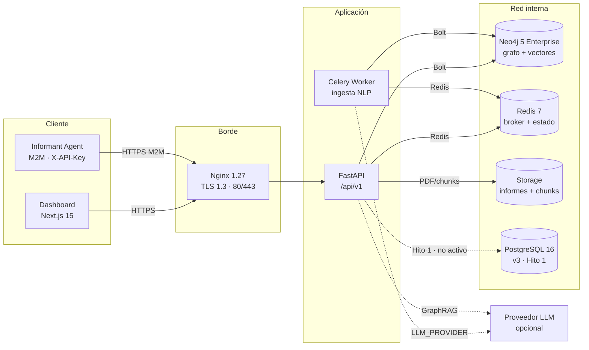
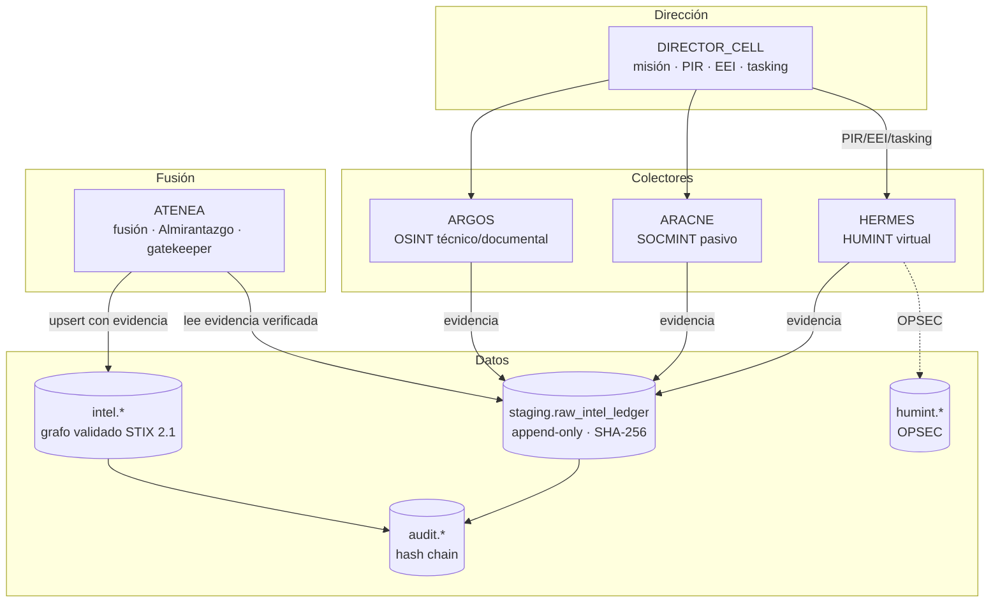
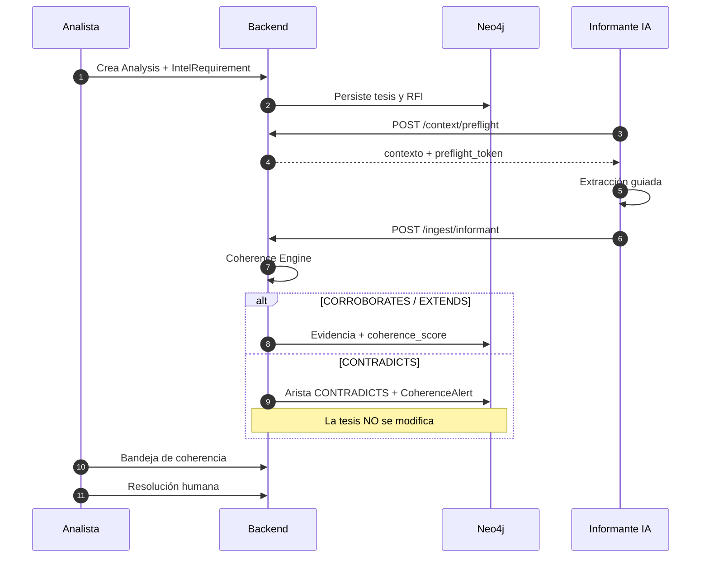

# Manual Técnico de la Aplicación

## OSINT Nexus Platform

**Documento:** Manual técnico de operación, arquitectura y mantenimiento  
**Versión del documento:** 1.0  
**Fecha de corte:** 2026-10-23  
**Estado:** Descriptivo. No sustituye a `SPEC.md`, `PLAN.md` ni a los contratos sellados.  
**Ámbito:** Plataforma v2.2 en producción + Hito 1 de la refactorización v3.0.

---

## Índice

1. [Resumen ejecutivo](#1-resumen-ejecutivo)
2. [Alcance y estado real del sistema](#2-alcance-y-estado-real-del-sistema)
3. [Arquitectura](#3-arquitectura)
4. [Inventario de componentes](#4-inventario-de-componentes)
5. [Requisitos e instalación local](#5-requisitos-e-instalación-local)
6. [Configuración y secretos](#6-configuración-y-secretos)
7. [Modelo de datos](#7-modelo-de-datos)
8. [API REST](#8-api-rest)
9. [Flujo de inteligencia e ingesta](#9-flujo-de-inteligencia-e-ingesta)
10. [Seguridad](#10-seguridad)
11. [Despliegue y operación](#11-despliegue-y-operación)
12. [Verificación, tests y calidad](#12-verificación-tests-y-calidad)
13. [Solución de problemas](#13-solución-de-problemas)
14. [Limitaciones conocidas y deuda técnica](#14-limitaciones-conocidas-y-deuda-técnica)
15. [Hoja de ruta](#15-hoja-de-ruta)
16. [Anexos](#16-anexos)

---

## 1. Resumen ejecutivo

**OSINT Nexus Platform** es una plataforma de inteligencia de fuentes abiertas
(OSINT/SOCMINT) con cuatro capacidades principales:

1. **Grafo de conocimiento** de entidades y relaciones con evidencia textual.
2. **Ingesta asistida por NLP/LLM** de informes PDF, TXT, Markdown y JSON.
3. **Motor de Coherencia Simbiótica**: la IA aporta evidencia y detecta
   contradicciones; el analista conserva la autoridad sobre la tesis.
4. **GraphRAG**: respuestas en lenguaje natural con citas verificables, nunca
   respuestas sin evidencia.

La versión **v2.2** es la que está implementada y operativa: backend FastAPI,
frontend Next.js, agente informante M2M, Neo4j 5 Enterprise, Redis, Celery y
Nginx. Su contrato OpenAPI está sellado en `v2.2.0`.

La versión **v3.0** es la arquitectura objetivo institucional: célula de agentes
`DIRECTOR_CELL` / `HERMES` / `ARACNE` / `ARGOS` / `ATENEA`, doble capa de datos
PostgreSQL 16 + pgvector (ledger append-only + grafo STIX 2.1), Almirantazgo,
TLP, RLS y OPSEC. En la fecha de corte solo está implementado el **Hito 1**
(contrato de base de datos, driver/repositorio PostgreSQL, ETL y tests de
aceptación), **pendiente de validación con Docker y de sello criptográfico**.

> **Regla de lectura:** todo lo marcado como “v3” o “Hito 1” es objetivo o
> implementación parcial. No debe asumirse que la API v3, el dual-write o el
> grafo PostgreSQL estén activos en producción.

---

## 2. Alcance y estado real del sistema

### 2.1 Qué está operativo

| Capacidad | Estado | Evidencia |
|---|---|---|
| API REST v2.2 (`/api/v1`, 29 operaciones) | Implementada | `contracts/openapi.yaml`, `apps/backend/app/api/v1/` |
| Autenticación JWT + refresh cookie | Implementada | `apps/backend/app/core/security.py`, `api/v1/auth.py` |
| 2FA TOTP para `ADMIN` | Implementada | `api/v1/auth.py`, `init-admin-user.py` |
| RBAC por rol y operación | Implementada | `app/core/rbac.py` |
| Ingesta asíncrona y WebSocket de progreso | Implementada | `api/v1/ingest.py`, `core/jobs.py`, `workers/` |
| Motor de coherencia | Implementado | `services/coherence_engine.py` |
| GraphRAG con citas | Implementado | `services/graphrag_engine.py`, `api/v1/search.py` |
| Dashboard Next.js (4 vistas + apoyo) | Implementado | `apps/frontend/` |
| Informante IA M2M | Implementado | `apps/informant-agent/` |
| Despliegue Docker Compose | Definido, no validado en VPS real | `deploy/docker-compose.prod.yml` |
| Contrato PostgreSQL v3 | Implementado como DRAFT, sin sellar | `contracts/v3/db-contract.sql` |
| API v3 (53 operaciones) | **No implementada** | Solo especificada en `SPEC.md` §9 |
| Dual-write Neo4j/PostgreSQL | **No implementado** | Entregable 1.9 pendiente |

### 2.2 Qué no debe asumirse

- Que `GRAPH_BACKEND=postgres` cambia el backend: la variable está declarada en
  `deploy/.env.example`, pero el código actual **no la consume**.
- Que la API `/api/v3` existe: no hay router v3 implementado.
- Que el contrato PostgreSQL está sellado: sigue en estado DRAFT y los tests
  Testcontainers no se han ejecutado contra un PostgreSQL real en este entorno.
- Que el proveedor LLM real está cableado: el código solo implementa
  `LLM_PROVIDER=null` (modo recuperación).

### 2.3 Audiencia

Este manual está dirigido a:

- **Operadores/SRE**: despliegue, backups, hardening, diagnóstico.
- **Analistas técnicos**: comprensión del flujo, API y modelo de datos.
- **Desarrolladores**: mantenimiento y evolución bajo SDD.
- **Auditores**: controles, trazabilidad, límites y evidencias.

---

## 3. Arquitectura

### 3.1 Vista lógica v2.2



**Decisiones clave**

- **Nginx es el único punto de entrada** y el único servicio con `ports:`
  publicados (`80`, `443`). Neo4j, Redis, PostgreSQL, backend, frontend,
  worker e informant-agent no publican puertos.
- **Neo4j y Redis viven en `internal_intel_net`**, una red Docker
  `internal: true` sin salida directa a Internet.
- **El frontend y el backend se comunican por la red interna**; el navegador
  solo habla con Nginx.
- **La base de datos nunca se expone** al cliente: toda lectura/escritura pasa
  por FastAPI con JWT/API Key, RBAC y, en v3, RLS/TLP.
- **El worker es dual-homed** (`public_net` + `internal_intel_net`) para poder
  llamar a un proveedor LLM externo manteniendo la base de datos aislada.

### 3.2 Arquitectura objetivo v3



**Topología de agentes**

| Agente | Responsabilidad | Permiso de escritura |
|---|---|---|
| `DIRECTOR_CELL` | Misión, PIR, EEI, tasking, cierre | `intel.missions/pirs/eeis/tasking_orders`, política OPSEC |
| `HERMES` | HUMINT virtual y SOCMINT conversacional | Solo ledger + `humint.*` |
| `ARACNE` | SOCMINT pasivo y grafos de red | Solo ledger |
| `ARGOS` | OSINT técnico y documental | Solo ledger |
| `ATENEA` | Fusión all-source, Almirantazgo, gatekeeper | **Único** que escribe el grafo validado |

La identidad de agente se deriva de `session_user` en PostgreSQL. El cliente no
puede declarar `collector_agent`; el contrato lo rechaza. Esta es la base del no
repudio.

### 3.3 Flujo de una petición

1. El cliente entra por Nginx (TLS 1.3).
2. Nginx aplica límites y cabeceras (`X-Real-IP`, `X-Request-ID`) y hace proxy a
   FastAPI o al frontend.
3. FastAPI resuelve identidad:
   - `Authorization: Bearer <JWT>` para humanos;
   - `X-API-Key` para el principal M2M `AI_INFORMANT`.
4. RBAC comprueba la operación (`operationId`) contra la matriz.
5. La ruta usa el gateway/repositorio correspondiente.
6. Se registra un evento JSON de auditoría en `osint.audit` y se devuelve
   `X-Request-ID`.
7. En v3, la transacción fija `osint.clearance` y `osint.break_glass` para RLS.
   Las políticas de tasking que usan `osint.agent` requieren que la capa API
   fije además esa variable; `X-Request-ID` es correlación, no contexto RLS.

---

## 4. Inventario de componentes

| Componente | Ruta | Tecnología | Función |
|---|---|---|---|
| Backend | `apps/backend` | Python 3.12, FastAPI, Pydantic v2 | API, RBAC, ingesta, coherencia, GraphRAG |
| Frontend | `apps/frontend` | Next.js 15, React 19, TypeScript, Tailwind, Cytoscape | Dashboard de 4 vistas |
| Informante IA | `apps/informant-agent` | Python, httpx, Pydantic, jsonschema | Recolección y extracción M2M |
| Neo4j | servicio `neo4j` | Neo4j 5 Enterprise | Grafo de conocimiento v2.2 |
| PostgreSQL | servicio `postgres` | PostgreSQL 16 + pgvector | Doble capa v3 (Hito 1) |
| Redis | servicio `redis` | Redis 7 | Broker Celery y estado de jobs |
| Worker | servicio `worker` | Celery 5 | Pipeline de ingesta asíncrono |
| Nginx | servicio `nginx` | Nginx 1.27 | TLS, proxy inverso, único puerto público |
| Storage | volumen `reports_data` | Volumen Docker | Informes crudos y chunks |
| CI v3 | `.github/workflows/v3-db.yml` | GitHub Actions | Tests Testcontainers PostgreSQL |
| Gobernanza | `SPEC.md`, `PLAN.md`, `AUDIT.md`, `contracts/` | SDD | Especificación, plan, auditoría y sellos |

### 4.1 Backend: módulos principales

| Módulo | Responsabilidad |
|---|---|
| `app/main.py` | Factoría FastAPI, montaje `/api/v1`, manejadores de error, auditoría |
| `app/api/router.py` | Agregación de routers |
| `app/api/v1/*.py` | Endpoints del contrato |
| `app/api/deps.py` | Identidad, API Key, stores, composición de servicios |
| `app/core/config.py` | Configuración por entorno y validaciones de seguridad |
| `app/core/rbac.py` | Roles, permisos y matriz endpoint → rol |
| `app/core/security.py` | Argon2id, JWT, refresh tokens |
| `app/core/users.py` | Directorio de operadores (`OSINT_USERS_JSON`) |
| `app/core/apikeys.py` | API Keys M2M (`OSINT_API_KEYS_JSON`) |
| `app/core/audit.py` | Bitácora JSON y `X-Request-ID` |
| `app/core/documents.py` | Almacenamiento y extracción de páginas |
| `app/core/jobs.py` | Estado de jobs en Redis/memoria |
| `app/services/nlp_extractor.py` | Pipeline NLP |
| `app/services/preflight.py` | Fase 0 y token HMAC |
| `app/services/coherence_engine.py` | Vínculos analíticos |
| `app/services/graphrag_engine.py` | GraphRAG con citas |
| `app/services/llm_client.py` | Fábrica de proveedor LLM |
| `app/db/repository.py` | Repositorio Neo4j v2.2 |
| `app/db/postgres_repository.py` | Repositorio PostgreSQL v3 (Hito 1) |
| `app/db/postgres_driver.py` | Pool, DSN y contexto RLS |
| `app/workers/tasks.py` | Tarea Celery de ingesta |

### 4.2 Frontend: vistas

| Vista | Componente | Función |
|---|---|---|
| Grafo interactivo | `components/graph/*` | Cytoscape, filtros, timeline, vecindad |
| Dossier Split-View | `components/dossier/*` | Ficha, informe, citas, PDF |
| Workspace de análisis | `components/analysis/*` | Tesis, RFI, evidencias, coherencia |
| Bandeja de coherencia | `components/coherence/*` | Alertas y resolución humana |
| Ingesta | `components/ingest/*` | Drag & drop y progreso |
| Consola GraphRAG | `components/search/*` | Consulta y citas |

El cliente API está en `src/services/api.ts`. Los tipos se generan desde
`contracts/openapi.yaml` con `npm run gen:api`.

### 4.3 Informante IA

- Cliente M2M con `X-API-Key`.
- Flujo obligatorio: `preflight → extraer → validar → ingerir`.
- Formatos de fuente: `*.json` y `*.txt` (recolectores locales).
- Valida contra `contracts/extraction-schema.json`.
- **Nunca** escribe en Neo4j/Redis/PostgreSQL: solo llama a la API.
- Rechaza la ingesta si no hay `preflight_token`; no emite la petición.

---

## 5. Requisitos e instalación local

### 5.1 Prerrequisitos

| Requisito | Versión mínima | Uso |
|---|---|---|
| Python | 3.12 | Backend, informante, scripts |
| Node.js | 20 | Frontend |
| npm | Incluido con Node | Dependencias frontend |
| Docker | Engine 24+ / Docker Desktop | Neo4j, Redis, PostgreSQL, tests v3 |
| Docker Compose | v2 | Stack de producción |
| Neo4j | 5 Enterprise | Grafo v2.2 |
| Redis | 7 | Broker/estado |
| PostgreSQL | 16 + pgvector | Solo Hito 1 v3 |

> Neo4j Enterprise es obligatorio para el contrato v2.2 porque usa constraints
> de existencia de propiedades (`REQUIRE ... IS NOT NULL`), no disponibles en
> Community. La imagen de referencia es `neo4j:5-enterprise`.

### 5.2 Backend

```bash
cd apps/backend
python -m venv .venv

# Windows
.venv\Scripts\activate

# Linux/macOS
source .venv/bin/activate

pip install -r requirements.txt -r requirements-dev.txt
uvicorn app.main:app --reload --port 8000
```

API interactiva: <http://localhost:8000/docs>

Variables mínimas para arrancar en desarrollo:

```bash
ENVIRONMENT=development
JWT_SECRET_KEY=<cadena aleatoria larga>
NEO4J_URI=bolt://localhost:7687
NEO4J_USER=neo4j
NEO4J_PASSWORD=<password>
REDIS_URL=redis://localhost:6379/0
LLM_PROVIDER=null
STORAGE_RAW_DIR=./storage/raw_reports
STORAGE_CHUNKS_DIR=./storage/processed_chunks
```

Sin `JWT_SECRET_KEY`, en desarrollo se genera una clave efímera y se emite un
`RuntimeWarning`; en producción el arranque falla.

### 5.3 Neo4j y Redis en desarrollo

```bash
docker run -d --name osint-neo4j \
  -p 7474:7474 -p 7687:7687 \
  -e NEO4J_AUTH=neo4j/CHANGE_ME \
  -e NEO4J_PLUGINS='["apoc"]' \
  -e NEO4J_ACCEPT_LICENSE_AGREEMENT=yes \
  neo4j:5-enterprise

docker run -d --name osint-redis -p 6379:6379 redis:7-alpine
```

Aplicar constraints (idempotente):

```bash
docker exec -i osint-neo4j cypher-shell -u neo4j -p CHANGE_ME \
  < contracts/graph-constraints.cypher
```

> Estos puertos son solo para desarrollo. En producción no se publican.

### 5.4 Frontend

```bash
cd apps/frontend
npm install
npm run gen:api
npm run dev
```

- URL: <http://localhost:3000>
- `NEXT_PUBLIC_API_BASE_URL` vacío ⇒ el cliente usa `/api/v1` (mismo origen).
- `BACKEND_ORIGIN=http://localhost:8000` permite el rewrite de Next en desarrollo.

### 5.5 Informante IA

```bash
cd apps/informant-agent
pip install -r requirements.txt

python -m informant_agent run \
  --source-dir ./fuentes \
  --base-url http://localhost:8000/api/v1 \
  --api-key "$INFORMANT_API_KEY"
```

Para extracción sin red:

```bash
python -m informant_agent extract --source-dir ./fuentes
```

### 5.6 PostgreSQL v3 (Hito 1, opcional)

Requisitos:

- Imagen `pgvector/pgvector:pg16`.
- Extensiones `pgcrypto`, `vector`, `btree_gist`, `pg_trgm`.

Arranque con Docker Compose:

```bash
docker compose -f deploy/docker-compose.prod.yml up -d postgres
```

En un volumen **nuevo**, el contrato se aplica automáticamente mediante
`docker-entrypoint-initdb.d/10-db-contract.sql`. En un volumen existente, aplicar
una sola vez:

```bash
docker compose -f deploy/docker-compose.prod.yml exec -T postgres \
  psql -U "${POSTGRES_USER:-osint_owner}" -d "${POSTGRES_DB:-osint}" \
  -v ON_ERROR_STOP=1 < contracts/v3/db-contract.sql
```

> El contrato **no es idempotente** para tipos y roles. No lo reapliques sobre
> una base ya inicializada sin revisar el estado. Para pruebas, usa un volumen
> limpio o Testcontainers.

Tests de aceptación v3:

```bash
cd apps/backend
python -m pytest tests/v3/db -q
```

Requieren Docker/Testcontainers. Un `skip` no cuenta como aceptación.

---

## 6. Configuración y secretos

### 6.1 Variables del backend

| Variable | Defecto | Descripción |
|---|---|---|
| `ENVIRONMENT` | `development` | `production`/`prod`/`staging` activan validaciones estrictas |
| `JWT_SECRET_KEY` | vacío | Secreto HMAC del JWT. Obligatorio en producción |
| `JWT_ALGORITHM` | `HS256` | Algoritmo JWT |
| `ACCESS_TOKEN_EXPIRE_MINUTES` | `15` | Máximo normativo 15 |
| `REFRESH_TOKEN_EXPIRE_DAYS` | `7` | Máximo normativo 7 |
| `COOKIE_SECURE` | `true` | Cookie de refresh solo HTTPS |
| `ADMIN_TOTP_REQUIRED` | `true` | 2FA obligatorio para ADMIN |
| `LOGIN_MAX_FAILURES` | `5` | Fallos antes de bloqueo |
| `LOGIN_WINDOW_SECONDS` | `900` | Ventana de bloqueo |
| `TRUST_PROXY_HEADERS` | `false` | Confiar en `X-Real-IP` solo detrás de Nginx |
| `ARGON2_TIME_COST` | `3` | Coste Argon2id |
| `ARGON2_MEMORY_COST` | `65536` | Memoria Argon2id (KiB) |
| `NEO4J_URI` | `bolt://localhost:7687` | URI Neo4j |
| `NEO4J_USER` | `neo4j` | Usuario Neo4j |
| `NEO4J_PASSWORD` | vacío | Password Neo4j |
| `REDIS_URL` | `redis://localhost:6379/0` | Redis |
| `EXTRACTION_CONFIDENCE_THRESHOLD` | `0.50` | Umbral de auto-aceptación |
| `STORAGE_RAW_DIR` | `/storage/raw_reports` | Informes crudos |
| `STORAGE_CHUNKS_DIR` | `/storage/processed_chunks` | Chunks procesados |
| `PREFLIGHT_SECRET` | efímero | Secreto HMAC del token de preflight |
| `CELERY_BROKER_URL` | vacío | Broker Celery; si falta, usa `REDIS_URL` |
| `OSINT_USERS_JSON` | vacío | Operadores y hashes Argon2id |
| `OSINT_API_KEYS_JSON` | vacío | API Keys M2M hasheadas |
| `LLM_PROVIDER` | `null` | Proveedor LLM; actualmente solo `null` está cableado |
| `POSTGRES_DSN` | vacío | DSN PostgreSQL v3 |
| `GRAPH_BACKEND` | `neo4j` | Declarado en `.env.example`; **no consumido aún** |

### 6.2 Variables de despliegue

Además de las anteriores:

| Variable | Descripción |
|---|---|
| `PUBLIC_HOSTNAME` | Dominio público sin `https://` |
| `NEO4J_ACCEPT_LICENSE_AGREEMENT` | `yes` para Neo4j Enterprise |
| `POSTGRES_DB` | Base PostgreSQL (`osint`) |
| `POSTGRES_USER` | Owner (`osint_owner`) |
| `POSTGRES_PASSWORD` | Password del owner |
| `INFORMANT_API_KEY` | API Key M2M en claro para el job |
| `INFORMANT_API_BASE_URL` | Base de la API para el informante |
| `INFORMANT_SOURCE_DIR` | Directorio de fuentes |
| `WORKER_CONCURRENCY` | Concurrencia del worker |
| `BACKUP_DIR` | Destino de backups cifrados |
| `BACKUP_PASSPHRASE_FILE` | Fichero 0600 con la frase GPG |
| `BACKUP_RETENTION_DAYS` | Retención (30) |

### 6.3 Variables del frontend

| Variable | Uso |
|---|---|
| `NEXT_PUBLIC_API_BASE_URL` | Base absoluta de la API; vacío ⇒ `/api/v1` mismo origen |
| `BACKEND_ORIGIN` | Destino del rewrite de Next en desarrollo |

> El compose de producción no define variables `NEXT_PUBLIC_*`: el cliente usa
> el fallback same-origin `/api/v1`, que es el previsto detrás de Nginx.

### 6.4 Variables del informante

| Variable | Defecto | Uso |
|---|---|---|
| `INFORMANT_API_BASE_URL` | `http://localhost:8000` | Base de la API |
| `INFORMANT_API_KEY` | — | API Key M2M obligatoria |
| `INFORMANT_SOURCE_DIR` | — | Directorio de fuentes |
| `INFORMANT_TIMEOUT` | `30` | Timeout HTTP |
| `INFORMANT_CONTRACT_SCHEMA` | autodetectado | Ruta al schema de extracción |

### 6.5 Gestión de secretos

- Nunca versionar `deploy/.env` ni claves en claro.
- Generar secretos en el host:

```bash
python3 - <<'PY'
import secrets
print("JWT_SECRET_KEY=" + secrets.token_urlsafe(64))
print("PREFLIGHT_SECRET=" + secrets.token_urlsafe(48))
print("NEO4J_PASSWORD=" + secrets.token_urlsafe(32))
print("POSTGRES_PASSWORD=" + secrets.token_urlsafe(32))
print("INFORMANT_API_KEY=" + secrets.token_urlsafe(32))
PY
```

- El backend no tiene credenciales por defecto: sin `OSINT_USERS_JSON` /
  `OSINT_ADMIN_*`, todo login responde `401`.
- Sin `OSINT_API_KEYS_JSON`, toda petición M2M responde `401`.
- Los roles `svc_*` de PostgreSQL se crean con `PASSWORD NULL`; las contraseñas
  se inyectan desde el gestor de secretos.
- No reutilices el DSN del owner para los agentes. `PostgresRepository` recibe
  el DSN por constructor: usa `svc_hermes` para el ledger y `svc_atenea` para el
  grafo validado, de modo que `session_user` sea la identidad efectiva.

---

## 7. Modelo de datos

### 7.1 Modelo v2.2 (Neo4j)

**Labels (9):**

`Person`, `Organization`, `CyberAsset`, `Location`, `Event`, `Report`,
`Analysis`, `IntelRequirement`, `CoherenceAlert`.

**Relaciones OSINT (7):**

`CONTROLS`, `FINANCED`, `USES_ASSET`, `LOCATED_AT`, `ASSOCIATED_WITH`,
`PARTICIPATED_IN`, `MENTIONED_IN`.

**Relaciones de coherencia/análisis (9):**

`INVESTIGATES`, `HAS_REQUIREMENT`, `CITES_ANALYSIS`, `CORROBORATES`,
`CONTRADICTS`, `EXTENDS`, `ANSWERS_REQUIREMENT`, `RAISED_FOR`, `ABOUT`.

**Reglas clave:**

- `id` es la clave de `MERGE`; nunca se hace `MERGE` sobre propiedades mutables.
- Toda arista OSINT lleva: `confidence`, `source_report_id`, `exact_quote`,
  `text_evidence_span`, `page_number`, `first_seen`, `last_seen`,
  `locked_by_analyst`.
- `locked_by_analyst=true` impide que un proceso automático sobrescriba el
  nodo/arista. La API responde `409 CONFLICT`.
- El contrato de constraints e índices es `contracts/graph-constraints.cypher`
  v2.1.0.

### 7.2 Modelo v3 (PostgreSQL)

**Doble capa**

1. **Capa 1 — evidencia cruda inmutable**
   - `staging.raw_intel_ledger`
   - `staging.raw_intel_attachments`
   - Conserva bytes exactos, `payload_sha256`, `prev_hash`, `record_hash`,
     `collector_agent`, TLP, retención y `legal_hold`.

2. **Capa 2 — grafo validado STIX 2.1**
   - `intel.intel_entities`
   - `intel.intel_relationships`
   - `intel.evidence_links` (FK a evidencia)
   - `intel.entity_aliases`, `entity_resolution_candidates`, `coherence_alerts`
   - `intel.missions`, `pirs`, `eeis`, `tasking_orders`
   - `intel.intelligence_reports`, `dissemination`, `agent_registry`

**Compartimento HUMINT**

`humint.sockpuppets`, `legends`, `interactions`, `deception_assessments`,
`psych_profiles`, `opsec_policies`, `opsec_events`.

**Auditoría**

`audit.events` (hash chain) y `audit.agent_runs`.

**Esquemas**

`staging`, `intel`, `humint`, `audit`, `api`.

### 7.3 Invariantes v3

| ID | Invariante |
|---|---|
| I-01 | El ledger es append-only: `UPDATE`, `DELETE` y `TRUNCATE` bloqueados |
| I-02 | `payload_sha256` = SHA-256 de los bytes exactos |
| I-03 | Toda entidad/relación validada tiene ≥ 1 evidencia existente |
| I-04 | Almirantazgo `[A-F][1-6]` y confianza 0–100 |
| I-05 | `valid_until > valid_from` o `NULL` |
| I-06 | No se borra: se revoca |
| I-07 | El TLP no se degrada sin autorización auditada |
| I-08 | `collector_agent` se deriva del rol DB, no del payload |

### 7.4 Funciones de escritura

Las tablas base no conceden `INSERT/UPDATE` directo a los roles de agente. La
única puerta de escritura son funciones `SECURITY DEFINER`:

| Función | Uso |
|---|---|
| `staging.append_evidence(...)` | Inserta evidencia con hash, cadena e idempotencia |
| `intel.upsert_entity(...)` | Crea/actualiza entidad con evidencia |
| `intel.upsert_relationship(...)` | Crea/actualiza relación con evidencia |
| `intel.revoke_entity(...)` / `revoke_relationship(...)` | Revocación lógica |
| `intel.resolve_candidate(...)` | Aceptar/rechazar fusión |
| `intel.admiralty_confidence(...)` | Cálculo base Almirantazgo |
| `intel.recalculate_confidence(...)` | Recalcula con corroboración/contradicción |
| `audit.log_event(...)` | Evento de auditoría con hash chain |
| `humint.check_opsec(...)` | `ALLOW` / `ABORT` / `ESCALATE` |
| `api.search_hybrid(...)` | Búsqueda BM25 + vectorial + RRF |
| `intel.create_coherence_alert(...)` | Alerta de contradicción/engaño |
| `intel.create_resolution_candidate(...)` | Candidato de fusión |

### 7.5 STIX 2.1

| Entidad | `stix_type` |
|---|---|
| Persona | `identity` (`identity_class=individual`) |
| Organización | `identity` (`identity_class=organization`) |
| Avatar/sockpuppet | `user-account` |
| Threat actor | `threat-actor` |
| Infraestructura/selector | `infrastructure` + SCO |
| Localización | `location` |
| Evento/incidente | `x-osint-event` (extensión) |
| Informe | `report` |
| Observación | `observed-data` |
| Anotación | `note` / `opinion` |
| Relación | `relationship` |

Selectores: `domain-name`, `ipv4-addr`, `ipv6-addr`, `email-addr`,
`user-account`, `x-osint-phone`, `x-osint-wallet`.

### 7.6 Almirantazgo y confianza

```
confidence_base = round(0.60 * source_points + 0.40 * info_points)
confidence = clamp(
    confidence_base
    + min(10, 5 * independent_sources)
    - min(30, 15 * high_severity_contradictions),
    0, 100
)
```

| Fuente | Puntos | Información | Puntos |
|---|---:|---|---:|
| A | 100 | 1 | 100 |
| B | 80 | 2 | 80 |
| C | 60 | 3 | 60 |
| D | 40 | 4 | 40 |
| E | 20 | 5 | 20 |
| F | 10 | 6 | 10 |

Un analista puede hacer override con motivo; se audita y se marca
`x_confidence_override=true`.

### 7.7 Modelo temporal

- `valid_from` / `valid_until`: validez de la aserción.
- `first_seen_at` / `last_seen_at`: observación.
- `captured_at_utc`: captura.
- `ingested_at`: inserción en ledger.

Una nueva aserción que contradiga otra en el mismo intervalo **no se inserta**:
se crea `CoherenceAlert` y se resuelve humanamente.

### 7.8 Retención y minimización

| Dato | Retención por defecto | Excepción |
|---|---|---|
| Evidencia cruda | 5 años | `legal_hold` bloquea la purga |
| PII en evidencia | 90 días (minimizada) | Base legal específica |
| Entidades/relaciones | 10 años | Misión cerrada + revisión |
| Transcripciones `humint` | 2 años | `legal_hold` / investigación |
| Auditoría | 7 años | Requisito legal |
| Embeddings | Ligados a la entidad | Se eliminan con la entidad revocada |

La purga solo puede ejecutarla un job `SECURITY DEFINER` con rol
`osint_graph_owner`, auditado, y **nunca** sobre filas con `legal_hold=true`,
`revoked=false` o evidencia enlazada.

### 7.9 Migración Neo4j → PostgreSQL

Script: `scripts/migrate/neo4j_to_pg.py`.

```bash
python scripts/migrate/neo4j_to_pg.py export --out storage/migration
python scripts/migrate/neo4j_to_pg.py load \
  --nodes storage/migration/nodes.jsonl \
  --edges storage/migration/edges.jsonl \
  --owner-dsn "$POSTGRES_DSN_OWNER" \
  --atenea-dsn "$POSTGRES_DSN_ATENEA"
python scripts/migrate/neo4j_to_pg.py reconcile --owner-dsn "$POSTGRES_DSN_OWNER"
```

Garantías:

- No borra Neo4j.
- Cada nodo/arista genera evidencia con `collector_agent='MIGRATION_LEGACY'`,
  SHA-256 y cadena de custodia.
- Lo no mapeable va a `staging.migration_quarantine`; no se inventan datos.
- `staging.migration_reconciliation` registra conteos y detalles.
- La carga es secuencial para preservar la cadena.

Límites: `Report`, `Analysis`, `IntelRequirement`, `CoherenceAlert`, `User` y
`ApiKey` no son entidades STIX y se cuarentenan; el mapeo legacy es conservador.

---

## 8. API REST

### 8.1 Convenciones

| Elemento | Valor |
|---|---|
| Base | `/api/v1` |
| Formato | JSON UTF-8 |
| Auth humana | `Authorization: Bearer <JWT>` |
| Auth M2M | `X-API-Key` |
| Refresh | Cookie `HttpOnly` + `Secure`, path `/api/v1/auth` |
| Correlación | `X-Request-ID` |
| Errores | `{"error": {"code": "...", "message": "..."}}` |
| Documentación | `/docs` (Swagger UI) |
| Contrato | `contracts/openapi.yaml` v2.2.0, 29 `operationId` |

### 8.2 Catálogo de operaciones

| Grupo | Método y ruta | `operationId` | Roles |
|---|---|---|---|
| Auth | `POST /auth/login` | `authLogin` | Público |
| Auth | `POST /auth/refresh` | `authRefresh` | Humano autenticado |
| Auth | `POST /auth/logout` | `authLogout` | Humano autenticado |
| Auth | `GET /auth/me` | `authMe` | Humano autenticado |
| Grafo | `GET /graph/nodes` | `listGraphNodes` | ADMIN, ANALYST, VIEWER |
| Grafo | `GET /graph/nodes/{id}` | `getGraphNode` | ADMIN, ANALYST, VIEWER |
| Grafo | `PUT /graph/nodes/{id}` | `updateGraphNode` | ADMIN, ANALYST |
| Grafo | `DELETE /graph/nodes/{id}` | `deleteGraphNode` | ADMIN |
| Grafo | `POST /graph/nodes/{id}/lock` | `lockGraphNode` | ADMIN, ANALYST |
| Grafo | `GET /graph/edges` | `listGraphEdges` | ADMIN, ANALYST, VIEWER |
| Grafo | `GET /graph/neighborhood/{id}` | `getGraphNeighborhood` | ADMIN, ANALYST, VIEWER |
| Coherencia | `POST /context/preflight` | `postContextPreflight` | ADMIN, ANALYST, AI_INFORMANT |
| Ingesta | `POST /ingest` | `createIngestJob` | ADMIN, ANALYST |
| Ingesta | `POST /ingest/informant` | `createInformantIngestJob` | AI_INFORMANT |
| Ingesta | `GET /ingest/{job_id}` | `getIngestJob` | ADMIN, ANALYST, VIEWER |
| Ingesta | `WS /ingest/{job_id}/ws` | `ingestProgressWs` | ADMIN, ANALYST, VIEWER |
| Informes | `GET /reports/{id}` | `getReport` | ADMIN, ANALYST, VIEWER |
| Informes | `GET /reports/{id}/file` | `getReportFile` | ADMIN, ANALYST, VIEWER |
| Informes | `GET /reports/{id}/chunks` | `getReportChunks` | ADMIN, ANALYST, VIEWER |
| Análisis | `GET /analyses` | `listAnalyses` | ADMIN, ANALYST, VIEWER |
| Análisis | `POST /analyses` | `createAnalysis` | ADMIN, ANALYST |
| Análisis | `GET /analyses/{id}` | `getAnalysis` | ADMIN, ANALYST, VIEWER |
| Análisis | `PUT /analyses/{id}` | `updateAnalysis` | ADMIN, ANALYST |
| Análisis | `POST /analyses/{id}/requirements` | `createIntelRequirement` | ADMIN, ANALYST |
| Análisis | `GET /analyses/{id}/requirements` | `listAnalysisRequirements` | ADMIN, ANALYST, VIEWER |
| Coherencia | `GET /coherence/alerts` | `listCoherenceAlerts` | ADMIN, ANALYST |
| Coherencia | `PATCH /coherence/alerts/{alert_id}/resolve` | `resolveCoherenceAlert` | ADMIN, ANALYST |
| Búsqueda | `POST /search/rag` | `searchRag` | ADMIN, ANALYST, VIEWER |
| Sistema | `GET /info` | `getInfo` | Público |

> `AI_INFORMANT` **no** puede leer el grafo. Su superficie es el preflight y la
> ingesta M2M. La tabla resumen del README que marca lectura de grafo para
> `AI_INFORMANT` no coincide con la matriz ejecutable de `app/core/rbac.py`.

### 8.3 Autenticación

**Login**

```http
POST /api/v1/auth/login
Content-Type: application/json

{
  "username": "admin",
  "password": "********",
  "totp_code": "123456"
}
```

Respuesta:

```json
{
  "access_token": "<JWT>",
  "token_type": "bearer",
  "expires_in": 900
}
```

- Access token: 15 minutos.
- Refresh token: cookie `osint_refresh_token`, `HttpOnly`/`Secure`, 7 días.
- Los datos del operador se consultan con `GET /auth/me`; no vienen en el
  `TokenResponse`.
- `ADMIN` sin TOTP es rechazado si `ADMIN_TOTP_REQUIRED=true`.
- 5 fallos en 15 minutos por `(IP, usuario)` ⇒ `429` con `Retry-After`.
- Nginx añade un límite adicional de 10 req/min con burst 5 en `/auth/login`.

**Uso**

```http
GET /api/v1/graph/nodes?limit=50
Authorization: Bearer <JWT>
```

**Refresh**

```http
POST /api/v1/auth/refresh
Cookie: osint_refresh_token=...
```

### 8.4 Preflight e ingesta M2M

**Paso 1 — Preflight**

```http
POST /api/v1/context/preflight
X-API-Key: <clave M2M>
Content-Type: application/json

{
  "keywords": ["Acme Corp", "State Bank"],
  "entity_hints": ["Acme"]
}
```

Devuelve `preflight_token`, análisis activos, RFIs y entidades canónicas. El
token es HMAC-SHA256 y caduca a los 15 minutos.

**Paso 2 — Ingesta**

```http
POST /api/v1/ingest/informant
X-API-Key: <clave M2M>
X-Preflight-Token: <token>
Content-Type: multipart/form-data

file=<informe>
payload=<JSON validado>
```

- Sin token o con token caducado ⇒ `409 CONFLICT`.
- Respuesta `202 Accepted` con `job_id`, `status`, `progress`, `pending_review`.

**Paso 3 — Progreso**

```http
GET /api/v1/ingest/{job_id}
Authorization: Bearer <JWT>
```

o WebSocket:

```
WS /api/v1/ingest/{job_id}/ws
```

Estados: `QUEUED`, `PROCESSING`, `DONE`, `FAILED`.

### 8.5 Ingesta humana

```http
POST /api/v1/ingest
Authorization: Bearer <JWT>
Content-Type: multipart/form-data

file=<PDF/TXT/MD/JSON>
title=<título>
```

- Rol mínimo: `ANALYST`.
- Formatos: `.pdf`, `.txt`, `.md`, `.markdown`, `.json`.
- Tamaño máximo de body en Nginx: 100 MB.
- El archivo se guarda como `{report_id}{ext}`; el nombre original se descarta.
- La subida responde `202` y no bloquea.

### 8.6 GraphRAG

```http
POST /api/v1/search/rag
Authorization: Bearer <JWT>
Content-Type: application/json

{
  "query": "¿Qué relación existe entre Acme y State Bank?"
}
```

Respuesta:

```json
{
  "answer": "...",
  "subgraph": {
    "nodes": [],
    "edges": []
  },
  "citations": [
    {
      "report_id": "uuid",
      "page_number": 3,
      "exact_quote": "State Bank financed Acme Corp in 2021."
    }
  ]
}
```

Regla dura: si no hay evidencia verificable, no se fabrica una respuesta. La API
devuelve un `answer` explícito de “sin evidencia” y `citations: []`, o `503` si
el motor no está compuesto.

### 8.7 Errores

```json
{
  "error": {
    "code": "CONFLICT",
    "message": "Se requiere un preflight_token vigente."
  }
}
```

| Código HTTP | `code` | Uso |
|---:|---|---|
| 400 | `BAD_REQUEST` | Petición malformada |
| 401 | `UNAUTHORIZED` | Sin credenciales o inválidas |
| 403 | `FORBIDDEN` | Rol/agente sin permiso |
| 404 | `NOT_FOUND` | Recurso inexistente |
| 409 | `CONFLICT` | Preflight ausente, nodo bloqueado |
| 422 | `VALIDATION_ERROR` | Esquema inválido |
| 429 | `TOO_MANY_REQUESTS` | Límite de login |
| 503 | `SERVICE_UNAVAILABLE` | Grafo/LLM/Redis no disponible |
| 500 | `INTERNAL_ERROR` | Error no controlado |

---

## 9. Flujo de inteligencia e ingesta

### 9.1 Ciclo simbiótico



### 9.2 Fases

| Fase | Qué ocurre | Garantía |
|---|---|---|
| 0 · Preflight | Análisis activos, RFIs, entidades canónicas | Sin token no hay ingesta |
| 1 · Extracción | Tripletas + vínculos con `exact_quote` y página | Se descarta cita no literal |
| 2 · Coherencia | `CORROBORATES`, `CONTRADICTS`, `EXTENDS`, `ANSWERS_REQUIREMENT` | `CONTRADICTS` crea alerta; no sobrescribe tesis |
| 3 · Decisión | Analista resuelve | Autoridad humana |

### 9.3 Vínculos

| `link_category` | Efecto |
|---|---|
| `CORROBORATES` | Añade evidencia y sube `coherence_score` |
| `CONTRADICTS` | Crea arista y `CoherenceAlert` |
| `EXTENDS` | Amplía el análisis |
| `ANSWERS_REQUIREMENT` | Vincula evidencia con un RFI |

### 9.4 Pipeline NLP

```
preflight → chunk → extract → validate → coherence → resolve → persist
```

- `chunking.py`: divide por páginas conservando offsets.
- `nlp_extractor.py`: extrae y valida contra `contracts/extraction-schema.json`.
- Umbral `0.50`: por debajo, `PENDING_HUMAN_REVIEW`; no impacta el grafo.
- `entity_resolver.py`: resuelve entidades canónicas y fusiones.
- `coherence_engine.py`: aplica vínculos analíticos.
- Persistencia en Neo4j v2.2; en v3 será el ledger + grafo validado.

### 9.5 Ingesta asíncrona

- Si hay `CELERY_BROKER_URL` o `REDIS_URL`, la API encola
  `osint.workers.ingest_report`.
- Si no hay broker o Celery, usa `BackgroundTasks` y mantiene el estado en el
  registro de jobs.
- Redis guarda `osint:ingest:job:{job_id}` con TTL 24 h.
- Si Redis cae, el registro mantiene un espejo local; el WebSocket sigue
  funcionando en el mismo proceso.

---

## 10. Seguridad

### 10.1 Roles y permisos

| Capacidad | ADMIN | ANALYST | VIEWER | AI_INFORMANT |
|---|:---:|:---:|:---:|:---:|
| Login interactivo | Sí | Sí | Sí | No |
| Leer grafo/informes/análisis | Sí | Sí | Sí | No |
| Crear/editar análisis y RFI | Sí | Sí | No | No |
| Bloquear nodo | Sí | Sí | No | No |
| Borrar nodo | Sí | No | No | No |
| Ingesta humana | Sí | Sí | No | No |
| Preflight | Sí | Sí | No | Sí |
| Ingesta M2M | No | No | No | Sí |
| Resolver coherencia | Sí | Sí | No | No |
| Administración | Sí | No | No | No |

La UI solo **oculta** acciones; la seguridad real está en el backend.

### 10.2 Controles

| Control | Implementación |
|---|---|
| Contraseñas | Argon2id (time cost 3, 64 MiB) |
| Sesión | JWT 15 min + refresh 7 días en cookie HttpOnly/Secure |
| 2FA | TOTP obligatorio para ADMIN, anti-repetición |
| Fuerza bruta | 5/15 min + Nginx 10 r/min + `429` |
| M2M | API Key con hash Argon2id y ámbito `AI_INFORMANT` |
| Ingesta ciega | `X-Preflight-Token` HMAC obligatorio |
| Inmutabilidad | `locked_by_analyst` ⇒ `409` |
| Aislamiento | DB/Redis sin puertos; solo Nginx 80/443 |
| Auditoría | Evento JSON por petición + `X-Request-ID` |
| Hardening | UFW, fail2ban, SSH endurecido |
| Secretos | Variables de entorno, sin defaults inseguros |

### 10.3 Auditoría

- Logger `osint.audit`, salida JSON a stdout.
- Un evento `http_request` por petición a `/api/v1`.
- Eventos `auth` con `SUCCESS`, `FAILURE` o `LOCKED`.
- Campos: `timestamp`, `request_id`, `actor_id`, `actor_role`, método, ruta,
  `resource_id`, status, duración, IP.
- **No** se registran cuerpo, query string, cookies ni cabeceras de credenciales.
- `X-Request-ID` se reutiliza si es seguro; si no, se genera UUID4.
- En v3, `audit.events` añade hash chain y `audit.agent_runs`.

### 10.4 OPSEC v3

- `humint.check_opsec(...)` se ejecuta antes de cada interacción.
- Veredictos: `ALLOW`, `ABORT`, `ESCALATE`.
- Una violación **aborta** la acción y genera `humint.opsec_events`; no se
  degrada a warning.
- El compartimento `humint` no es accesible para ATENEA/API.
- Políticas: límite de interacciones/día, mensajes por objetivo, temas
  prohibidos y reglas de exposición.

### 10.5 Hardening del VPS

```bash
sudo bash deploy/scripts/vps-hardening.sh
```

- UFW: solo 22/80/443; `deny incoming`.
- Fail2ban sobre SSH.
- SSH sin login por contraseña, sin root con contraseña.
- Ejecutar al final, cuando ya se acceda con clave pública.

---

## 11. Despliegue y operación

### 11.1 Arquitectura desplegada

| Servicio | Imagen | Red | Puertos | Rol |
|---|---|---|---|---|
| `nginx` | `nginx:1.27-alpine` | `public_net` | **80, 443** | Único entrada TLS |
| `frontend` | build `apps/frontend` | `public_net` | — | Dashboard |
| `backend` | build `apps/backend` | `public_net` + `internal_intel_net` | — | FastAPI |
| `worker` | build `apps/backend` | `public_net` + `internal_intel_net` | — | Celery |
| `informant-agent` | build `informant-agent` | `internal_intel_net` | — | Job M2M |
| `neo4j` | `neo4j:5-enterprise` | `internal_intel_net` | — | Grafo |
| `redis` | `redis:7-alpine` | `internal_intel_net` | — | Broker/estado |
| `postgres` | `pgvector/pgvector:pg16` | `internal_intel_net` | — | v3 Hito 1 |

Comprobación de aislamiento:

```bash
docker compose -f deploy/docker-compose.prod.yml config | grep -c '^ *ports:'
# => 1
```

### 11.2 Prerrequisitos del VPS

- 4 vCPU, 8 GB RAM, 40 GB SSD.
- Docker Engine ≥ 24 con Compose v2.
- Dominio con registro A.
- Puertos 22, 80, 443 abiertos.
- `git`, `curl`, `python3`, `gpg` para backups.

### 11.3 TLS

Nginx espera:

```
deploy/nginx/certs/fullchain.pem
deploy/nginx/certs/privkey.pem
```

Let's Encrypt:

```bash
sudo apt-get install -y certbot
mkdir -p deploy/nginx/webroot deploy/nginx/certs

sudo certbot certonly --webroot -w "$PWD/deploy/nginx/webroot" \
  -d osint-nexus.example.com --agree-tos -m tu@correo.tld --non-interactive

sudo cp /etc/letsencrypt/live/osint-nexus.example.com/fullchain.pem deploy/nginx/certs/fullchain.pem
sudo cp /etc/letsencrypt/live/osint-nexus.example.com/privkey.pem  deploy/nginx/certs/privkey.pem
sudo chmod 644 deploy/nginx/certs/fullchain.pem
sudo chmod 600 deploy/nginx/certs/privkey.pem
```

Renovación:

```bash
sudo certbot renew --quiet
docker compose -f deploy/docker-compose.prod.yml restart nginx
```

### 11.4 Configurar `.env`

```bash
cp deploy/.env.example deploy/.env
```

Editar como mínimo:

- `PUBLIC_HOSTNAME`
- `ENVIRONMENT=production`
- `JWT_SECRET_KEY`, `PREFLIGHT_SECRET`
- `NEO4J_PASSWORD`, `NEO4J_ACCEPT_LICENSE_AGREEMENT=yes`
- `POSTGRES_PASSWORD` y `POSTGRES_DSN`
- `INFORMANT_API_KEY`
- `STORAGE_RAW_DIR=/storage/raw_reports`
- `STORAGE_CHUNKS_DIR=/storage/processed_chunks`
- `LLM_PROVIDER=null` si no se ha cableado un proveedor real

### 11.5 Build y arranque

```bash
export COMPOSE="docker compose -f deploy/docker-compose.prod.yml"

$COMPOSE build
$COMPOSE up -d
$COMPOSE ps
$COMPOSE logs -f backend
```

Notas:

- `worker` reutiliza la imagen `osint-nexus-backend:latest`.
- `informant-agent` es un job (`restart: "no"`): termina al acabar.
- Neo4j tarda 20–40 s en aceptar conexiones la primera vez.
- PostgreSQL aplica el contrato solo en un volumen nuevo.

### 11.6 Constraints del grafo

```bash
bash deploy/scripts/apply-constraints.sh
```

- Idempotente.
- Verifica 25 constraints y 14 índices (10 B-tree, 1 full-text y 3 vectoriales
  por label) según el contrato v2.1.0.
- La salida debe ser `RESULTADO: constraints e índices del contrato aplicados y
  verificados`; cualquier `[FALTA]` devuelve exit ≠ 0.

### 11.7 Primer ADMIN

```bash
$COMPOSE exec backend python - --username admin \
  < deploy/scripts/init-admin-user.py
```

Copia `OSINT_USERS_JSON=...` a `.env` y recrea:

```bash
$COMPOSE up -d --force-recreate backend
```

El script:

- Pide contraseña interactiva (mínimo 14 caracteres).
- Genera hash Argon2id.
- Genera secreto TOTP de 160 bits y URI `otpauth://`.
- No persiste nada por sí solo; la fuente de verdad es `.env`.

### 11.8 API Key M2M

```bash
$COMPOSE exec backend python - --client-name informant-agent --generate \
  < deploy/scripts/init-api-keys.py
```

Copia:

- `OSINT_API_KEYS_JSON=[...]` a `.env`.
- La clave en claro a `INFORMANT_API_KEY`.

Recrear:

```bash
$COMPOSE up -d --force-recreate backend informant-agent
```

### 11.9 Informante

```bash
mkdir -p deploy/informant-sources
$COMPOSE run --rm informant-agent run --source-dir /sources
```

Programar con `cron` o `systemd-timer`. El agente solo habla con la API.

### 11.10 Smoke test

```bash
SMOKE_USERNAME=admin \
SMOKE_PASSWORD='<password>' \
SMOKE_API_KEY='<clave M2M>' \
PUBLIC_HOSTNAME=osint-nexus.example.com \
bash deploy/scripts/smoke-test.sh
```

Comprueba:

1. `GET /info` → 200.
2. `POST /auth/login` → 200.
3. `POST /context/preflight` → 200 + token.
4. `POST /ingest/informant` → 202.
5. `GET /graph/nodes` → 200.
6. `POST /search/rag` → 200.
7. `GET /coherence/alerts` → 200.

Cualquier desviación devuelve exit ≠ 0. No muta estado persistente.

### 11.11 Backups

```bash
bash deploy/scripts/backup.sh
```

Genera en `${BACKUP_DIR}/<UTC>/`:

- `neo4j.tar.gz.gpg` (copia en caliente).
- `storage.tar.gz.gpg` (`/storage`).
- `SHA256SUMS`.

Características:

- Cifrado AES-256 con GPG.
- Frase en fichero 0600.
- Retención `BACKUP_RETENTION_DAYS` (30).
- RPO 24 h y RTO objetivo 4 h.
- Los datos en claro solo atraviesan tuberías.

Restauración:

```bash
# Verificar integridad
bash deploy/scripts/restore.sh /var/backups/osint-nexus/20261023T023000Z

# Restaurar (sobrescribe)
bash deploy/scripts/restore.sh /var/backups/osint-nexus/20261023T023000Z --yes
```

El restore:

1. Verifica `SHA256SUMS`.
2. Detiene el worker.
3. Restaura Neo4j.
4. Restaura `/storage`.
5. Arranca worker y aplica constraints.
6. Recomienda smoke test.

> **Limitación:** el backup actual no incluye PostgreSQL, Redis ni `.env`.
> Mientras v3 no sea el backend de producción, el respaldo de Neo4j es el
> crítico; antes de activar PostgreSQL habrá que ampliar el procedimiento.

### 11.12 Logs y salud

```bash
$COMPOSE ps
$COMPOSE logs -f backend worker
$COMPOSE logs --tail=100 nginx
```

- Backend: healthcheck `GET /api/v1/info`.
- PostgreSQL: `pg_isready`.
- Logs Docker: `json-file`, 10 MB × 10.
- Auditoría: stdout con logger `osint.audit`.

### 11.13 Actualización

```bash
$COMPOSE pull
$COMPOSE build
$COMPOSE up -d
```

Antes de actualizar:

1. Backup.
2. Revisar `CHANGELOG.md` y `contracts/SEAL.md`.
3. Validar contratos y tests.
4. Actualizar en ventana de mantenimiento.
5. Smoke test posterior.

### 11.14 Rollback

- Volver a la imagen/commit anterior.
- Restaurar backup si hubo migración de datos.
- Reaplicar constraints.
- Ejecutar smoke test.
- Documentar el incidente y la decisión.

---

## 12. Verificación, tests y calidad

### 12.1 Comandos

```bash
# Contratos
bash scripts/validate-contracts.sh

# Auditoría SDD
python scripts/audit_sdd.py

# Backend
cd apps/backend && python -m pytest -q

# Tests v3 PostgreSQL
cd apps/backend && python -m pytest tests/v3/db -q

# Informante
cd apps/informant-agent && python -m pytest -q

# Frontend
cd apps/frontend
npx tsc --noEmit
npm run lint
npm run build
```

### 12.2 Resultado registrado

| Verificación | Resultado |
|---|---|
| Contratos vs `SEAL.md` | 3/3 hashes OK |
| Validación de contratos | 3/3 válidos; 9 warnings no bloqueantes |
| Auditoría SDD | 12/12 |
| Backend | 436 passed, 15 skipped (sin Docker; ejecución local con Python 3.14.6) |
| Informante | 36 passed |
| Frontend | `tsc` ✓, `lint` ✓, `build` ✓ |
| Docker Compose | `config` ✓, 1 solo `ports:` |
| Tests v3 | 12 skipped por falta de Docker/Testcontainers (del total de 15) |
| SQL/JSON/YAML | Parseo y `py_compile` OK |

Los 15 skipped incluyen los 12 tests v3. **Un skip no cierra el Hito 1**: la
aceptación exige ejecutarlos en CI con Docker.

### 12.3 Tests de aceptación v3

| ID | Qué valida |
|---|---|
| T-H1-01 | Hash de payload incorrecto ⇒ `23514` |
| T-H1-02 | Ledger append-only: `UPDATE`/`DELETE`/`TRUNCATE` bloqueados |
| T-H1-03 | Entidad sin evidencia o con evidencia inexistente ⇒ error |
| T-H1-04 | Relación sin evidencia ⇒ error |
| T-H1-05 | Almirantazgo y confianza (`A1=100`, `F6=10`, bonus) |
| T-H1-06 | Solapamiento temporal ⇒ `23P01` |
| T-H1-07 | HERMES no puede escribir el grafo ⇒ `42501` |
| T-H1-08 | `api.v_orphan_check` devuelve 0 filas |
| T-H1-09 | RLS por clearance TLP |
| T-H1-10 | Misión cerrada y auditoría inmutable |
| Cadena | `prev_hash`/`record_hash` y `verify_evidence` |
| TLP | Metadatos de evidencia filtrados por TLP |

### 12.4 CI

`.github/workflows/v3-db.yml`:

- Se ejecuta en push/PR que toquen backend, contratos v3 o compose.
- Instala dependencias.
- Ejecuta `pytest tests/v3/db -q` con Docker/Testcontainers.
- Timeout 25 minutos.

### 12.5 Quality gates

Antes de sellar o desplegar:

1. `validate-contracts.sh` sin fallos.
2. `audit_sdd.py` 12/12.
3. Backend e informante sin regresiones.
4. Tests v3 en CI, no skip.
5. Frontend compila.
6. Compose válido y un solo `ports:`.
7. Sin secretos versionados.
8. Contratos v3 con hash en `SEAL.md`.

---

## 13. Solución de problemas

| Síntoma | Causa probable | Solución |
|---|---|---|
| `failed to connect to the docker API` | Docker no está iniciado | Iniciar Docker Desktop o `systemctl start docker` |
| `required variable INFORMANT_API_KEY is missing` | Falta `deploy/.env` o la variable | Copiar `.env.example` y definirla |
| Neo4j reinicia en bucle | Falta aceptar licencia Enterprise | `NEO4J_ACCEPT_LICENSE_AGREEMENT=yes` |
| `apply-constraints.sh` muestra `[FALTA]` | Neo4j no arrancó o el contrato no se montó | Revisar logs y el bind-mount `/constraints`; reejecutar |
| Smoke test `/auth/login` 401 | Sin `OSINT_USERS_JSON` o backend no recreado | Crear admin y `--force-recreate` |
| Smoke test `/context/preflight` 401 | API Key no coincide | Revisar `OSINT_API_KEYS_JSON` y `SMOKE_API_KEY` |
| `GET /graph/nodes` 503 | Neo4j arrancando o inaccesible | Revisar logs y red interna |
| `502` en Nginx | Faltan certificados o backend caído | Revisar `certs/` y `docker compose ps` |
| `409` en `/ingest/informant` | Token de preflight ausente/caducado | Ejecutar preflight y reintentar |
| `409` al actualizar nodo | `locked_by_analyst=true` | Añadir evidencia o resolver alerta; no sobrescribir |
| `503` al ingerir con `LLM_PROVIDER=openai` | Proveedor real no cableado | Usar `LLM_PROVIDER=null` o implementar el proveedor |
| `npm run build` falla con `EISDIR ... readlink` | Node/webpack en Windows | Usar el preload incluido en `npm run build` |
| Tests v3 skipped | Docker/Testcontainers no disponible | Iniciar Docker y ejecutar `tests/v3/db` |
| Contratos “modificados” | Cambio sin re-sello | Comparar con `SEAL.md`; abrir spec y re-sellar |
| PostgreSQL no aplica el contrato | Volumen ya inicializado | Aplicar manualmente una vez o usar volumen limpio |

---

## 14. Limitaciones conocidas y deuda técnica

### 14.1 Bloqueantes del Hito 1

1. **Sin validación real de PostgreSQL.** No hay daemon Docker en el entorno de
   desarrollo; los 12 tests v3 están skipped. No se ha ejecutado el DDL, RLS,
   triggers ni funciones contra un PostgreSQL real.
2. **Contratos v3 sin sellar.** `contracts/v3/db-contract.sql` y
   `agent-contracts.json` no tienen hash en `contracts/SEAL.md`.
3. **Sin dual-write.** `GRAPH_BACKEND=dual` no está implementado; Neo4j sigue
   siendo el backend efectivo.
4. **Sin API v3.** Las 53 operaciones de `SPEC.md` §9 no están implementadas.
5. **Sin ETL validado.** El script existe, pero no se ha ejecutado contra datos
   reales ni con PostgreSQL validado.

### 14.2 Limitaciones funcionales

- **LLM real no cableado.** `LLM_PROVIDER` distinto de `null` hace que la
  composición del extractor responda `503`. El modo recuperación funciona, pero
  no extrae tripletas generativas.
- **Sin OCR.** La extracción usa `pypdf`; un PDF escaneado sin capa de texto
  produce páginas vacías. Hay que aplicar OCR antes de ingestarlo.
- **2FA solo ADMIN.** ANALYST puede tener TOTP, pero no es obligatorio.
- **Directorio de usuarios en entorno.** `OSINT_USERS_JSON` es la fuente de
  verdad; no hay CRUD de usuarios ni persistencia en grafo/PostgreSQL.
- **API Keys en entorno.** No hay revocación en caliente sin recrear el backend.
- **Backup sin PostgreSQL/Redis.** El script actual cubre Neo4j y `/storage`.
- **APOC no instalado por defecto.** El backend no usa APOC para la resolución
  de entidades (`repository.py`), pero el comentario del contrato de grafo
  propone `apoc.refactor.mergeNodes`. Si se sigue esa ruta, hay que preinstalar
  APOC: `NEO4J_PLUGINS` requiere egress y Neo4j está en red interna.
- **Índices vectoriales por label.** El contrato crea `person_embedding_idx`,
  `organization_embedding_idx` y `cyberasset_embedding_idx`; no hay un índice
  vectorial multi-label.
- **Worker y egress.** El worker es dual-homed, pero el README de despliegue
  original decía lo contrario; el compose actual sí lo conecta a `public_net`.
- **Divergencia de contrato de extracción.** El backend espeja un contrato
  antiguo (7 labels/9 predicados) mientras el contrato sellado define 5/6. El
  informante sigue el sellado. Requiere reconciliación.
- **Documentación desactualizada (resuelto).** `deploy/README.md` y el README
  del frontend se han corregido: TOTP sí está implementado y el JWT es de 15 min.
- **Compose frontend (resuelto).** Se eliminó `NEXT_PUBLIC_API_BASE` del compose:
  las variables `NEXT_PUBLIC_*` se incrustan en el build y la variable real es
  `NEXT_PUBLIC_API_BASE_URL`. El fallback same-origin `/api/v1` es el previsto.

### 14.3 Riesgos de seguridad

- SHA-256 sin HMAC no impide que un owner malicioso reescriba la cadena; se
  mitiga separando owner, aplicación y sellos WORM.
- La auditoría v2.2 es JSON en stdout; no es tamper-evident. v3 añade hash
  chain en `audit.events`.
- Sin Docker/CI verde, no hay evidencia de que RLS y triggers funcionen.
- El contrato v3 crea roles `svc_*` con `PASSWORD NULL`; la inyección de
  contraseñas es responsabilidad del operador.
- El driver PostgreSQL solo fija `osint.clearance` y `osint.break_glass`. Las
  políticas RLS que dependen de `osint.agent` necesitan que la capa API fije esa
  variable antes de consultar tasking; hoy no está cableado.

---

## 15. Hoja de ruta

| Hito | Objetivo | Estado |
|---|---|---|
| Hito 0 | Baseline, gobernanza y CI | Completado |
| Hito 1 | PostgreSQL, custodia, migración | En curso; contrato DRAFT |
| Hito 2 | Orquestador y separación de permisos | Pendiente |
| Hito 3 | Hermes: HUMINT virtual y SOCMINT | Pendiente |
| Hito 4 | Atenea: fusión, Almirantazgo, EARS | Pendiente |
| Hito 5 | Aracne y Argos | Pendiente |
| Hito 6 | Frontend v3, cutover, observabilidad | Pendiente |

**Siguiente paso técnico inmediato**

1. Iniciar Docker.
2. Ejecutar `cd apps/backend && python -m pytest tests/v3/db -q`.
3. Corregir fallos de DDL/RLS/triggers/funciones.
4. Ejecutar `bash scripts/validate-contracts.sh` y `python scripts/audit_sdd.py`.
5. Sellar hashes v3 en `contracts/SEAL.md`.
6. Implementar dual-write y `GRAPH_BACKEND=dual`.
7. Validar ETL Neo4j → PostgreSQL con datos reales.
8. Resolver `DEC-01`…`DEC-08` y `SPEC-GAP-001`…`010`.

---

## 16. Anexos

### A. Chuleta de comandos

```bash
# Backend
cd apps/backend
python -m venv .venv
.venv\Scripts\activate
pip install -r requirements.txt -r requirements-dev.txt
uvicorn app.main:app --reload --port 8000

# Tests
python -m pytest -q
python -m pytest tests/v3/db -q

# Frontend
cd apps/frontend
npm install
npm run gen:api
npm run dev
npm run build

# Informante
cd apps/informant-agent
python -m informant_agent run --source-dir ./fuentes

# Contratos y auditoría
bash scripts/validate-contracts.sh
python scripts/audit_sdd.py

# Compose
export COMPOSE="docker compose -f deploy/docker-compose.prod.yml"
$COMPOSE build
$COMPOSE up -d
$COMPOSE ps
$COMPOSE logs -f backend

# Constraints
bash deploy/scripts/apply-constraints.sh

# Smoke
SMOKE_USERNAME=admin SMOKE_PASSWORD=... SMOKE_API_KEY=... \
  PUBLIC_HOSTNAME=osint-nexus.example.com \
  bash deploy/scripts/smoke-test.sh

# Backup / restore
bash deploy/scripts/backup.sh
bash deploy/scripts/restore.sh /var/backups/osint-nexus/<timestamp>
bash deploy/scripts/restore.sh /var/backups/osint-nexus/<timestamp> --yes
```

### B. Matriz de variables por componente

| Variable | Backend | Worker | Frontend | Informante | Postgres |
|---|:---:|:---:|:---:|:---:|:---:|
| `JWT_SECRET_KEY` | ✓ | ✓ | — | — | — |
| `NEO4J_*` | ✓ | ✓ | — | — | — |
| `REDIS_URL` | ✓ | ✓ | — | — | — |
| `CELERY_BROKER_URL` | — | ✓ | — | — | — |
| `POSTGRES_*` | ✓ | — | — | — | ✓ |
| `OSINT_USERS_JSON` | ✓ | ✓ | — | — | — |
| `OSINT_API_KEYS_JSON` | ✓ | ✓ | — | — | — |
| `INFORMANT_API_KEY` | — | — | — | ✓ | — |
| `NEXT_PUBLIC_API_BASE_URL` | — | — | ✓ | — | — |
| `LLM_PROVIDER` | ✓ | ✓ | — | — | — |
| `BACKUP_*` | — | — | — | — | — |

### C. Glosario

| Término | Definición |
|---|---|
| **OSINT** | Inteligencia de fuentes abiertas |
| **SOCMINT** | Inteligencia de redes sociales |
| **HUMINT** | Inteligencia de origen humano |
| **PIR** | Priority Intelligence Requirement |
| **EEI** | Essential Element of Information |
| **RFI** | Request for Information |
| **TLP** | Traffic Light Protocol |
| **STIX 2.1** | Estándar de intercambio de inteligencia |
| **SDO/SCO/SRO** | Objetos STIX de dominio, ciberobservables y relaciones |
| **Almirantazgo** | Escala A–F (fuente) y 1–6 (información) |
| **RLS** | Row-Level Security de PostgreSQL |
| **GraphRAG** | RAG sobre grafo con citas |
| **SDD** | Spec-Driven Development |
| **Preflight** | Fase 0 de contexto antes de ingerir |
| **Coherencia** | Motor que contrasta evidencia con tesis humanas |

### D. Referencias normativas

| Documento | Uso |
|---|---|
| `SPEC.md` v3.0.0 | Especificación normativa aprobada |
| `PLAN.md` | Plan de hitos, gates y rollback |
| `AUDIT.md` | Diagnóstico de brechas y línea base |
| `contracts/openapi.yaml` v2.2.0 | Contrato de API vigente |
| `contracts/extraction-schema.json` v2.0.0 | Contrato de extracción |
| `contracts/graph-constraints.cypher` v2.1.0 | Ontología Neo4j |
| `contracts/SEAL.md` | Hashes sellados |
| `contracts/v3/db-contract.sql` | Contrato físico PostgreSQL (DRAFT) |
| `contracts/v3/agent-contracts.json` | JSON Schema inter-agente v3 |
| `docs/adr/ADR-002-evidence-model.md` | Decisión de evidencia/custodia |
| `deploy/README.md` | Runbook de despliegue |
| `AGENTS.md` | Reglas operativas y zonas de escritura |

### E. Checklist de operación

**Antes de desplegar**

- [ ] `.env` completo y sin secretos por defecto.
- [ ] Certificados TLS en `deploy/nginx/certs/`.
- [ ] Backup reciente.
- [ ] Contratos validados.
- [ ] Tests backend/informante/frontend en verde.
- [ ] `docker compose config` válido.
- [ ] Solo Nginx publica puertos.

**Después de desplegar**

- [ ] `docker compose ps` saludable.
- [ ] `GET /api/v1/info` responde 200.
- [ ] Login ADMIN con TOTP.
- [ ] Preflight M2M responde token.
- [ ] Ingesta M2M responde 202.
- [ ] Grafo, informes y GraphRAG responden.
- [ ] Alertas de coherencia visibles.
- [ ] Logs de auditoría con `X-Request-ID`.
- [ ] Smoke test completo.

**Antes de sellar v3**

- [ ] PostgreSQL 16 + pgvector limpio.
- [ ] Contrato aplicado sin errores.
- [ ] 12 tests T-H1 en verde.
- [ ] RLS y grants revisados.
- [ ] Hash SHA-256 registrado en `contracts/SEAL.md`.
- [ ] `validate-contracts.sh` y `audit_sdd.py` en verde.

---

**Fin del manual.**
