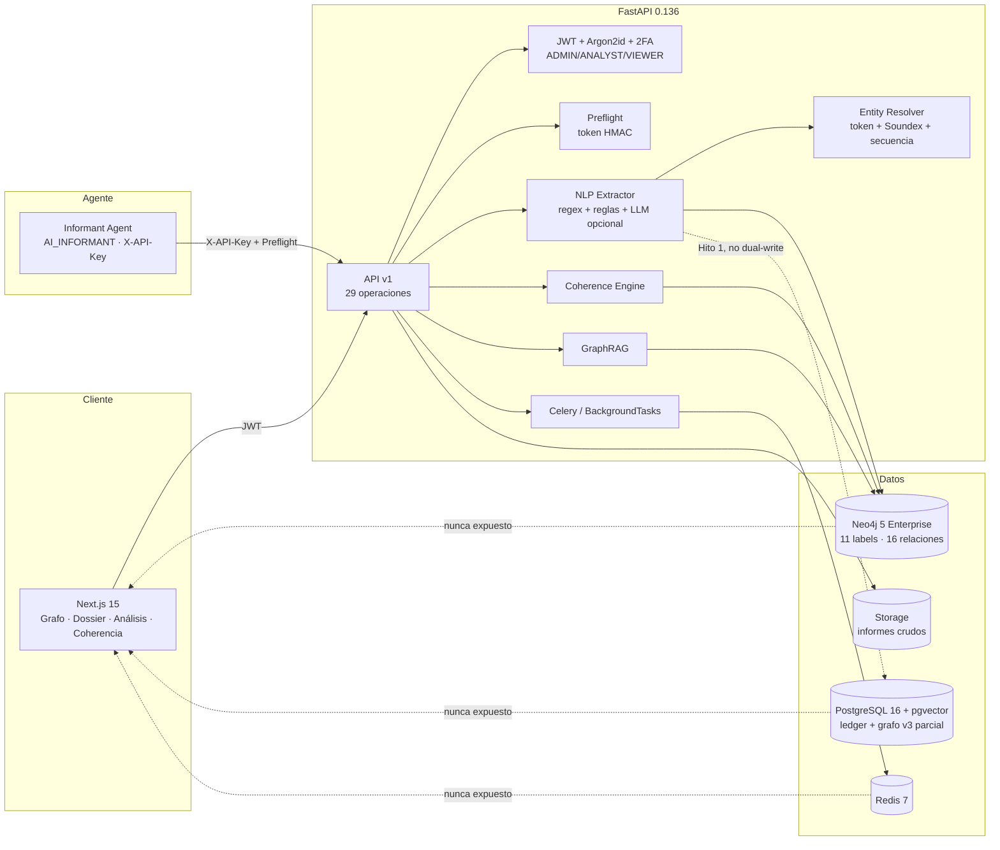

# 00 — Auditoría de Ingeniería Multi-INT y Harness Hermes

> **Fase 1 SDD · Diagnóstico, no autoriza cambios de código.**
> Proyecto: OSINT Nexus Platform · Repositorio: `murdok1982/DataBaseInt-Osint-socmint-Sigint`
> Baseline de código: `main` post-Hito 1 (árbol de trabajo 2026-10-26)
> Documento: `specs/00-AUDIT.md` · Versión: **1.0.0 (DRAFT para revisión)**
> Autor: Arquitecto SDD (Agente 0) · Aprobador: usuario
> Documentos relacionados: [`SPEC.md`](../SPEC.md) · [`PLAN.md`](../PLAN.md) · [`AUDIT.md`](../AUDIT.md) · [`contracts/v3/db-contract.sql`](../contracts/v3/db-contract.sql)

---

## 0. Veredicto ejecutivo

La plataforma actual es un producto OSINT v2.2 funcional, con seguridad, RBAC, ingesta documental, resolución de entidades, coherencia y frontend. El Hito 1 añadió un contrato PostgreSQL v3 **parcial y todavía no sellado** con ledger append-only, grafo STIX, Almirantazgo, TLP, RLS y OPSEC. Esa base es valiosa y debe conservarse.

Pero **no es todavía la arquitectura solicitada**:

| Dimensión | Estado real | Objetivo | Veredicto |
|---|---|---|---|
| Modelo de selectores | `intel_entities.name` + `aliases text[]` mutables; `entity_aliases` sin ventana temporal | `core_entities` + `observables` inmutables + `observable_alias_history` | **Crítico** |
| Multi-INT | OSINT documental; SOCMINT sólo como texto; sin SIGINT | OSINT + SOCMINT + SIGINT en un mismo modelo temporal-espacial | **Crítico** |
| Evidencia cruda | `staging.raw_intel_ledger` con SHA-256 y hash chain | `raw_evidence_vault` WORM, verificación de cadena y adjuntos | **Parcial-Alto** |
| Harness Hermes | Agente M2M determinista (regex + reglas), sin tools ni estado `AGENT_STAGED` | Harness con tools JSON Schema/Pydantic, cuarentena y aprobación humana | **Crítico** |
| Geoespacial | Sin PostGIS, sin `geography`, sin `ST_DWithin` | PostGIS + índices GiST + correlación SIGINT-SOCMINT | **Crítico** |
| UI interactiva | Grafo Cytoscape + timeline por `first_seen/last_seen`; sin mapa ni bandeja de propuestas | Grafo multicapa, mapa-tiempo, inspector forense y aprobación | **Crítico** |
| Producción | Neo4j sigue siendo el backend por defecto (`GRAPH_BACKEND=neo4j`) | PostgreSQL validado y `dual`/`postgres` con rollback | **Alto** |

**Conclusión:** se puede reutilizar aproximadamente **55–65 %** del código (seguridad, RBAC, ingesta, resolución, coherencia, frontend, despliegue y tooling SDD), pero el modelo de datos, el harness y la correlación espacial requieren una **especificación nueva y aprobación explícita**. No se debe escribir código de producción hasta cerrar las decisiones de §7.

---

## 1. Alcance, método y evidencia

### 1.1 Artefactos inspeccionados

| Área | Artefactos |
|---|---|
| Backend | `apps/backend/app/**`: API, core, db, services, schemas, workers |
| Contratos | `contracts/openapi.yaml`, `contracts/extraction-schema.json`, `contracts/graph-constraints.cypher`, `contracts/v3/db-contract.sql`, `contracts/v3/agent-contracts.json` |
| Specs | `SPEC.md` v3.0.0, `PLAN.md`, `AUDIT.md`, `specs/00`–`06` históricas |
| Agente | `apps/informant-agent/**` |
| Frontend | `apps/frontend/src/**` (Next.js 15.5.28, React 19) |
| Despliegue | `deploy/docker-compose.prod.yml`, `deploy/.env.example`, `deploy/README.md` |
| Tests | `apps/backend/tests/**`, `apps/informant-agent`, `apps/frontend/src/**/*.test.*` |
| Gobernanza | `AGENTS.md`, `.antigravity/sdd-constitution.md`, `scripts/audit_sdd.py`, `scripts/validate-contracts.sh` |

### 1.2 Verificación ejecutada

| Comprobación | Resultado | Observación |
|---|---|---|
| `python scripts/audit_sdd.py` | 12/12 checks | Gobernanza y trazabilidad base |
| `python -m pytest -q` (backend) | **436 passed, 15 skipped** | Última ejecución registrada; 12 skips son tests v3 que requieren Docker |
| `python -m pytest -q` (informant-agent) | **36 passed** | Sin cambios en esta auditoría |
| `docker compose config` | No ejecutado | No hay daemon Docker en el entorno |
| PostgreSQL real | **No verificado** | El DDL v3 no se ha aplicado a un servidor PostgreSQL real en este entorno |
| Neo4j real | **No verificado** | Los tests usan dobles; no hay smoke test de contenedores |

> **Limitación probatoria:** todo lo que dependa de PostgreSQL, PostGIS, RLS, triggers o Testcontainers queda marcado como **no verificado** hasta que se ejecute en CI con Docker. Un `skip` local no cierra un requisito EARS.

### 1.3 Búsqueda de la arquitectura objetivo

Se buscó en todo el árbol, excluyendo `.git`, `node_modules`, `__pycache__` y artefactos de build:

```text
raw_evidence_vault | hermes_agent_runs | core_entities | observables |
observable_alias_history | intelligence_events | PostGIS | geography |
ST_DWithin | IMSI | MAC_BSSID | AGENT_STAGED | ANALYST_VERIFIED
```

Resultado: **cero implementaciones**. Las únicas apariciones son documentales o de prueba (`IMEI` en un fixture de chunking). No existe el modelo de observables, el evento SIGINT, el esquema geoespacial ni el harness de tools.

---

## 2. Arquitectura actual (as-is)

### 2.1 Vista de componentes



### 2.2 Flujo de ingesta actual

1. `POST /api/v1/context/preflight` → contexto de análisis, RFIs y diccionario canónico; emite `preflight_token` HMAC.
2. `POST /api/v1/ingest/informant` → exige `X-API-Key` y `X-Preflight-Token`; sin token, `409`.
3. `NLPExtractor` ejecuta `chunk → extract → validate → coherence → resolve → persist`.
4. `EntityResolver` decide `MERGE`, `NEW` o `PENDING_HUMAN_REVIEW` con umbrales 0,70/0,88.
5. `GraphRepository` escribe en Neo4j. El repositorio PostgreSQL v3 existe, pero **no está conectado al flujo de producción**.
6. `CoherenceEngine` crea vínculos `CORROBORATES`, `CONTRADICTS`, `EXTENDS`, `ANSWERS_REQUIREMENT`, `CITES_ANALYSIS`.
7. El frontend consume `/graph`, `/reports`, `/analyses`, `/coherence`, `/search/rag`.

### 2.3 Modelo v2.2 (Neo4j)

**11 labels:** `Person`, `Organization`, `CyberAsset`, `Location`, `Event`, `Report`, `Analysis`, `IntelRequirement`, `CoherenceAlert`, `User`, `ApiKey`.

**16 relaciones:** `CONTROLS`, `FINANCED`, `USES_ASSET`, `LOCATED_AT`, `ASSOCIATED_WITH`, `PARTICIPATED_IN`, `MENTIONED_IN`, `INVESTIGATES`, `HAS_REQUIREMENT`, `CITES_ANALYSIS`, `CORROBORATES`, `CONTRADICTS`, `EXTENDS`, `ANSWERS_REQUIREMENT`, `RAISED_FOR`, `ABOUT`.

**Propiedades de arista:** `confidence` float 0–1, `source_report_id`, `exact_quote`, `text_evidence_span`, `page_number`, `first_seen`, `last_seen`, `locked_by_analyst`.

### 2.4 Modelo v3.0 existente (PostgreSQL, parcial)

El contrato `contracts/v3/db-contract.sql` ya define:

- `staging.raw_intel_ledger`: bytes, SHA-256, `prev_hash`/`record_hash`, TLP, base legal, retención, adjuntos.
- `intel.intel_entities` / `intel.intel_relationships`: STIX 2.1, Almirantazgo `[A-F][1-6]`, confianza 0–100, vigencia temporal, revocación, TLP, embeddings.
- `intel.entity_aliases`, `intel.entity_resolution_candidates`, `intel.coherence_alerts`.
- `intel.missions` → `pirs` → `eeis` → `tasking_orders`.
- `humint.sockpuppets`, `legends`, `interactions`, `opsec_policies`, `opsec_events` y `humint.check_opsec`.
- `audit.agent_runs`, `audit.events` append-only con hash chain.
- Roles `svc_hermes`, `svc_aracne`, `svc_argos`, `svc_atenea`, RLS y políticas TLP.

Lo que **no** define: `observables`, `observable_alias_history`, `intelligence_events`, `core_entities` (nombre exacto), `raw_evidence_vault` (nombre exacto), `hermes_agent_runs` (nombre exacto), PostGIS, geolocalización, telemetría SIGINT, tools de Hermes ni estado `AGENT_STAGED`.

---

## 3. Evaluación crítica

### 3.1 Integridad relacional y Multi-INT

#### 3.1.1 Cómo se relacionan hoy OSINT, SOCMINT y SIGINT

- **OSINT:** es el flujo principal (informes, PDF, noticias, Telegram/RSS, registro público). Se extraen tripletas y se persisten como entidades/relaciones.
- **SOCMINT:** no tiene modelo propio. Un handle o perfil se trata como `CyberAsset` o `Person`; no hay `user-account`, `platform`, `account_id`, `observed_from/until` ni historial de alias.
- **SIGINT:** **no existe**. No hay conectores RF, IMSI, IMEI, MAC/BSSID, GPS, metadatos de llamada/SMS, ni eventos de emisión. `IMEI` sólo aparece en un fixture de prueba.

**Consecuencia:** no se puede cruzar una emisión SIGINT con un perfil SOCMINT porque no hay una entidad temporal-espacial común. La correlación es imposible con el esquema actual.

#### 3.1.2 Alias mutables vs selectores inmutables

El esquema v3 almacena:

```sql
-- contracts/v3/db-contract.sql, intel.intel_entities
name      text NOT NULL,
aliases   text[] NOT NULL DEFAULT '{}'::text[],
```

y:

```sql
-- contracts/v3/db-contract.sql, intel.entity_aliases
alias             text NOT NULL,
alias_type        text CHECK (alias_type IN ('name','handle','email','phone','domain','wallet','other')),
normalized_value  text NOT NULL,
source_evidence_id uuid,
UNIQUE (entity_id, alias_type, normalized_value)
```

Problemas:

1. `name` y `aliases` son mutables; una actualización de `upsert_entity` puede cambiar el nombre canónico y el array de alias sin dejar historia.
2. `entity_aliases` no tiene `observed_from`, `observed_until`, `valid_from`, `valid_until` ni `revoked`; no se puede responder “qué alias tenía esta entidad el 12 de marzo”.
3. No se distingue un **selector inmutable** (p. ej. `account_id`, `IMSI`, `MAC`) de un **alias mutable** (p. ej. `display_name`, `@handle`). Todo se trata como texto.
4. `ALIAS_OF` existe en `intel.relationship_types`, pero no se escribe de forma sistemática en la resolución; el `EntityResolver` actual fusiona o crea alias en el array, no crea una relación `ALIAS_OF` con evidencia.
5. La unicidad `(entity_id, alias_type, normalized_value)` impide el mismo alias en dos entidades, pero no impide que una entidad acumule alias contradictorios sin ventana temporal.

**Veredicto:** el modelo actual usa alias mutables y no tiene selectores inmutables. Es la brecha más importante para la integridad multi-INT.

#### 3.1.3 Evidencia por aserción

`intel.evidence_links` permite enlazar una entidad o una relación con `evidence_id`, y `upsert_entity`/`upsert_relationship` rechazan arrays vacíos o IDs inexistentes. Es una base sólida. Faltan:

- enlaces para `intelligence_events`, `observables` y `observable_alias_history`;
- una vista que devuelva `supporting_evidence_ids[]` por aserción;
- integridad de adjuntos a nivel de trigger;
- prueba de que una relación no puede quedar huérfana tras una revocación.

### 3.2 Rigor forense

#### 3.2.1 Lo que sí existe

`staging.raw_intel_ledger` es el activo más maduro del Hito 1:

- `raw_payload` + `raw_payload_bytes` + `payload_sha256`;
- `captured_at_utc` distinto de `ingested_at`;
- `tlp_classification`, `legal_basis`, `collection_method`, `retention_until`, `legal_hold`;
- `prev_hash`/`record_hash` con `pg_advisory_xact_lock` para serializar la cadena;
- triggers `trg_ledger_no_update_delete`, `trg_ledger_no_truncate`, `trg_ledger_chain`;
- `staging.verify_evidence`;
- `audit.events` append-only con hash chain;
- roles de colector derivados de `session_user`, no de un campo enviado por el cliente.

#### 3.2.2 Brechas forenses

| ID | Brecha | Evidencia | Impacto |
|---|---|---|---|
| **AUD-01** | No existe el nombre/tabla `raw_evidence_vault`; el contrato usa `raw_intel_ledger` | `db-contract.sql` L295 | Desalineación con el modelo solicitado y con la documentación |
| **AUD-02** | `verify_evidence` sólo verifica el hash del payload, no la cadena `prev_hash`/`record_hash` completa | L1119–1129 | No demuestra no-repudio de toda la secuencia |
| **AUD-03** | Colisión de idempotencia: misma clave + bytes distintos devuelve la evidencia anterior sin comparar `payload_sha256` | L993–999 | Un payload malicioso puede “colarse” como duplicado y perderse la detección |
| **AUD-04** | Los adjuntos tienen `sha256` pero no hay trigger que verifique el contenido contra el hash | L328–340, L1091–1103 | Un adjunto puede ser sustituido en el object store |
| **AUD-05** | No hay WORM/almacenamiento inmutable para adjuntos; sólo `storage_uri` | L335 | La evidencia no es defendible si el storage se altera |
| **AUD-06** | No hay tabla de eventos ni evidencia geoespacial; `evidence_links` sólo entidad/relación | L422–434 | Una emisión SIGINT no tiene aserción validada |
| **AUD-07** | El contrato v3 no está sellado ni ejecutado contra PostgreSQL real | `contracts/SEAL.md`; tests v3 skip | No hay garantía de DDL/RLS/triggers |
| **AUD-08** | `raw_payload` se declara canónico RFC 8785, pero la función no valida la canonicalización de los bytes | L317–318, L1044–1051 | Hash reproducible sólo si el cliente cumple el contrato; no se verifica |

### 3.3 Seguridad del Harness Hermes

#### 3.3.1 Qué existe

`apps/informant-agent` es un cliente M2M correcto para su alcance:

- `preflight` obligatorio antes de ingerir;
- validación contra `contracts/extraction-schema.json` con `additionalProperties: false`;
- `X-API-Key` y `X-Preflight-Token`;
- extracción determinista por patrones/reglas;
- transporte HTTP con timeout y errores tipados.

No es un harness de agente con tools. No hay:

- bucle de tool-calling;
- catálogo de tools con JSON Schema/Pydantic;
- `run_id`, `prompt_sha256` ni `tool_catalog_sha256`;
- cuarentena `AGENT_STAGED`;
- aprobación humana de propuestas;
- aislamiento de prompt injection;
- límites por herramienta ni presupuesto de tokens;
- firma/HMAC por tool call.

#### 3.3.2 Riesgos concretos

| ID | Riesgo | Evidencia | Severidad |
|---|---|---|---|
| **AUD-09** | El LLM podría escribir directamente si se le da acceso a SQL/HTTP sin gateway | No hay gateway de tools; `llm_client.py` sólo genera texto | Crítico |
| **AUD-10** | Inyección de prompt en `raw_payload`/documento | El payload se procesa como texto; no hay separación dato/instrucción | Alto |
| **AUD-11** | Duplicación por falta de selector inmutable | `entity_resolver.py` usa nombre/Soundex/secuencia | Alto |
| **AUD-12** | Alucinación sin cuarentena | No existe `AGENT_STAGED`; `entity_resolution_candidates` sólo cubre merges | Crítico |
| **AUD-13** | SQL/Cypher dinámico | Cypher interpola `max_hops`/`depth` tras validación entera; SQL usa parámetros | Bajo, pero debe probarse |
| **AUD-14** | OPSEC no conectado al runtime | `humint.check_opsec` existe en SQL, pero el agente no lo invoca antes de cada interacción | Alto |
| **AUD-15** | Sin rate-limit por agente/tool | Sólo login tiene `429`; no hay límite de evidencia/minuto por `svc_*` | Alto |

**Veredicto:** Hermes no existe como harness; el agente actual es un extractor M2M. La buena noticia es que la seguridad de identidad y el esquema OPSEC ya tienen cimientos reutilizables.

### 3.4 Rendimiento e interactividad

#### 3.4.1 Índices existentes

| Índice | Tabla | Uso |
|---|---|---|
| `idx_entities_name_trgm` (GIN `gin_trgm_ops`) | `intel_entities.name` | búsqueda difusa |
| `idx_entities_aliases` (GIN) | `aliases` | alias |
| `idx_entities_tsv` (GIN) | `search_tsv` | full-text |
| `idx_entities_embedding` (HNSW) | `embedding vector(1024)` | similitud |
| `idx_rel_period` (GiST) | relaciones | solapamiento temporal |
| `idx_ledger_pir_time`, `idx_ledger_hash`, `idx_ledger_agent` | ledger | custodia |
| `idx_audit_time` (BRIN) | auditoría | series temporales |

#### 3.4.2 Índices y endpoints que faltan

| ID | Falta | Impacto |
|---|---|---|
| **AUD-16** | PostGIS (`geometry`/`geography`), índice GiST espacial | No hay consultas de radio ni colocalización |
| **AUD-17** | `intelligence_events` con `event_time` + BRIN + compuesto `(mission_id, event_time)` | No hay timeline de eventos ni ventanas temporales eficientes |
| **AUD-18** | Índices compuestos `(discipline, confidence, tlp)` y `(event_type, event_time)` | Filtros multi-INT costosos |
| **AUD-19** | Endpoint de subgrafo multicapa con `depth` 1–5, filtros TLP/Admiralty/disciplina y paginación | La UI actual sólo tiene vecindad 1–3 y filtros limitados |
| **AUD-20** | Endpoint de colocalización SIGINT-SOCMINT y de evasión de alias | No se puede correlacionar |
| **AUD-21** | `as_of` / inteligencia temporal en API | La UI no puede reconstruir el estado pasado |
| **AUD-22** | Límites de coste/tiempo y `EXPLAIN` en CI | Riesgo de consultas recursivas costosas |

#### 3.4.3 UI actual

Componentes existentes:

- `GraphCanvas.tsx`: Cytoscape, nodos/aristas, selección.
- `GraphFilters.tsx`: label, confianza, fechas, búsqueda.
- `Timeline.tsx`: ventana `from`/`to` sobre `first_seen`/`last_seen`.
- `DossierPanel.tsx`, `ReportViewer.tsx`: ficha y cita.
- `AnalysisWorkspace.tsx`: análisis y RFI.
- `CoherenceInbox.tsx`: alertas de coherencia.
- `SearchConsole.tsx`, `IngestDropzone.tsx`: GraphRAG e ingesta.

Brechas de UI:

- no hay mapa ni timeline espacial;
- no hay filtros por disciplina, TLP ni Almirantazgo;
- no hay visualización de `AGENT_STAGED` ni bandeja de aprobación de propuestas;
- no hay inspector de evidencia cruda con hash/cadena de custodia;
- no hay distinción visual entre OSINT/SOCMINT/SIGINT;
- no hay `as_of` ni reproducción histórica;
- no hay vista de misión/PIR/cobertura.

---

## 4. Inventario y reutilización

| Activo | Archivo(s) | Reutilización | Trabajo |
|---|---|---|---|
| Seguridad, JWT, Argon2id, 2FA, API keys | `app/core/**` | 80 % | ampliar roles `svc_*` y permisos por tool |
| Entity Resolution | `app/services/entity_resolver.py` | 60 % | añadir selectores, trigramas, embeddings, `ALIAS_OF`, estado staged |
| Coherencia/fusión | `app/services/coherence_engine.py` | 70 % | convertir en gatekeeper de Atenea y propuestas |
| Ingesta NLP | `app/services/nlp_extractor.py`, `chunking.py` | 65 % | adaptar a eventos/observables y tools |
| GraphRAG | `app/services/graphrag_engine.py` | 75 % | adaptar a PostgreSQL híbrido y filtros TLP |
| Repositorio Neo4j | `app/db/repository.py` | 40 % | conservar como proyección/lectura; no fuente de verdad |
| PostgreSQL v3 | `app/db/postgres_repository.py`, `contracts/v3/db-contract.sql` | 55 % | completar observables/eventos/PostGIS y sellar |
| Frontend | `apps/frontend/src/**` | 65 % | mapa, filtros multicapa, aprobación, evidencia |
| Despliegue | `deploy/**` | 70 % | PostGIS + pgvector, migraciones, backups |
| Tests | `apps/backend/tests/**`, `apps/informant-agent` | 65 % | tests EARS, PostGIS, RLS, tools |
| SDD | `scripts/audit_sdd.py`, `contracts/SEAL.md` | 100 % | extender a v3.1 |

---

## 5. Registro de brechas priorizado

| ID | Brecha | Severidad | Spec/tarea |
|---|---|---|---|
| AUD-01 | `raw_evidence_vault` no existe con el nombre/contrato solicitado | Alta | SPEC-01 / TASK-06 |
| AUD-02 | Verificación de cadena incompleta | Alta | SPEC-01 / TASK-10 |
| AUD-03 | Colisión de idempotencia silenciosa | Crítica | SPEC-02 / TASK-18 |
| AUD-04 | Adjuntos sin verificación de hash en DB | Alta | SPEC-01 / TASK-11 |
| AUD-05 | Sin WORM/object store inmutable | Alta | SPEC-01 / TASK-11 |
| AUD-06 | Sin eventos ni evidencia geoespacial | Crítica | SPEC-01 / TASK-07 |
| AUD-07 | Contrato v3 no sellado/verificado | Crítica | TASKS Fase 0/6 |
| AUD-08 | Canonicalización no verificada | Media | SPEC-01 / TASK-09 |
| AUD-09 | Sin gateway de tools | Crítica | SPEC-02 / TASK-16 |
| AUD-10 | Prompt injection sin aislamiento | Alta | SPEC-02 / TASK-25 |
| AUD-11 | Sin selector inmutable | Crítica | SPEC-01/02 / TASK-08, TASK-19 |
| AUD-12 | Sin `AGENT_STAGED` ni aprobación | Crítica | SPEC-02/04 / TASK-20 |
| AUD-13 | Dinamismo Cypher/SQL | Baja | TASK-14 |
| AUD-14 | OPSEC no conectado | Alta | SPEC-02 / TASK-22 |
| AUD-15 | Sin rate-limit por agente/tool | Alta | SPEC-02 / TASK-23 |
| AUD-16 | Sin PostGIS/GiST | Crítica | SPEC-01/03 / TASK-13, TASK-27 |
| AUD-17 | Sin timeline de eventos | Alta | SPEC-01/03 / TASK-07, TASK-28 |
| AUD-18 | Índices multi-INT ausentes | Alta | SPEC-01/03 / TASK-13 |
| AUD-19 | Subgrafo multicapa ausente | Alta | SPEC-03 / TASK-29 |
| AUD-20 | Colocalización/evasón ausentes | Crítica | SPEC-03 / TASK-27, TASK-31 |
| AUD-21 | Sin `as_of` | Alta | SPEC-03/04 / TASK-30, TASK-38 |
| AUD-22 | Sin límites de coste | Media | SPEC-03 / TASK-32 |
| AUD-23 | UI sin mapa/aprobación/evidencia | Crítica | SPEC-04 / TASK-36–40 |
| AUD-24 | Producción sigue en Neo4j | Alto | TASKS Fase 5 |

---

## 6. Riesgos de la especificación propuesta

| ID | Riesgo | Prob. | Impacto | Mitigación |
|---|---|---|---|---|
| R-01 | Renombrar tablas v3 rompe el contrato/app | Media | Alto | vistas de compatibilidad + migración por fases + dual-write |
| R-02 | PostGIS no está en la imagen `pgvector/pgvector:pg16` | Alta | Alto | imagen `postgis/postgis:16-3.4` + instalar pgvector, o imagen combinada probada |
| R-03 | `AGENT_STAGED` mal definido permite escribir grafo sin aprobación | Media | Crítico | constraint de estado + trigger + permisos `svc_atenea` |
| R-04 | Selectores sensibles (IMSI/MAC) expuestos en logs/UI | Media | Crítico | cifrado en reposo, máscara por TLP, auditoría, no logs |
| R-05 | Resolución por embeddings genera falsos positivos | Alta | Alto | umbral alto + revisión humana + nunca auto-fusionar nombres |
| R-06 | Consultas recursivas costosas | Media | Medio | límites, `statement_timeout`, índices, materialized views |
| R-07 | Evidencia WORM incompatible con GDPR/retensión | Media | Alto | legal hold, retención, purga auditada, cifrado |
| R-08 | Deriva entre `contracts/v3` y los nuevos specs | Alta | Alto | sello v3.1, CI, `audit_sdd.py` |

---

## 7. Decisiones que requieren aprobación (STOP)

Antes de implementar, el usuario debe resolver:

| ID | Decisión | Opciones | Recomendación |
|---|---|---|---|
| **DEC-A** | Nombres físicos | (a) renombrar a `raw_evidence_vault`, `core_entities`, etc.; (b) mantener v3 y crear vistas con esos nombres | (a) con vistas de compatibilidad, migración por fases |
| **DEC-B** | Imagen PostgreSQL | (a) `postgis/postgis:16-3.4` + pgvector; (b) imagen combinada propia | (a) probada en CI |
| **DEC-C** | Estado de cuarentena | (a) `staging.agent_proposals` con `AGENT_STAGED`; (b) reutilizar `entity_resolution_candidates` | (a) generaliza todos los tipos |
| **DEC-D** | Semántica de alias | (a) alias histórico append-only con ventana; (b) alias mutable auditado | (a) |
| **DEC-E** | Selectores sensibles | (a) cifrado + máscara; (b) sólo hash | (a) |
| **DEC-F** | API nueva | (a) `/api/v1/correlation`; (b) `/api/v3` | (a) consistente con frontend; documentar versión |
| **DEC-G** | Mapa | (a) MapLibre GL; (b) Leaflet + deck.gl | (a) |
| **DEC-H** | Retención/WORM | (a) object store con lock; (b) sólo DB | (a) |

---

## 8. Condición de parada

Este documento es **sólo diagnóstico**. No se ha modificado código de producción, ni `contracts/v3/db-contract.sql`, ni `apps/**`, ni `deploy/**`.

La Fase 4 (implementación) no comienza hasta que:

1. El usuario apruebe `SPEC-01`…`SPEC-04` y `TASKS.md`.
2. Se resuelvan `DEC-A`…`DEC-H`.
3. Se actualice `contracts/SEAL.md` con los nuevos hashes.
4. El contrato PostgreSQL se ejecute en CI con Docker/Testcontainers.

**Siguiente paso:** revisar el resumen ejecutivo y `TASKS.md`; responder “APROBADO” o indicar cambios. No se escribirá código hasta entonces.
